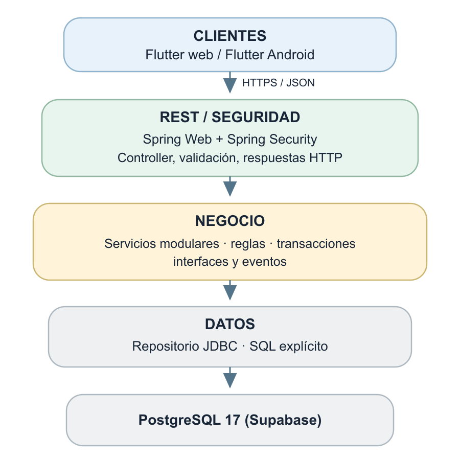
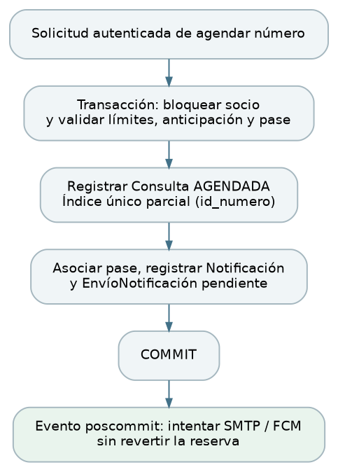
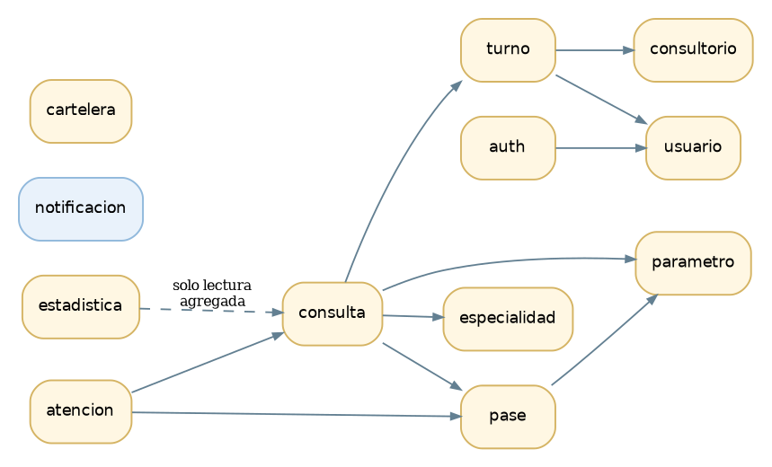
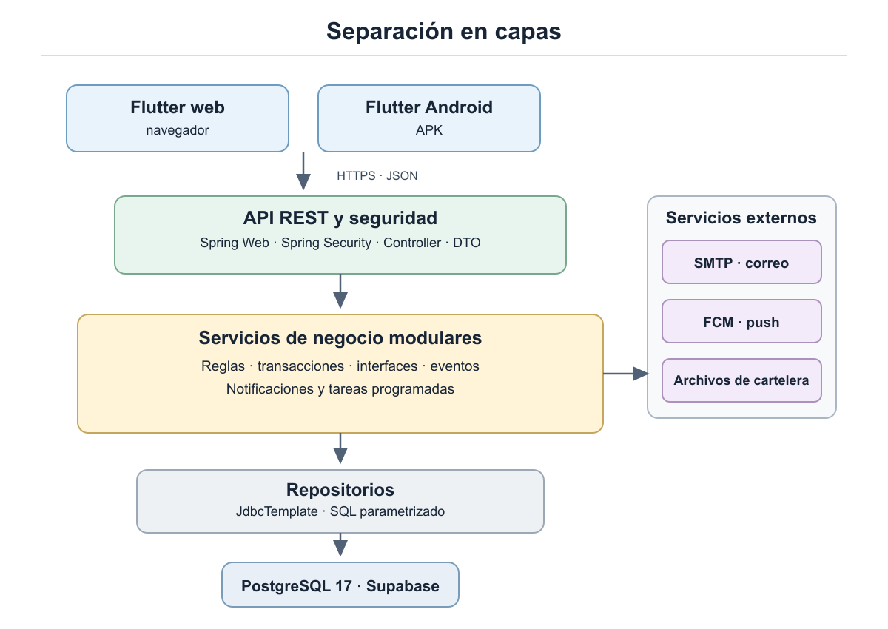
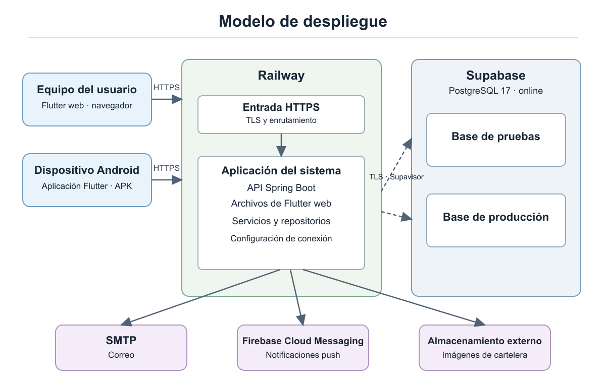

**<u>Documento de Arquitectura</u>**

Índice

[1. Introducción 2](#introducción)

> [1.1. Propósito 2](#propósito)
>
> [1.2. Alcance 2](#alcance)

[2. Representación y estilo arquitectónico 3](#representación-y-estilo-arquitectónico)

> [2.1. Cuatro vistas complementarias 3](#cuatro-vistas-complementarias)
>
> [2.2. Estilo seleccionado 4](#estilo-seleccionado)

[3. Objetivos y restricciones 5](#objetivos-y-restricciones)

[4. Atributos de calidad: trazabilidad de los 29 RNF 6](#atributos-de-calidad-trazabilidad-de-los-29-rnf)

[5. Vista de casos de uso 8](#vista-de-casos-de-uso)

> [5.1. Roles y reglas compartidas 8](#roles-y-reglas-compartidas)
>
> [5.2. Matriz de casos críticos vigentes 8](#matriz-de-casos-críticos-vigentes)
>
> [5.3. Cancelaciones priorizadas en el diseño 10](#cancelaciones-priorizadas-en-el-diseño)
>
> [5.4. Aspectos arquitectónicos de los casos críticos 10](#aspectos-arquitectónicos-de-los-casos-críticos)

[6. Recorridos críticos por paquetes 12](#recorridos-críticos-por-paquetes)

> [6.1. Identidad y activación 12](#identidad-y-activación)
>
> [6.2. Disponibilidad, agenda y pases 12](#disponibilidad-agenda-y-pases)
>
> [6.3. Cancelación, suspensión y rehabilitación 13](#cancelación-suspensión-y-rehabilitación)
>
> [6.4. Atención, historia clínica y resultados 13](#atención-historia-clínica-y-resultados)
>
> [6.5. Pases emitidos durante el registro 13](#pases-emitidos-durante-el-registro)
>
> [6.6. Administración, estadísticas y operaciones no críticas 14](#administración-estadísticas-y-operaciones-no-críticas)

[7. Vista lógica del sistema 15](#vista-lógica-del-sistema)

> [7.1. Capas, dependencias y reglas 15](#capas-dependencias-y-reglas)
>
> [7.1.1. Responsabilidades de los módulos 17](#responsabilidades-de-los-módulos)
>
> [7.1.2. Cliente Flutter web y Android 18](#cliente-flutter-web-y-android)
>
> [7.2. Interfaz ConsultasDelTurno y ausencia de ciclos 18](#interfaz-consultasdelturno-y-ausencia-de-ciclos)
>
> [7.3. Repositorios y persistencia 18](#repositorios-y-persistencia)
>
> [7.4. API REST y errores 19](#api-rest-y-errores)

[8. Vista de procesos 20](#vista-de-procesos)

> [8.1. Concurrencia 20](#concurrencia)
>
> [8.2. Eventos y notificaciones 21](#eventos-y-notificaciones)
>
> [8.3. Sesiones e inactivación inmediata 21](#sesiones-e-inactivación-inmediata)
>
> [8.4. Recordatorios y estados derivados 22](#recordatorios-y-estados-derivados)
>
> [8.5. Listados de pacientes presentes 22](#listados-de-pacientes-presentes)

[9. Vista física y operativa 23](#vista-física-y-operativa)

> [9.1. Entornos 23](#entornos)
>
> [9.2. Cambios en la base de datos y respaldos 24](#cambios-en-la-base-de-datos-y-respaldos)
>
> [9.3. Secretos y servicios externos 24](#secretos-y-servicios-externos)
>
> [9.4. Plataforma y control de cambios 24](#plataforma-y-control-de-cambios)
>
> [9.5. Almacenamiento de imágenes de cartelera 25](#almacenamiento-de-imágenes-de-cartelera)

[10. Decisiones arquitectónicas 26](#decisiones-arquitectónicas)

[11. Riesgos y medidas de control 27](#riesgos-y-medidas-de-control)

> [11.1. Evolución futura 28](#evolución-futura)
>
> [11.2. Escenarios de verificación de la arquitectura 28](#escenarios-de-verificación-de-la-arquitectura)

# 1. Introducción

## 1.1. Propósito

Establecer la estructura del sistema, sus capas y módulos, los contratos entre componentes, el comportamiento de ejecución y el despliegue. Sirve de referencia para el Documento de Diseño y para la implementación del cliente Flutter y del servidor Java.

## 1.2. Alcance

El sistema cubre la gestión de personas y cuentas; turnos semanales, fechas y números; agendas y cancelaciones; avisos de llegada; registro de atenciones, historia clínica y pases; catálogos, cartelera, notificaciones y estadísticas. Cuenta con cuatro roles: Socio, Funcionario, Médico y Administrador.

La arquitectura se apoya en 45 RF, de los cuales 22 son críticos, y 29 RNF. RF-10, RF-19 y RF-27 conservan su clasificación no crítica y se priorizan en el diseño por su relación con la agenda, la devolución de pases y las notificaciones.

# 2. Representación y estilo arquitectónico

## 2.1. Cuatro vistas complementarias

| **Vista**    | **Cuestión**                   | **Alcance**                                                                    |
|--------------|--------------------------------|--------------------------------------------------------------------------------|
| Casos de uso | ¿Qué escenarios debe soportar? | Matriz de casos críticos, variantes de cancelación y módulos responsables.     |
| Lógica       | ¿Cómo se organiza?             | Capas y monolito modular; contratos, repositorios e inversión de dependencias. |
| Procesos     | ¿Qué sucede en ejecución?      | Transacciones, concurrencia, sesiones, notificaciones y tareas.                |
| Física       | ¿Dónde se ejecuta?             | Cliente Flutter, Spring Boot, PostgreSQL, SMTP, FCM y canales de comunicación. |

## 2.2. Estilo seleccionado

Cliente-servidor de tres niveles y monolito modular. Un único backend Java 25/Spring Boot 4.1 expone una API REST por HTTPS para web y Android. Las reglas de negocio y el acceso a PostgreSQL residen exclusivamente en el servidor. Cada módulo funcional agrupa controlador, servicios de negocio, repositorio y DTO; las dependencias entre módulos deben ser acíclicas.

Figura A1. Organización lógica en capas.

# 3. Objetivos y restricciones

- Integridad y concurrencia: un número no puede asignarse simultáneamente a dos consultas no canceladas; deben respetarse también los límites por socio.

- Privacidad: los datos clínicos solo los devuelve el módulo de atención con autorización de servidor; nunca se incluyen en registros técnicos.

- Trazabilidad: cancelaciones, avisos de llegada, estados y acciones administrativas conservan los datos exigidos; no se borran consultas históricas.

- Portabilidad: Java 25, Spring Boot, PostgreSQL 17, Docker y configuración externa al artefacto.

- Tiempo de proyecto: arquitectura simple de operar, con SQL explícito y despliegue monolítico.

# 4. Atributos de calidad: trazabilidad de los 29 RNF

| **RNF** | **Asunto**            | **Táctica de arquitectura**                                                                                                                    |
|---------|-----------------------|------------------------------------------------------------------------------------------------------------------------------------------------|
| RNF-01  | Plataformas           | Flutter web y Android; un solo contrato de API REST.                                                                                           |
| RNF-02  | Accesos diferenciados | Validar acceso socio/empleado en servidor y roles autorizados.                                                                                 |
| RNF-03  | Navegadores           | Flutter web compatible con los navegadores requeridos; cliente web y API servidos desde el mismo origen.                                       |
| RNF-04  | Android               | APK compatible con Android 8.0+ (API 26).                                                                                                      |
| RNF-05  | Control de acceso     | Spring Security + permisos por rol y propietario; comprobar Cuenta.habilitada y primer_ingreso_completado en cada operación protegida.         |
| RNF-06  | Contraseñas           | BCrypt adaptativo con sal y factor de costo 12.                                                                                                |
| RNF-07  | Cifrado               | TLS en el borde y TLS desde JDBC a PostgreSQL.                                                                                                 |
| RNF-08  | Sesiones              | JWT corto + refresh rotativo; verificar Sesion no revocada para invalidar también access tokens al cerrar sesión.                              |
| RNF-09  | Secretos              | Variables de entorno y gestores de secretos; nunca en repositorio.                                                                             |
| RNF-10  | Errores seguros       | Respuesta genérica en autenticación; manejo centralizado de excepciones.                                                                       |
| RNF-11  | Datos de salud        | Autorización de historia clínica únicamente desde servicio de atención, sin datos clínicos en estadísticas.                                    |
| RNF-12  | Registros técnicos    | No registrar secretos, tokens en claro ni contenidos clínicos; usar identificador de correlación.                                              |
| RNF-13  | Número único          | Índice único parcial de Consulta.id_numero para todos los estados no cancelados.                                                               |
| RNF-14  | Historial             | Consultas y atenciones conservadas; transición de estado sin borrado.                                                                          |
| RNF-15  | Auditoría             | Responsable y momento en llegada, resultado NO_SE_PRESENTO, suspensiones, rehabilitaciones, cancelaciones e inactivaciones/reactivaciones.     |
| RNF-16  | Zona horaria          | America/Montevideo; Clock inyectable, date/time local y timestamptz para instantes.                                                            |
| RNF-17  | Rendimiento           | Índices, SQL filtrado, paginación y pool; verificar \<3 s en consultas y agenda.                                                               |
| RNF-18  | Disponibilidad        | Activación y prueba antes de demostraciones; sin promesa de continuidad.                                                                       |
| RNF-19  | Respaldo              | pg_dump periódico y restauración ensayada.                                                                                                     |
| RNF-20  | Reconstrucción        | Bases de pruebas y producción en Supabase; los cambios se verifican en pruebas antes de aplicarse en producción; respaldos según RNF-19.       |
| RNF-21  | Idioma                | API usa ISO 8601 y mensajes en español; cliente formatea.                                                                                      |
| RNF-22  | Adaptabilidad         | Responsabilidad de Flutter; API desacoplada de presentación.                                                                                   |
| RNF-23  | Mensajes              | Errores estándar: code, message; códigos 400/401/403/404/409/500.                                                                              |
| RNF-24  | Canales               | Notificación interna persistida, SMTP y push FCM cuando aplica.                                                                                |
| RNF-25  | Fallas de envío       | Registrar pendientes en transacción; entregar después del commit; no revertir por fallas SMTP/FCM.                                             |
| RNF-26  | Recordatorio          | Programar con antelación configurable de 24 h; excluir agendas realizadas con menor anticipación; unicidad por consulta.                       |
| RNF-27  | Parámetros            | Configuración externa mediante variables de entorno; cambios sin modificar código ni reconstruir el artefacto, sin pantalla de administración. |
| RNF-28  | Entornos              | Mismo artefacto con configuración distinta por entorno.                                                                                        |
| RNF-29  | Java                  | Servidor implementado en Java 25 + Spring Boot 4.1.                                                                                            |

# 5. Vista de casos de uso

## 5.1. Roles y reglas compartidas

Socio: web/Android. Funcionario, Médico y Administrador: web. Todo usuario autenticado debe tener una Cuenta habilitada y primer ingreso completado. Un empleado también puede tener una cuenta de socio separada; las reglas de conflicto de interés comparan Persona.ci, no id_cuenta.

## 5.2. Matriz de casos críticos vigentes

| **CU** | **RF** | **Operación**                 | **Módulo de entrada** | **Colaboraciones**                   |
|--------|--------|-------------------------------|-----------------------|--------------------------------------|
| 3.1.1  | RF-01  | Login                         | auth                  | usuario, security                    |
| 3.1.2  | RF-02  | Primer ingreso                | auth                  | usuario, notificacion (SMTP)         |
| 3.2.1  | RF-08  | Consultar disponibilidad      | consulta              | turno, especialidad, parametro       |
| 3.2.2  | RF-09  | Agendar consulta              | consulta              | turno, pase, parametro, notificacion |
| 3.2.3  | RF-11  | Historial de agendas          | consulta              | llegada / estados derivados          |
| 3.2.4  | RF-12  | Historia clínica propia       | atencion              | pase                                 |
| 3.3.1  | RF-13  | Alta turno semanal            | turno                 | usuario, consultorio, especialidad   |
| 3.3.2  | RF-14  | Suspender fechas              | turno                 | consulta, pase, notificacion         |
| 3.3.3  | RF-15  | Rehabilitar fechas            | turno                 | consultorio, conflicto de turnos     |
| 3.3.4  | RF-16  | Aviso de llegada              | consulta              | usuario                              |
| 3.3.5  | RF-17  | Consultar turnos              | turno                 | estado fecha                         |
| 3.3.6  | RF-18  | Consultar agendas             | consulta              | llegada                              |
| 3.4.1  | RF-21  | Turnos y pacientes            | consulta              | turno, llegada                       |
| 3.4.2  | RF-23  | Registrar resultado           | atencion              | consulta, pase, notificacion         |
| 3.4.3  | RF-24  | Emitir pases durante atención | pase                  | atencion, parametro                  |
| 3.5.1  | RF-29  | Alta especialidad             | especialidad          | —                                    |
| 3.5.2  | RF-31  | Alta usuario                  | usuario               | especialidad                         |
| 3.5.3  | RF-33  | Alta consultorio              | consultorio           | —                                    |
| 3.5.4  | RF-35  | Consultar usuarios            | usuario               | —                                    |
| 3.5.5  | RF-39  | Estadísticas especialidad     | estadistica           | lecturas agregadas                   |
| 3.5.6  | RF-40  | Estadísticas turnos           | estadistica           | lecturas agregadas                   |
| 3.5.7  | RF-41  | Estadísticas consultas        | estadistica           | lecturas agregadas                   |

##  

## 5.3. Cancelaciones priorizadas en el diseño

RF-10 (socio), RF-19 (funcionario) y RF-27 (médico) se desarrollan como flujos prioritarios de diseño. Conservan su clasificación no crítica y no amplían los 22 casos críticos de la matriz. Sus referencias son los identificadores RF, sin numeración adicional de casos críticos.

| **Flujo**           | **Restricción distintiva**                                                                   | **Resultado**                                                                    |
|---------------------|----------------------------------------------------------------------------------------------|----------------------------------------------------------------------------------|
| RF-10 • Socio       | Hasta 2 h antes; sin aviso de llegada del propio socio en ese día.                           | CANCELADA_SOCIO; devuelve pase vigente, conserva historia.                       |
| RF-19 • Funcionario | Hasta 2 h antes; a pedido del socio; registrar cuenta del funcionario; conflicto de interés. | CANCELADA_SOCIO; notifica y conserva responsable.                                |
| RF-27 • Médico      | Hasta 2 h antes por cada número; motivo; puede cancelar uno o toda una fecha.                | CANCELADA_INSTITUCION; si cancela toda la fecha, Turno SUSPENDIDO y TurnoEvento. |

## 5.4. Aspectos arquitectónicos de los casos críticos

| **CU**   | **RF** | **Aspecto arquitectónico**                                                                  |
|----------|--------|---------------------------------------------------------------------------------------------|
| CU 3.1.1 | RF-01  | autenticación, accesos diferenciados, roles y emisión de credenciales.                      |
| CU 3.1.2 | RF-02  | enlaces de un solo uso, activación y respuestas que no revelan la existencia de una cuenta. |
| CU 3.2.1 | RF-08  | lectura de disponibilidad, anticipación y tiempos de respuesta.                             |
| CU 3.2.2 | RF-09  | concurrencia, límites por socio, uso de pase y atomicidad de la reserva.                    |
| CU 3.2.3 | RF-11  | conservación del historial, filtros y estados derivados.                                    |
| CU 3.2.4 | RF-12  | acceso del socio únicamente a su historia clínica.                                          |
| CU 3.3.1 | RF-13  | generación de fechas y números, y prevención de solapamientos de médico y consultorio.      |
| CU 3.3.2 | RF-14  | suspensión, cancelaciones, devolución de pases y notificaciones en una operación atómica.   |
| CU 3.3.3 | RF-15  | rehabilitación con nueva validación de disponibilidad, sin restaurar reservas.              |
| CU 3.3.4 | RF-16  | unicidad del aviso diario, responsable y actualización de listados.                         |
| CU 3.3.5 | RF-17  | lectura de configuraciones y fechas concretas con sus estados.                              |
| CU 3.3.6 | RF-18  | filtros, acceso del funcionario y actualización de pacientes presentes.                     |
| CU 3.4.1 | RF-21  | acceso exclusivo del médico a sus turnos y pacientes.                                       |
| CU 3.4.2 | RF-23  | autorización clínica y registro atómico de atención o NO_SE_PRESENTO.                       |
| CU 3.4.3 | RF-24  | emisión de pases junto con la atención, con control de duplicados y vigencia.               |
| CU 3.5.1 | RF-29  | unicidad de especialidades y reglas de exigencia de pase.                                   |
| CU 3.5.2 | RF-31  | creación coherente de Persona y Cuenta, rol y especialidades del médico.                    |
| CU 3.5.3 | RF-33  | unicidad e identificación de consultorios.                                                  |
| CU 3.5.4 | RF-35  | consulta por cuenta, filtros y conservación de cuentas históricas.                          |
| CU 3.5.5 | RF-39  | agregación de demanda por fecha de agenda, incluidas las canceladas.                        |
| CU 3.5.6 | RF-40  | utilización de números y reconstrucción de fechas activas mediante TurnoEvento.             |
| CU 3.5.7 | RF-41  | resultados guardados y derivados, tasas y denominadores sin datos.                          |

# 6. Recorridos críticos por paquetes

## 6.1. Identidad y activación

AuthController → AuthService → UsuarioService/UsuarioRepository y SesionRepository. Validación BCrypt, tipo de acceso, rol, cuenta habilitada y primer ingreso completado. JwtService emite access token y refresh rotativo; Sesion conserva solo el hash. ActivacionService y EnlaceCuenta aplican tokens de un solo uso y 24 h; el correo de activación es resultado solicitado, no una notificación de consulta.

## 6.2. Disponibilidad, agenda y pases

ConsultaController → DisponibilidadService/AgendaService → TurnoService, PaseService, ParametroService y repositorios del módulo consulta. La consulta de disponibilidad no reserva nada. Al confirmar, AgendaService vuelve a verificar todas las condiciones y persiste dentro de una transacción. La exclusividad la respalda un índice único parcial sobre Consulta.id_numero. Para los límites por socio se serializa la validación bloqueando la identidad correspondiente.

Figura A2. Transacción de agendamiento y separación de entrega externa.

## 6.3. Cancelación, suspensión y rehabilitación

CancelacionService aplica límites propios del actor, conflicto de interés, devolución de pase según vigencia y conserva Consulta y responsable. El módulo turno invoca una interfaz ConsultasDelTurno declarada por turno e implementada por consulta, evitando ciclos. Suspender fechas concretas es inmediato (RF-14), cancela en la transacción las consultas AGENDADA afectadas y registra TurnoEvento. Rehabilitar fechas (RF-15) no modifica consultorio ni horarios, no recupera reservas y falla si existe conflicto de médico o consultorio.

## 6.4. Atención, historia clínica y resultados

AtencionController → AtencionService. La historia clínica se construye a partir de Atencion, no de una tabla clínica duplicada. El socio accede a sus atenciones; el médico accede a historia completa solo si mantiene una Consulta AGENDADA con ese socio cuyo día no terminó, aunque todavía no haya llegada (RF-22). Registrar atención requiere llegada el día de la cita, consulta propia del médico y afección obligatoria; se guardan Atencion, pases nuevos y Consulta.ATENDIDA en una sola transacción. Registrar NO_SE_PRESENTO guarda estado y responsable, sin Atencion. No se vuelve a consumir aquí el pase anterior: se consumió en RF-09.

## 6.5. Pases emitidos durante el registro

PaseService valida fecha de vencimiento (1 a 365 días, 90 por defecto), especialidad de destino y ausencia de otro pase disponible o consulta activa incompatible. Los pases nuevos se crean junto con Atencion, no en una operación independiente después de guardarla. La situación del pase se deriva de vencimiento y de Consulta.id_pase en estados no cancelados.

##  

## 6.6. Administración, estadísticas y operaciones no críticas

UsuarioService, EspecialidadService y ConsultorioService aplican altas individuales y cargas CSV; las consultas estadísticas se realizan con agregados SQL desde un repositorio propio de solo lectura. RF-38 permite corregir los datos administrados conservando el estado y contenido de las consultas y atenciones registradas. La conservación del historial no exige versiones anteriores de los datos corregidos ni un registro general de modificaciones (RNF-14). Cartelera y notificación quedan como módulos separados.

# 7. Vista lógica del sistema

## 7.1. Capas, dependencias y reglas

Cada paquete funcional contiene clases Controller, Service, Repository y DTO; los controladores no consultan repositorios. Los servicios establecen @Transactional y se coordinan mediante interfaces públicas de otros módulos. Los repositorios usan JdbcTemplate con SQL parametrizado y no aplican reglas de autorización. config, security y exception son transversales. La API devuelve JSON UTF-8 y fechas ISO 8601.

Figura A3. Dependencias principales (esquema simplificado, no exhaustivo).

El diagrama de capas complementa la vista de dependencias y distingue las responsabilidades de presentación, negocio y persistencia.

Figura A4. Separación en capas del sistema.

### 7.1.1. Responsabilidades de los módulos

El backend se organiza en doce módulos funcionales. Cada uno expone operaciones públicas y mantiene sus reglas y repositorios; los módulos consumidores no acceden directamente a los repositorios ajenos.

| **Módulo**   | **Responsabilidad**                                                                                        |
|--------------|------------------------------------------------------------------------------------------------------------|
| auth         | inicio y cierre de sesión, renovación, primer ingreso, cambio y recuperación de contraseña.                |
| usuario      | identidad, cuentas, datos de contacto, roles y habilitación administrativa.                                |
| turno        | planificación semanal, fechas y números, consultorios asignados, suspensiones, rehabilitaciones y eventos. |
| consulta     | disponibilidad, agenda, cancelaciones, historial y avisos de llegada diarios.                              |
| atencion     | registro del resultado clínico, historia clínica y autorización de acceso a atenciones.                    |
| pase         | validación de vigencia, emisión junto con la atención y control de uso y devolución al agendar o cancelar. |
| especialidad | catálogo de especialidades y exigencia de pase.                                                            |
| consultorio  | catálogo de consultorios y datos de ubicación.                                                             |
| parametro    | acceso validado a la configuración externa de las reglas del sistema.                                      |
| cartelera    | publicación y consulta de anuncios y referencias a sus imágenes.                                           |
| notificacion | avisos internos, destinos push y entrega externa por correo y FCM.                                         |
| estadistica  | consultas agregadas de solo lectura, sin acceso a contenidos clínicos.                                     |

config, security y exception reúnen configuración técnica, validación de credenciales, permisos y manejo común de errores.

### 7.1.2. Cliente Flutter web y Android

La aplicación comparte una base de código Flutter y se organiza por funcionalidad. Las pantallas y widgets presentan información y reciben acciones; los providers con Riverpod mantienen los estados de carga, datos y error; los repositories encapsulan el consumo de la API; los models representan los contratos JSON. go_router organiza la navegación y dio centraliza las solicitudes HTTP y la renovación de sesión.

La versión web ofrece el acceso de socios y el de empleados. La aplicación Android incluye todas las funciones del Socio y registra el dispositivo para recibir notificaciones push con el permiso del usuario. Las restricciones de navegación facilitan el uso, mientras que el servidor verifica la autorización en cada operación.

En web, la API se consume mediante rutas relativas al mismo origen. En Android se utiliza la URL pública HTTPS del backend, provista mediante configuración externa al código. La configuración de ejecución permite utilizar el mismo artefacto de cada plataforma en distintos entornos. El cliente aplica validaciones de entrada, presenta mensajes comprensibles en español y muestra fechas dd/mm/aaaa y horas de 24 horas en la zona de Uruguay; las reglas de negocio definitivas residen en el servidor.

## 7.2. Interfaz ConsultasDelTurno y ausencia de ciclos

El módulo turno declara ConsultasDelTurno, con la operación de cancelar las consultas de una fecha por suspensión, y un adaptador del módulo consulta implementa ese contrato. En tiempo de ejecución turno solicita la operación; a nivel de compilación no importa clases concretas de consulta. El adaptador ejecuta la cancelación dentro de la transacción iniciada por turno y no vuelve a invocar TurnoService, evitando una dependencia circular entre servicios. El detalle de firma, parámetros y resultados corresponde al Documento de Diseño.

## 7.3. Repositorios y persistencia

Los conceptos del dominio se distribuyen en las tablas definidas por Modelo de Datos: Persona, Cuenta, MedicoEspecialidad, Especialidad, Consultorio, TurnoSemanal, NumeroSemanal, Turno, Numero, Consulta, AvisoLlegada, Atencion, Pase, TurnoEvento, Sesion, EnlaceCuenta, Anuncio, ImagenAnuncio, Notificacion, EnvioNotificacion y DispositivoPush. La configuración de parámetros se mantiene fuera del esquema de negocio, conforme a R-MDAT-22.

## 7.4. API REST y errores

Rutas bajo /api, recursos en plural y acciones explícitas de cambio de estado. Códigos: 200/201 correcto, 400 inválido, 401 sin autenticación, 403 sin permiso, 404 recurso inexistente o ajeno, 409 conflicto y 500 inesperado. El error uniforme contiene code y message; se evitan trazas y datos sensibles. La paginación, los filtros y el orden se procesan en la base.

# 8. Vista de procesos

## 8.1. Concurrencia

La unicidad del número no se implementa mediante un bloqueo únicamente en memoria. Consulta.id_numero tiene un índice único parcial que excluye CANCELADA_SOCIO y CANCELADA_INSTITUCION. Un segundo índice parcial sobre Consulta.id_pase, cuando no es nulo, aplica la misma condición. Ambos incluyen ATENDIDA y NO_SE_PRESENTO como ocupaciones definitivas. Las operaciones que modifican los límites o la disponibilidad de un socio bloquean su fila de Cuenta antes de validar, para que dos agendas simultáneas no superen los límites ni produzcan solapamientos.

Agenda y suspensión coordinan sus transacciones mediante un bloqueo compartido sobre el Turno concreto. El agendamiento bloquea la fecha y vuelve a comprobar que siga activa antes de insertar la consulta; la suspensión bloquea esa misma fecha antes de cambiar su estado y cancelar las consultas AGENDADA. Así, una reserva concurrente queda incluida en la suspensión o se rechaza al encontrar la fecha suspendida.

El alta de turnos, la modificación de consultorio y la rehabilitación serializan las validaciones bloqueando las filas de los recursos afectados, médico y consultorio, antes de comprobar los cruces en todas las fechas de vigencia. Todos esos caminos usan el mismo criterio de bloqueo. Las operaciones que cambian el resultado de una consulta bloquean la Consulta y vuelven a comprobar AGENDADA, para impedir resultados incompatibles entre atención y cancelación.

Las transacciones adquieren los recursos múltiples en un orden uniforme: médico y consultorio, turnos, cuentas de socios, consultas y pases; dentro de cada grupo se ordenan por identificador. Los bloqueos se mantienen hasta el commit o rollback. Las comprobaciones que dependen de esos recursos se repiten después de adquirirlos; los conflictos se traducen a una respuesta controlada de la API.

##  

## 8.2. Eventos y notificaciones

Notificacion y sus EnvioNotificacion en estado PENDIENTE se registran dentro de la transacción de negocio, según R-MDAT-20. Luego del COMMIT un ejecutor intenta el envío externo por SMTP/FCM y actualiza los resultados. La falla externa nunca revierte la operación y el aviso interno ya existe al confirmar.

El ejecutor consulta periódicamente los envíos pendientes y recupera el trabajo al iniciar el servidor. Los intentos, su momento y el resultado se actualizan sobre el mismo EnvioNotificacion. Los errores transitorios se reintentan con espera y límites definidos por configuración; al agotarlos se conserva FALLIDO para su seguimiento. La toma de trabajo se coordina para impedir que dos ejecuciones procesen simultáneamente el mismo envío. La unicidad por notificación, canal y destino evita crear registros de entrega duplicados; un fallo de comunicación después de la aceptación por el proveedor puede producir una repetición externa, por lo que no se promete entrega exactamente una vez.

Los mensajes sobre actualización de historia clínica no incluyen afección, tratamiento ni observaciones. Los correos de activación y recuperación pertenecen al circuito de auth y EnlaceCuenta, sin requerir una Consulta.

## 8.3. Sesiones e inactivación inmediata

Se utiliza JWT de corta duración (15 minutos) y refresh rotativo (7 días), usando Sesion para controlar vigencia y revocación. Cada acceso protegido verifica firma y vencimiento del JWT y consulta Sesion.revocada_en y Cuenta.habilitada/primer_ingreso_completado antes de autorizar la operación (RNF-05 y RNF-08). El JWT incluye el identificador de sesión. El servidor conserva el resumen del refresh token; cada renovación invalida el anterior y emite otro.

El access token se mantiene en memoria y se envía en el encabezado Authorization como Bearer. En web, el refresh token se transporta en una cookie HttpOnly, Secure y SameSite=Lax del mismo origen. Las operaciones autenticadas mediante esa cookie, incluida la renovación y el cierre de sesión, aplican protección CSRF. En Android, el cliente HTTP gestiona la cookie de renovación y cualquier persistencia de esa credencial utiliza el almacenamiento seguro de la plataforma; las credenciales no se guardan como preferencias en texto plano.

Inactivar empleados o cerrar sesión revoca sus sesiones; los tokens emitidos no permiten seguir operando. El cliente descarta sus credenciales al cerrar sesión o cuando la renovación es rechazada. La consulta de Sesion y Cuenta agrega acceso a base por solicitud y se incluye en la verificación de rendimiento de RNF-17.

## 8.4. Recordatorios y estados derivados

Una tarea programada identifica consultas AGENDADA y registra su recordatorio con la antelación configurable, inicialmente 24 horas, siempre que la reserva no se haya realizado con menor anticipación. Conserva el instante previsto en Notificacion.programada_para y asegura un solo recordatorio por consulta mediante un índice único parcial por id_consulta para el tipo RECORDATORIO. Los envíos externos siguen el circuito de la sección 8.2 y su resultado se conserva por canal y destino.

Antes de cada intento de envío se comprueba que la consulta siga AGENDADA y que su hora todavía no haya pasado. Un recordatorio de una consulta cancelada no se envía ni se reintenta; el registro se conserva y queda excluido de la selección por el estado de la consulta. Al reiniciar se recuperan los recordatorios vencidos de consultas que todavía no ocurrieron, sin generar recordatorios para reservas realizadas con menor anticipación que la configurada.

No asistió y No atendida no se persisten: se calculan tras las 24:00 de Uruguay según AvisoLlegada. No existen suspensiones temporales que requieran rehabilitación automática.

## 8.5. Listados de pacientes presentes

La API soporta filtros por fecha, turno, médico y llegada. El cliente consulta periódicamente cada 15 segundos mientras el listado está visible y actualiza al recuperar el foco. Esta actualización automática muestra los cambios con una demora de hasta un intervalo de consulta más el tiempo de respuesta y de red. La autorización permanece en servidor; el médico solo ve sus turnos. El intervalo es una táctica de arquitectura para los listados en tiempo real de RF-16, RF-18 y RF-21.

# 9. Vista física y operativa

Figura A5. Modelo de despliegue del sistema.

## 9.1. Entornos

| **Entorno**          | **Servidor y base**                                                                                       | **Objetivo**                                                        |
|----------------------|-----------------------------------------------------------------------------------------------------------|---------------------------------------------------------------------|
| Desarrollo           | Backend de desarrollo conectado a la base de pruebas de Supabase.                                         | Desarrollar y verificar cambios sin afectar la base de producción.  |
| Integración continua | GitHub Actions; compilación y pruebas automatizadas.                                                      | Compilar y probar cada PR.                                          |
| Demostración         | Railway (aplicación web y API) + base online de Supabase PostgreSQL 17 mediante Supavisor en modo sesión. | Mostrar el sistema conectado a la base configurada para el entorno. |

## 9.2. Cambios en la base de datos y respaldos

El equipo utiliza dos bases PostgreSQL 17 alojadas en Supabase: una de pruebas y otra de producción. Los cambios en la base se realizan y verifican primero en pruebas; una vez validados, se aplican en producción. Ambas bases son compartidas por los integrantes del equipo. Se hacen respaldos lógicos periódicos con pg_dump, restauración ensayada y respaldo antes de las demostraciones.

## 9.3. Secretos y servicios externos

Configuración mediante variables DB_URL, DB_USER, DB_PASSWORD, JWT_SECRET_BASE64, COOKIE_SECURE, COOKIE_SAME_SITE, CORS_ALLOWED_ORIGIN, MAIL_HOST/PORT/USERNAME/PASSWORD/FROM, EMAIL_VERIFICATION_URL, APP_FIREBASE_ENABLED y GOOGLE_APPLICATION_CREDENTIALS. Los secretos no se colocan en documentos, repositorios o capturas; cualquier credencial expuesta se rota. El correo se integra mediante SMTP y el proveedor se selecciona por configuración, sin dependencia del código de negocio.

Los parámetros de la sección 3.1.3 de Requerimientos se suministran como configuración externa validada por ParametroService: anticipaciones, límites de consultas, duraciones, vigencia de pases y enlaces, antelación del recordatorio y longitud mínima de contraseña. Sus valores iniciales son los definidos en Requerimientos. Una modificación de configuración puede requerir reiniciar el servicio, pero no cambiar el código ni reconstruir el artefacto. No se incorpora una pantalla de administración ni una tabla de parámetros al modelo de negocio.

## 9.4. Plataforma y control de cambios

El backend y la aplicación web se despliegan en Railway; los cambios de código se controlan mediante PR, compilación y pruebas automatizadas. El servicio entrega la aplicación Flutter web y la API desde el mismo origen. La aplicación Android se distribuye como APK y consume la API pública HTTPS.

## 9.5. Almacenamiento de imágenes de cartelera

Las imágenes de los anuncios se conservan en un almacenamiento de archivos externo a PostgreSQL. ImagenAnuncio guarda una referencia estable al archivo y su orden de presentación, según el Modelo de Datos. El módulo cartelera coordina la carga autorizada por el Administrador y la consulta por los usuarios habilitados, aplicando validaciones de tipo y tamaño configurables.

El acceso al almacenamiento se encapsula mediante una interfaz del backend y su conexión se define por configuración, sin vincular la lógica de negocio a un proveedor específico. Un anuncio solo publica referencias a archivos cuya carga terminó correctamente. Los archivos se conservan de forma persistente y su respaldo y recuperación se coordinan con las referencias guardadas en la base.

# 10. Decisiones arquitectónicas

| **ID** | **Decisión**                                    | **Estado** | **Justificación / efecto**                                                                                                 |
|--------|-------------------------------------------------|------------|----------------------------------------------------------------------------------------------------------------------------|
| DA-01  | Monolito modular y REST                         | Adoptada   | Evita complejidad de microservicios; separa por responsabilidad.                                                           |
| DA-02  | Java 25 + Spring Boot 4.1                       | Adoptada   | Java responde al requisito docente; Java 25 y Spring Boot 4.1 son elecciones tecnológicas del equipo.                      |
| DA-03  | JdbcTemplate con SQL explícito                  | Adoptada   | Control de consultas, transacciones, índices y bloqueos.                                                                   |
| DA-04  | Persistencia en PostgreSQL 17 sobre Supabase    | Adoptada   | Bases de pruebas y producción alojadas en Supabase; los cambios se verifican en pruebas antes de aplicarse en producción.  |
| DA-05  | Índices únicos parciales en Consulta            | Adoptada   | id_numero e id_pase excluyen solo consultas canceladas.                                                                    |
| DA-06  | Sesión de servidor verificable                  | Adoptada   | JWT + validación de Sesion y Cuenta en cada petición para revocación inmediata.                                            |
| DA-07  | Suspensiones inmediatas                         | Adoptada   | Fechas concretas actuales o futuras, con efecto inmediato y sin restauración automática de reservas.                       |
| DA-08  | Pase como único concepto                        | Adoptada   | Sin habilitaciones distintas; consumo al agendar.                                                                          |
| DA-09  | Notificación interna en la transacción          | Adoptada   | SMTP/FCM tras commit, con pendientes persistidos.                                                                          |
| DA-10  | Estados derivados al consultar                  | Adoptada   | Sin cambios nocturnos a filas de consulta.                                                                                 |
| DA-11  | Cliente servido desde mismo origen              | Adoptada   | Cookies de primera parte en web.                                                                                           |
| DA-12  | Parámetros configurables                        | Adoptada   | Variables de entorno y ParametroService; modificación sin cambiar código ni reconstruir el artefacto, sin tabla adicional. |
| DA-13  | Conservación y trazabilidad                     | Adoptada   | Historial de consultas y atenciones y responsables de las acciones exigidas; sin versiones generales de datos corregidos.  |
| DA-14  | Imágenes de cartelera en almacenamiento externo | Adoptada   | Archivos fuera de PostgreSQL; ImagenAnuncio conserva referencias; acceso al proveedor encapsulado.                         |
| DA-15  | Cancelaciones priorizadas en el diseño          | Adoptada   | RF-10, RF-19 y RF-27 conservan su clasificación no crítica; se mantienen los 22 casos críticos.                            |

# 11. Riesgos y medidas de control

| **Nivel** | **Riesgo/decisión**                                                            | **Tratamiento**                                                                                                           |
|-----------|--------------------------------------------------------------------------------|---------------------------------------------------------------------------------------------------------------------------|
| ALTO      | Pérdida de coherencia entre requerimientos, casos de uso y componentes.        | Trazabilidad con 45 RF, 22 críticos, 29 RNF y los códigos 3.x del Documento de Casos de Uso.                              |
| ALTO      | Agenda y suspensión concurrentes, o turnos que se solapan.                     | Bloqueos comunes sobre fecha, médico y consultorio y nueva validación dentro de la transacción (8.1).                     |
| ALTO      | Reutilización de credenciales tras cierre de sesión o inactivación.            | Validación de Sesion y Cuenta en cada acceso, revocación y renovación rotativa (8.3).                                     |
| MEDIO     | Configuración inválida o diferente entre entornos.                             | Validación de parámetros al iniciar y configuración externa con los valores definidos en Requerimientos.                  |
| MEDIO     | Pérdida de archivos de cartelera o referencias sin archivo.                    | Almacenamiento persistente externo, publicación tras carga correcta y recuperación coordinada de archivos y referencias.  |
| MEDIO     | Cancelaciones con reglas inconsistentes según el actor.                        | Aplicación de RF-10, RF-19 y RF-27 con su clasificación no crítica, validación de límites y conflicto de interés.         |
| MEDIO     | Exposición de datos clínicos mediante listados, mensajes o registros técnicos. | Autorización en atencion, estadísticas agregadas y exclusión de contenido clínico de notificaciones y registros técnicos. |
| MEDIO     | POC y modelo definitivo usan entidades diferentes.                             | Implementación conforme a los módulos y al Modelo de Datos; la POC acredita viabilidad de los mecanismos utilizados.      |
| BAJO      | Recordatorios y entrega externa durante caída.                                 | Persistencia de pendientes; reintentos y verificación al reiniciar.                                                       |

## 11.1. Evolución futura

El patrón outbox completo, SSE/WebSockets para actualizaciones más rápidas, despliegue escalado y respaldos gestionados quedan como mejoras. No se incorporan por defecto al alcance actual del prototipo.

## 11.2. Escenarios de verificación de la arquitectura

Reserva simultánea: dos socios intentan confirmar el mismo número; una sola consulta no cancelada queda registrada y el segundo intento recibe un conflicto controlado.

Límites por socio: dos agendas simultáneas no superan el total permitido, no duplican especialidad activa ni generan franjas superpuestas.

Agenda frente a suspensión: al finalizar ambas operaciones, el turno suspendido no conserva consultas AGENDADA; una reserva previa se cancela y una posterior se rechaza.

Alta o rehabilitación simultánea: dos operaciones sobre el mismo médico o consultorio no habilitan números superpuestos.

Atención frente a cancelación: una consulta conserva un único resultado válido, sin atención asociada a una consulta cancelada ni doble emisión de pases.

Sesión revocada: una solicitud con credenciales anteriores a un cierre de sesión o una inactivación es rechazada por el servidor.

Caída de SMTP o FCM: la operación de negocio permanece confirmada y el envío pendiente o fallido se conserva para su procesamiento y seguimiento.

Reinicio y recordatorios: se recuperan los envíos elegibles sin duplicar sus registros; no se envían recordatorios de consultas canceladas o cuya hora ya pasó.

Respaldo y restauración: los respaldos conservan el esquema, sus restricciones e índices, además de consultas, atenciones y referencias a imágenes recuperables.

Rendimiento: las consultas y la agenda cumplen el límite de RNF-17, incluyendo la comprobación de sesión; los listados visibles se actualizan con el intervalo definido en 8.5. Estos escenarios orientan las pruebas detalladas del Documento de Verificación.
