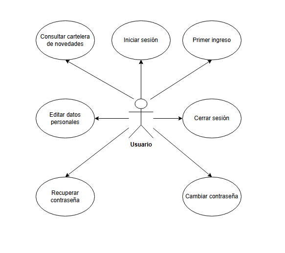
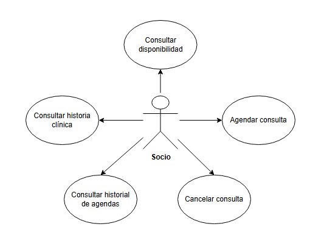
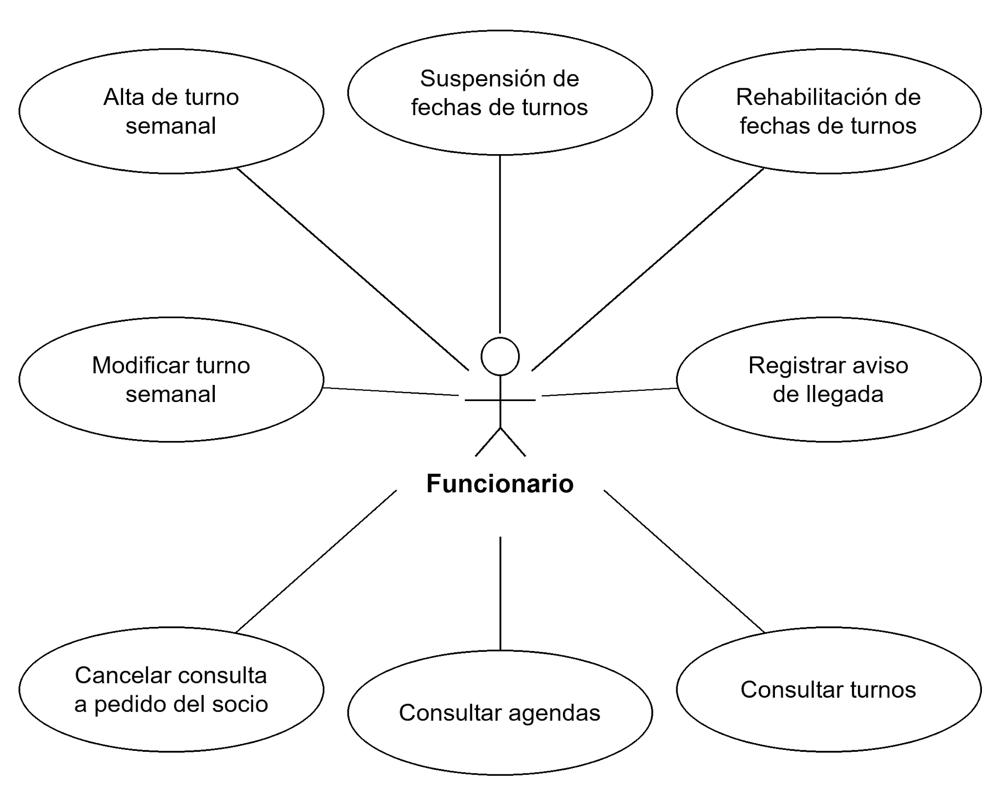
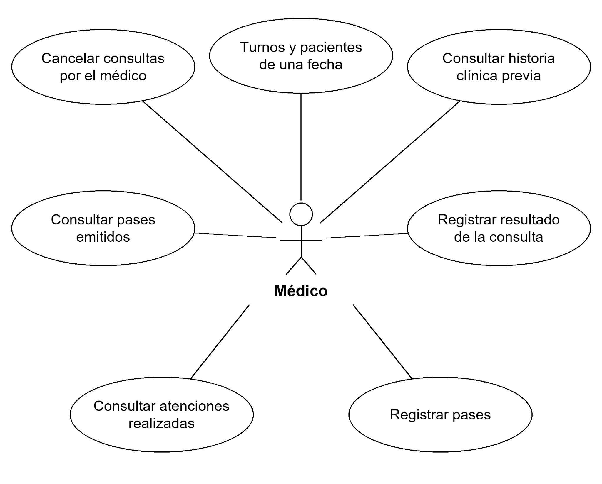
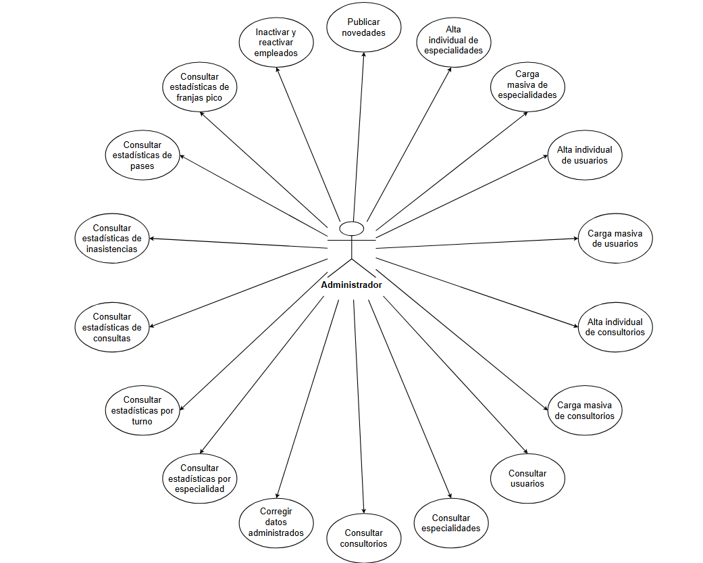

**<u>Documento de Casos de Uso</u>**

[**1. Actores 3**](#actores)

> [1.1. Socio 3](#socio)
>
> [1.2. Funcionario 3](#funcionario)
>
> [1.3. Médico 3](#médico)
>
> [1.4. Administrador 5](#administrador)

[**2. Diagramas de casos de uso 6**](#diagramas-de-casos-de-uso)

> [2.1. Casos de uso comunes entre todos los usuarios 6](#casos-de-uso-comunes-entre-todos-los-usuarios)
>
> [2.2. Casos de uso del Socio 7](#casos-de-uso-del-socio)
>
> [2.3. Casos de uso del Funcionario 7](#casos-de-uso-del-funcionario)
>
> [2.4. Casos de uso del Médico 8](#casos-de-uso-del-médico)
>
> [2.5. Casos de uso del Administrador 9](#casos-de-uso-del-administrador)

[**3. Casos de uso críticos 10**](#casos-de-uso-críticos)

> [3.1. Funcionalidades comunes entre los usuarios 10](#funcionalidades-comunes-entre-los-usuarios)

[3.1.1. Iniciar sesión 10](#iniciar-sesión)

[3.1.2. Primer ingreso 12](#primer-ingreso)

> [3.2. Funcionalidades del Socio 15](#funcionalidades-del-socio)

[3.2.1. Consultar disponibilidad 15](#consultar-disponibilidad)

[3.2.2. Agendar consulta 16](#agendar-consulta)

[3.2.3. Consultar historial de agendas 19](#consultar-historial-de-agendas)

[3.2.4. Consultar historia clínica 20](#consultar-historia-clínica)

> [3.3. Funcionalidades del Funcionario 22](#funcionalidades-del-funcionario)

[3.3.1. Alta de turno semanal 22](#alta-de-turno-semanal)

[3.3.2. Suspensión de fechas de turnos 24](#suspensión-de-fechas-de-turnos)

[3.3.3. Rehabilitación de fechas de turnos 26](#rehabilitación-de-fechas-de-turnos)

[3.3.4. Registrar aviso de llegada 27](#registrar-aviso-de-llegada)

[3.3.5. Consultar turnos 30](#consultar-turnos)

[3.3.6. Consultar agendas 31](#consultar-agendas)

> [3.4. Funcionalidades del Médico 32](#funcionalidades-del-médico)

[3.4.1. Turnos y pacientes de una fecha 32](#turnos-y-pacientes-de-una-fecha)

[3.4.2. Registrar resultado de la consulta 33](#registrar-resultado-de-la-consulta)

[3.4.3. Registrar pases 35](#registrar-pases)

> [3.5. Funcionalidades del Administrador 38](#funcionalidades-del-administrador)

[3.5.1. Alta individual de especialidades 38](#alta-individual-de-especialidades)

[3.5.2. Alta individual de usuarios 40](#alta-individual-de-usuarios)

[3.5.3. Alta individual de consultorios 42](#alta-individual-de-consultorios)

[3.5.4. Consultar usuarios 43](#consultar-usuarios)

[3.5.5. Consultar estadísticas por especialidad 44](#consultar-estadísticas-por-especialidad)

[3.5.6. Consultar estadísticas por turno 46](#consultar-estadísticas-por-turno)

[3.5.7. Consultar estadísticas de consultas 47](#consultar-estadísticas-de-consultas)

#  Actores

## 1.1. Socio

**Descripción:** Usuario final de la institución médica que consulta disponibilidad, agenda y cancela sus consultas, y accede a su historial de agendas y a su historia clínica.

**Responsabilidades:**

- Activar y gestionar su cuenta de usuario.

- Consultar disponibilidad de números por especialidad y médico.

- Agendar y cancelar sus consultas.

- Consultar su historial de agendas y su historia clínica.

## 1.2. Funcionario

**Descripción:** Personal de atención en ventanilla y gestión operativa de la institución.

**Responsabilidades:**

- Dar de alta y modificar configuraciones semanales; suspender y rehabilitar fechas concretas de sus turnos.

- Registrar el aviso de llegada de los socios en ventanilla.

- Consultar lista de turnos y agendas en tiempo real.

- Cancelar consultas a pedido del socio.

## 1.3. Médico

**Descripción:** Profesional de la salud encargado de prestar la atención médica correspondiente a los socios presentados.

**Responsabilidades:**

- Consultar sus turnos y todos sus números, con los pacientes asignados y sus avisos de llegada. Consultar la historia clínica completa de un paciente mientras tenga una consulta Agendada con él cuyo día todavía no terminó, incluso antes de la fecha y sin exigir llegada.

- Registrar la atención médica brindada (afección, tratamiento y observaciones) o que el paciente no se presentó a la consulta.

- Emitir pases durante el registro de la atención, a distintas especialidades, incluida la propia.

- Consultar sus atenciones y sus pases.

- Decidir a quién llamar con los pacientes y sus avisos de llegada a la vista, sin una fila obligatoria impuesta por el sistema.

- Cancelar consultas de sus turnos por razones justificadas.

## 1.4. Administrador

**Descripción:** Usuario encargado de mantener los datos de usuarios, especialidades y consultorios, publicar novedades y consultar reportes institucionales y estadísticas.

**Responsabilidades:**

- Publicar anuncios en la cartelera de novedades.

- Registrar individual y masivamente especialidades, consultorios y usuarios (socios y empleados)

- Consultar y corregir datos administrados en el padrón.

- Inactivar y reactivar cuentas de empleados.

- Consultar reportes estadísticos y la demanda de cada servicio.

#  

#  Diagramas de casos de uso

En esta sección se mostrarán los diagramas de todos los casos de uso y sus actores asociados. En la sección 3 se mostrarán detalladamente los casos de uso críticos del sistema.

## 2.1. Casos de uso comunes entre todos los usuarios 

## 2.2. Casos de uso del Socio

## 

## 2.3. Casos de uso del Funcionario

## 2.4. Casos de uso del Médico

## 2.5. Casos de uso del Administrador

#  Casos de uso críticos

A continuación se desarrollan los flujos principales y alternativos de los 22 requerimientos críticos. Cada ficha identifica su RF en la versión vigente de Requerimientos. Las operaciones autenticadas requieren una cuenta activa; una cuenta inactiva no puede seguir operando con una sesión abierta. Los valores de anticipación, límites y vigencia son configurables sin cambiar el código, sin una pantalla para administrarlos.

## 3.1. Funcionalidades comunes entre los usuarios

### 3.1.1. Iniciar sesión

| **CU 3.1.1 - Iniciar sesión (RF-01)**                           |                                                                                                                                                                                 |                                                                                                                          |
|-----------------------------------------------------------------|---------------------------------------------------------------------------------------------------------------------------------------------------------------------------------|--------------------------------------------------------------------------------------------------------------------------|
| **Sinopsis**                                                    | Un usuario con cuenta activa accede a la plataforma ingresando su Cédula de Identidad (CI) y contraseña. El sistema valida sus credenciales y restringe el acceso según su rol. |                                                                                                                          |
| **Actores**                                                     | Todos los Roles (Socio, Funcionario, Médico, Administrador)                                                                                                                     |                                                                                                                          |
| **Precondiciones**                                              | El usuario posee una cuenta activa cargada en el padrón.                                                                                                                        |                                                                                                                          |
| **Postcondiciones**                                             | El usuario queda autenticado en la sesión y se le redirige al menú principal correspondiente a su perfil.                                                                       |                                                                                                                          |
| **Flujo Principal**                                             |                                                                                                                                                                                 |                                                                                                                          |
| **Paso**                                                        | **Actor**                                                                                                                                                                       | **Descripción**                                                                                                          |
| 1                                                               | Usuario                                                                                                                                                                         | Accede al portal de entrada correspondiente (Acceso Socios vía web/Android o Acceso Empleados vía web)                   |
| 2                                                               | Sistema                                                                                                                                                                         | Despliega el formulario de autenticación solicitando CI y contraseña.                                                    |
| 3                                                               | Usuario                                                                                                                                                                         | Ingresa su número de Cédula de Identidad (CI) y su contraseña, y presiona “Iniciar Sesión”.                              |
| 4                                                               | Sistema                                                                                                                                                                         | Verifica que los campos no estén vacíos.                                                                                 |
| 5                                                               | Sistema                                                                                                                                                                         | Verifica la CI y la contraseña de la cuenta correspondiente al acceso utilizado: Socio o empleado.                       |
| 6                                                               | Sistema                                                                                                                                                                         | Controla que la cuenta correspondiente al tipo de acceso utilizado esté en estado “Activa”.                              |
| 7                                                               | Sistema                                                                                                                                                                         | Inicia la sesión de usuario y despliega la interfaz gráfica adaptada al rol (Socio, Funcionario, Médico o Administrador) |
| **Flujo Alternativo - Credenciales incorrectas o inexistentes** |                                                                                                                                                                                 |                                                                                                                          |
| **Paso**                                                        | **Actor**                                                                                                                                                                       | **Descripción**                                                                                                          |
| 5.A.1                                                           | Sistema                                                                                                                                                                         | En el paso 5, detecta que la CI no existe o la contraseña no coincide con el hash guardado.                              |

| 5.A.2                                   | Sistema   | Muestra el mensaje genérico: “Cédula de Identidad o contraseña incorrectas” (sin revelar cuál de los dos falló para mantener la seguridad). |
|-----------------------------------------|-----------|---------------------------------------------------------------------------------------------------------------------------------------------|
| 5.A.3                                   | Sistema   | Retorna al paso 2 permitiendo reintentar el ingreso.                                                                                        |
| **Flujo Alternativo - Cuenta inactiva** |           |                                                                                                                                             |
| **Paso**                                | **Actor** | **Descripción**                                                                                                                             |
| 6.A.1                                   | Sistema   | En el paso 6, identifica que la cuenta está en estado “Inactiva”.                                                                           |
| 6.A.2                                   | Sistema   | Muestra un mensaje indicando que la cuenta se encuentra inhabilitada para operar.                                                           |
| 6.A.3                                   | Sistema   | Rechaza el acceso y redirige al usuario al paso 2 del flujo principal.                                                                      |

###  

### 3.1.2. Primer ingreso 

| **CU 3.1.2 - Primer ingreso (RF-02)**                                       |                                                                                                                                                 |                                                                                                                                                                                                                                           |
|-----------------------------------------------------------------------------|-------------------------------------------------------------------------------------------------------------------------------------------------|-------------------------------------------------------------------------------------------------------------------------------------------------------------------------------------------------------------------------------------------|
| **Sinopsis**                                                                | Permite a una persona registrada en el padrón activar su cuenta e ingresar sus datos por primera vez mediante la recepción de un correo seguro. |                                                                                                                                                                                                                                           |
| **Actores**                                                                 | Todos los Roles (Socio, Funcionario, Médico, Administrador)                                                                                     |                                                                                                                                                                                                                                           |
| **Precondiciones**                                                          | La persona está cargada en el padrón, su cuenta corresponde al acceso utilizado y no fue inactivada administrativamente.                        |                                                                                                                                                                                                                                           |
| **Postcondiciones**                                                         | La cuenta pasa a estado “Activa” con su contraseña configurada y el usuario puede iniciar sesión.                                               |                                                                                                                                                                                                                                           |
| **Flujo Principal**                                                         |                                                                                                                                                 |                                                                                                                                                                                                                                           |
| **Paso**                                                                    | **Actor**                                                                                                                                       | **Descripción**                                                                                                                                                                                                                           |
| 1                                                                           | Usuario                                                                                                                                         | Selecciona la opción “¿Es mi primera vez?” desde la pantalla de login.                                                                                                                                                                    |
| 2                                                                           | Sistema                                                                                                                                         | Despliega un formulario solicitando el número de Cédula de Identidad (CI).                                                                                                                                                                |
| 3                                                                           | Usuario                                                                                                                                         | Ingresa su CI y presiona “Continuar”.                                                                                                                                                                                                     |
| 4                                                                           | Sistema                                                                                                                                         | Busca la cuenta de esa CI según el acceso utilizado: Socio o empleado.                                                                                                                                                                    |
| 5                                                                           | Sistema                                                                                                                                         | Muestra en pantalla el mensaje obligatorio: “Si su cédula se encuentra registrada, se le ha enviado un correo electrónico con las instrucciones”.                                                                                         |
| 6                                                                           | Sistema                                                                                                                                         | Si la cuenta existe en ese acceso, está pendiente de activación y no fue inactivada administrativamente, genera un enlace de un solo uso válido por 24 horas y lo envía al correo registrado. En los demás casos aplica los alternativos. |
| 7                                                                           | Usuario                                                                                                                                         | Abre su casilla de correo y hace clic en el enlace recibido.                                                                                                                                                                              |
| 8                                                                           | Sistema                                                                                                                                         | Valida que el enlace siga vigente y no se haya utilizado, y que la cuenta no haya sido inactivada administrativamente.                                                                                                                    |
| 9                                                                           | Sistema                                                                                                                                         | Muestra un formulario de activación mostrando su correo (no editable), e incluye campos obligatorios: Dirección, al menos un Teléfono y Contraseña.                                                                                       |
| 10                                                                          | Usuario                                                                                                                                         | Completa la dirección, el teléfono, ingresa una contraseña que cumpla con la longitud mínima (mínimo 8 caracteres) y confirma.                                                                                                            |
| 11                                                                          | Sistema                                                                                                                                         | Valida los datos y que la cuenta siga habilitada para activación; guarda dirección, teléfono y contraseña segura, y activa la cuenta. El primer ingreso no revierte una inactivación administrativa.                                      |
| 12                                                                          | Sistema                                                                                                                                         | Muestra un mensaje de éxito e invita al usuario a iniciar sesión.                                                                                                                                                                         |
| **Flujo Alternativo - Enlace expirado o usado**                             |                                                                                                                                                 |                                                                                                                                                                                                                                           |
| **Paso**                                                                    | **Actor**                                                                                                                                       | **Descripción**                                                                                                                                                                                                                           |
| 8.A.1                                                                       | Usuario                                                                                                                                         | Accede a un enlace con más de 24 horas transcurridas desde su emisión o ya fue utilizado.                                                                                                                                                 |
| 8.A.2                                                                       | Sistema                                                                                                                                         | Despliega un aviso informando que el enlace ya no es válido y ofrece un botón para solicitar un nuevo correo de activación.                                                                                                               |
| 8.A.3                                                                       | Usuario                                                                                                                                         | Presiona el botón para solicitar el reenvío de un nuevo enlace y retorna al paso 4 del flujo principal.                                                                                                                                   |
| **Flujo Alternativo - La cuenta ya se encuentra activa**                    |                                                                                                                                                 |                                                                                                                                                                                                                                           |
| **Paso**                                                                    | **Actor**                                                                                                                                       | **Descripción**                                                                                                                                                                                                                           |
| 4.A.1                                                                       | Sistema                                                                                                                                         | En el paso 4, detecta que la cuenta del acceso utilizado ya está activa.                                                                                                                                                                  |
| 4.A.2                                                                       | Sistema                                                                                                                                         | Mantiene la respuesta genérica y envía un correo indicando que la cuenta ya está activa y cómo recuperar la contraseña (RF-05).                                                                                                           |
| **Flujo Alternativo - Cuenta inexistente o inactivada administrativamente** |                                                                                                                                                 |                                                                                                                                                                                                                                           |
| **Paso**                                                                    | **Actor**                                                                                                                                       | **Descripción**                                                                                                                                                                                                                           |
| 4.B.1                                                                       | Sistema                                                                                                                                         | No encuentra una cuenta para esa CI en el acceso utilizado, o detecta una inactivación administrativa.                                                                                                                                    |
| 4.B.2                                                                       | Sistema                                                                                                                                         | Mantiene la misma respuesta genérica y no envía un correo de activación.                                                                                                                                                                  |
| 4.B.3                                                                       | Usuario                                                                                                                                         | Finaliza la solicitud sin que se active ninguna cuenta.                                                                                                                                                                                   |
| **Flujo Alternativo - Cuenta inactivada después de emitir el enlace**       |                                                                                                                                                 |                                                                                                                                                                                                                                           |
| **Paso**                                                                    | **Actor**                                                                                                                                       | **Descripción**                                                                                                                                                                                                                           |
| 8.B.1                                                                       | Sistema                                                                                                                                         | Detecta que la cuenta fue inactivada administrativamente después de solicitar el enlace.                                                                                                                                                  |
| 8.B.2                                                                       | Sistema                                                                                                                                         | Impide completar la activación y conserva la inactivación.                                                                                                                                                                                |
| 8.B.3                                                                       | Usuario                                                                                                                                         | Finaliza el primer ingreso sin activar la cuenta.                                                                                                                                                                                         |

###  

## 3.2. Funcionalidades del Socio

### 3.2.1. Consultar disponibilidad

| **CU 3.2.1 - Consultar disponibilidad (RF-08)**        |                                                                                                            |                                                                                                                                                                                      |
|--------------------------------------------------------|------------------------------------------------------------------------------------------------------------|--------------------------------------------------------------------------------------------------------------------------------------------------------------------------------------|
| **Sinopsis**                                           | El socio busca números libres para consultas médicas filtrando por especialidad, médico y rango de fechas. |                                                                                                                                                                                      |
| **Actores**                                            | Socio                                                                                                      |                                                                                                                                                                                      |
| **Precondiciones**                                     | Socio con sesión iniciada.                                                                                 |                                                                                                                                                                                      |
| **Postcondiciones**                                    | Se despliega en pantalla la lista de números disponibles que cumplen con todas las reglas de negocio.      |                                                                                                                                                                                      |
| **Flujo Principal**                                    |                                                                                                            |                                                                                                                                                                                      |
| **Paso**                                               | **Actor**                                                                                                  | **Descripción**                                                                                                                                                                      |
| 1                                                      | Socio                                                                                                      | Accede al menú “Consultar Disponibilidad / Agendar”.                                                                                                                                 |
| 2                                                      | Sistema                                                                                                    | Muestra el formulario con los filtros: Especialidad (opcional), Médico (opcional) y Rango de Fechas (opcional). Para buscar, se debe indicar especialidad o médico, al menos uno.                                                                   |
| 3                                                      | Socio                                                                                                      | Selecciona al menos una especialidad o un médico; puede elegir ambos, además del rango de fechas opcional.                                                                    |
| 4                                                      | Socio                                                                                                      | Presiona Buscar disponibilidad.                                                                                                                                                      |
| 5                                                      | Sistema                                                                                                    | Filtra los números libres que cumplen la anticipación máxima de 30 días y la mínima de 2 horas antes de la hora de inicio del número, que es la hora estimada de atención.           |
| 6                                                      | Sistema                                                                                                    | Excluye los números de fechas suspendidas, incluidas las suspendidas por el médico. Una consulta cancelada no impide ofrecer de nuevo su número si cumple las condiciones de agenda. |
| 7                                                      | Sistema                                                                                                    | Ordena los resultados por defecto por fecha y hora más próximas (u opcionalmente por apellido del médico).                                                                           |
| 8                                                      | Sistema                                                                                                    | Despliega la grilla de resultados mostrando: Fecha, Hora de inicio/fin, Nombre del Médico, Especialidad, Consultorio e indicación de si requiere Pase.                               |
| **Flujo Alternativo - No existen números disponibles** |                                                                                                            |                                                                                                                                                                                      |
| **Paso**                                               | **Actor**                                                                                                  | **Descripción**                                                                                                                                                                      |
| 5.A.1                                                  | Sistema                                                                                                    | No encuentra números disponibles en la base de datos que cumplan con los criterios de búsqueda especificados por el socio.                                                           |
| 5.A.2                                                  | Sistema                                                                                                    | Muestra un mensaje informativo: “No se encontraron turnos disponibles para los criterios seleccionados”.                                                                             |
| 5.A.3                                                  | Socio                                                                                                      | Visualiza el mensaje y modifica los filtros para realizar una nueva búsqueda.                                                                                                        |

### 3.2.2. Agendar consulta

| **CU 3.2.2 - Agendar consulta (RF-09)**                            |                                                                                                                                                                                                                                                                                            |                                                                                                                                                                                                    |
|--------------------------------------------------------------------|--------------------------------------------------------------------------------------------------------------------------------------------------------------------------------------------------------------------------------------------------------------------------------------------|----------------------------------------------------------------------------------------------------------------------------------------------------------------------------------------------------|
| **Sinopsis**                                                       | El socio selecciona un número libre en el sistema y confirma su reserva de consulta médica.                                                                                                                                                                                                |                                                                                                                                                                                                    |
| **Actores**                                                        | Socio.                                                                                                                                                                                                                                                                                     |                                                                                                                                                                                                    |
| **Precondiciones**                                                 | Socio con sesión iniciada.                                                                                                                                                                                                                                                                 |                                                                                                                                                                                                    |
| **Postcondiciones**                                                | La consulta queda Agendada con identificador único. Si requiere pase, se consume al confirmar y se conserva cuál se utilizó. Solo una cancelación devuelve ese pase si sigue vigente, con su vencimiento original; No asistió, No atendida y No se presentó a la consulta no lo devuelven. |                                                                                                                                                                                                    |
| **Flujo Principal**                                                |                                                                                                                                                                                                                                                                                            |                                                                                                                                                                                                    |
| **Paso**                                                           | **Actor**                                                                                                                                                                                                                                                                                  | **Descripción**                                                                                                                                                                                    |
| 1                                                                  | Socio                                                                                                                                                                                                                                                                                      | Selecciona un número disponible desplegado en el caso de uso CU 3.2.1.                                                                                                                             |
| 2                                                                  | Sistema                                                                                                                                                                                                                                                                                    | Presenta la confirmación con número, médico, especialidad, fecha, hora de inicio y fin y consultorio.                                                                                              |
| 3                                                                  | Socio                                                                                                                                                                                                                                                                                      | Revisa los datos y hace clic en el botón “Confirmar Agenda”.                                                                                                                                       |
| 4                                                                  | Sistema                                                                                                                                                                                                                                                                                    | Controla la anticipación máxima de 30 días y la mínima de 2 horas antes de la hora de inicio del número.                                                                                           |
| 5                                                                  | Sistema                                                                                                                                                                                                                                                                                    | Verifica que el socio no tenga otra consulta activa en la especialidad y tenga menos de 3 activas en total. Se considera activa una consulta Agendada cuyo día todavía no terminó.                 |
| 6                                                                  | Sistema                                                                                                                                                                                                                                                                                    | Verifica que el socio no posea otra consulta previa agendada que se superponga en el mismo horario.                                                                                                |
| 7                                                                  | Sistema                                                                                                                                                                                                                                                                                    | Si la especialidad requiere pase, verifica que exista un pase sin usar a esa especialidad cuyo vencimiento no sea anterior a la fecha de consulta. No exige que el médico elegido sea el emisor.   |
| 8                                                                  | Sistema                                                                                                                                                                                                                                                                                    | Comprueba que la fecha del turno siga activa y el número continúe libre. Para el identificador del turno y número solo puede existir una consulta no cancelada, incluso ante reservas simultáneas. |
| 9                                                                  | Sistema                                                                                                                                                                                                                                                                                    | Registra la consulta Agendada con identificador único y consume el pase, si corresponde, asociándolo a la consulta. Conserva las reservas canceladas en el historial.                              |
| 10                                                                 | Sistema                                                                                                                                                                                                                                                                                    | Muestra un comprobante en pantalla con el identificador único, número asignado dentro del turno, médico, fecha y hora y consultorio.                                                               |
| **Flujo Alternativo - Número agendado previamente por otro socio** |                                                                                                                                                                                                                                                                                            |                                                                                                                                                                                                    |
| **Paso**                                                           | **Actor**                                                                                                                                                                                                                                                                                  | **Descripción**                                                                                                                                                                                    |
| 8.A.1                                                              | Sistema                                                                                                                                                                                                                                                                                    | Durante la verificación en base de datos, detecta que el número fue tomado por otro usuario un instante antes.                                                                                     |
| 8.A.2                                                              | Sistema                                                                                                                                                                                                                                                                                    | Cancela el proceso de registro y despliega la alerta: “El número seleccionado ya no está disponible”.                                                                                              |
| 8.A.3                                                              | Socio                                                                                                                                                                                                                                                                                      | Presiona “Aceptar” y es redirigido por el sistema al listado de disponibilidad (CU 3.2.1.).                                                                                                        |
| **Flujo Alternativo - Incumplimiento de límites de consultas**     |                                                                                                                                                                                                                                                                                            |                                                                                                                                                                                                    |
| **Paso**                                                           | **Actor**                                                                                                                                                                                                                                                                                  | **Descripción**                                                                                                                                                                                    |
| 5.A.1                                                              | Sistema                                                                                                                                                                                                                                                                                    | Detecta que el socio ya posee 3 consultas activas en total o 1 activa en la misma especialidad elegida.                                                                                            |
| 5.A.2                                                              | Sistema                                                                                                                                                                                                                                                                                    | Bloquea el agendamiento y despliega un mensaje indicando explícitamente la regla de límite incumplida.                                                                                             |
| 5.A.3                                                              | Socio                                                                                                                                                                                                                                                                                      | Cancela la operación o utiliza la cancelación de una consulta previa si cumple sus condiciones (RF-10); luego puede volver a consultar disponibilidad.                                             |
| **Flujo Alternativo - Falta de pase válido**                       |                                                                                                                                                                                                                                                                                            |                                                                                                                                                                                                    |
| **Paso**                                                           | **Actor**                                                                                                                                                                                                                                                                                  | **Descripción**                                                                                                                                                                                    |
| 7.A.1                                                              | Sistema                                                                                                                                                                                                                                                                                    | Detecta que la especialidad requiere pase y el socio no tiene uno sin usar a esa especialidad con vigencia suficiente para la fecha elegida.                                                       |
| 7.A.2                                                              | Sistema                                                                                                                                                                                                                                                                                    | Muestra un aviso indicando que se requiere un pase médico previo emitido para agendarse en dicha especialidad.                                                                                     |
| 7.A.3                                                              | Socio                                                                                                                                                                                                                                                                                      | Visualiza el aviso y retorna al menú principal.                                                                                                                                                    |
| **Flujo Alternativo - Anticipación fuera del límite**              |                                                                                                                                                                                                                                                                                            |                                                                                                                                                                                                    |
| **Paso**                                                           | **Actor**                                                                                                                                                                                                                                                                                  | **Descripción**                                                                                                                                                                                    |
| 4.A.1                                                              | Sistema                                                                                                                                                                                                                                                                                    | Detecta que la fecha supera los 30 días de anticipación o que faltan menos de 2 horas para el inicio del número.                                                                                   |
| 4.A.2                                                              | Sistema                                                                                                                                                                                                                                                                                    | Rechaza la reserva e informa el límite incumplido.                                                                                                                                                 |
| 4.A.3                                                              | Socio                                                                                                                                                                                                                                                                                      | Vuelve a consultar disponibilidad y elige otro número, o cancela.                                                                                                                                  |
| **Flujo Alternativo - Superposición con otra consulta**            |                                                                                                                                                                                                                                                                                            |                                                                                                                                                                                                    |
| **Paso**                                                           | **Actor**                                                                                                                                                                                                                                                                                  | **Descripción**                                                                                                                                                                                    |
| 6.A.1                                                              | Sistema                                                                                                                                                                                                                                                                                    | Detecta que el número elegido se solapa con otra consulta Agendada del socio.                                                                                                                      |
| 6.A.2                                                              | Sistema                                                                                                                                                                                                                                                                                    | Rechaza la reserva e informa la superposición.                                                                                                                                                     |
| 6.A.3                                                              | Socio                                                                                                                                                                                                                                                                                      | Elige otro número sin superposición o cancela la operación.                                                                                                                                        |

### 3.2.3. Consultar historial de agendas

| **CU 3.2.3 - Consultar historial de agendas (RF-11)** |                                                                                                           |                                                                                                                                                                                                       |
|-------------------------------------------------------|-----------------------------------------------------------------------------------------------------------|-------------------------------------------------------------------------------------------------------------------------------------------------------------------------------------------------------|
| **Sinopsis**                                          | Permite al socio ver la totalidad de sus consultas pasadas y futuras con el estado detallado de cada una. |                                                                                                                                                                                                       |
| **Actores**                                           | Socio.                                                                                                    |                                                                                                                                                                                                       |
| **Precondiciones**                                    | Socio con sesión iniciada.                                                                                |                                                                                                                                                                                                       |
| **Postcondiciones**                                   | Se despliega el listado consolidado de agendas.                                                           |                                                                                                                                                                                                       |
| **Flujo Principal**                                   |                                                                                                           |                                                                                                                                                                                                       |
| **Paso**                                              | **Actor**                                                                                                 | **Descripción**                                                                                                                                                                                       |
| 1                                                     | Socio                                                                                                     | Selecciona la opción “Mis consultas/Historial de agendas”.                                                                                                                                            |
| 2                                                     | Sistema                                                                                                   | Obtiene todas las consultas del socio, incluidas las canceladas, conservando su historial.                                                                                                            |
| 3                                                     | Sistema                                                                                                   | Para consultas que siguen Agendadas al terminar el día, a las 24:00 de Uruguay, muestra No asistió si no hubo aviso de llegada o No atendida si lo hubo. No altera los estados ya registrados.        |
| 4                                                     | Sistema                                                                                                   | Muestra la lista ordenada por defecto por fecha descendente (más reciente primero)                                                                                                                    |
| 5                                                     | Socio                                                                                                     | Aplica filtros por estado (Agendada, Atendida, Cancelada por el socio, Cancelada por la institución, No asistió, No atendida y No se presentó a la consulta), especialidad, médico o rango de fechas. |
| 6                                                     | Sistema                                                                                                   | Actualiza la lista en pantalla mostrando por cada ítem: ID de consulta, especialidad, médico, fecha, hora, consultorio y estado resultante.                                                           |

### 3.2.4. Consultar historia clínica

| **CU 3.2.4 - Consultar historia clínica (RF-12)** |                                                                                                                     |                                                                                                                                                                                     |
|---------------------------------------------------|---------------------------------------------------------------------------------------------------------------------|-------------------------------------------------------------------------------------------------------------------------------------------------------------------------------------|
| **Sinopsis**                                      | Permite al socio revisar las atenciones médicas que se le han registrado en el sistema.                             |                                                                                                                                                                                     |
| **Actores**                                       | Socio.                                                                                                              |                                                                                                                                                                                     |
| **Precondiciones**                                | Socio con sesión iniciada.                                                                                          |                                                                                                                                                                                     |
| **Postcondiciones**                               | Se muestran las atenciones propias filtradas y el detalle de afección, tratamiento, observaciones y pases emitidos. |                                                                                                                                                                                     |
| **Flujo Principal**                               |                                                                                                                     |                                                                                                                                                                                     |
| **Paso**                                          | **Actor**                                                                                                           | **Descripción**                                                                                                                                                                     |
| 1                                                 | Socio                                                                                                               | Accede al menú “Mi historia Clínica”.                                                                                                                                               |
| 2                                                 | Sistema                                                                                                             | Busca todos los registros de atención médica finalizados (estado “Atendida”) asociados al socio.                                                                                    |
| 3                                                 | Sistema                                                                                                             | Presenta los filtros combinables de rango de fechas, especialidad, médico y búsqueda opcional por texto en tratamiento, y la lista de atenciones ordenada por fecha y especialidad. |
| 4                                                 | Socio                                                                                                               | Aplica opcionalmente uno o varios filtros, o mantiene la lista completa.                                                                                                            |
| 5                                                 | Sistema                                                                                                             | Actualiza la lista de atenciones según los filtros combinados. Si no hay coincidencias, lo informa.                                                                                 |
| 6                                                 | Socio                                                                                                               | Selecciona una atención médica de la lista para ver su detalle.                                                                                                                     |
| 7                                                 | Sistema                                                                                                             | Muestra afección, tratamiento, observaciones, médico, especialidad, fecha y los pases emitidos con su vigencia.                                                                     |

## 3.3. Funcionalidades del Funcionario

### 3.3.1. Alta de turno semanal

| **CU 3.3.1 - Alta de turno semanal (RF-13)**                            |                                                                                                                                                                                                                                                  |                                                                                                                                                                                      |
|-------------------------------------------------------------------------|--------------------------------------------------------------------------------------------------------------------------------------------------------------------------------------------------------------------------------------------------|--------------------------------------------------------------------------------------------------------------------------------------------------------------------------------------|
| **Sinopsis**                                                            | El funcionario define una configuración semanal con vigencia y números, a partir de la que se generan turnos concretos para cada fecha del día elegido.                                                                                          |                                                                                                                                                                                      |
| **Actores**                                                             | Funcionario.                                                                                                                                                                                                                                     |                                                                                                                                                                                      |
| **Precondiciones**                                                      | Funcionario con sesión iniciada. Existen un médico activo, una especialidad asignada a él y el consultorio.                                                                                                                                      |                                                                                                                                                                                      |
| **Postcondiciones**                                                     | Se guarda la configuración semanal y se genera un turno concreto por cada fecha del día elegido en su vigencia. Cada turno tiene identificador único autogenerado y números únicos dentro de él, que se ofrecen según las condiciones de agenda. |                                                                                                                                                                                      |
| **Flujo Principal**                                                     |                                                                                                                                                                                                                                                  |                                                                                                                                                                                      |
| **Paso**                                                                | **Actor**                                                                                                                                                                                                                                        | **Descripción**                                                                                                                                                                      |
| 1                                                                       | Funcionario                                                                                                                                                                                                                                      | Ingresa al panel de gestión de turnos y presiona “Nuevo Turno Semanal”.                                                                                                              |
| 2                                                                       | Sistema                                                                                                                                                                                                                                          | Despliega el formulario para la parametrización del turno semanal.                                                                                                                   |
| 3                                                                       | Funcionario                                                                                                                                                                                                                                      | Selecciona médico activo, una de sus especialidades, día de la semana y consultorio, e ingresa las fechas obligatorias de inicio y finalización.                                     |
| 4                                                                       | Funcionario                                                                                                                                                                                                                                      | Define al menos un número, identificado como 1, 2, 3, etc., con hora de inicio y fin en múltiplos de 5 minutos y duración de 10 a 60 minutos. Puede dejar huecos entre números.      |
| 5                                                                       | Funcionario                                                                                                                                                                                                                                      | Presiona el botón “Guardar Turno”.                                                                                                                                                   |
| 6                                                                       | Sistema                                                                                                                                                                                                                                          | Valida los datos obligatorios, que la fecha final sea igual o posterior a la inicial, el médico activo y su especialidad, el cupo mínimo y los horarios y duraciones de los números. |
| 7                                                                       | Sistema                                                                                                                                                                                                                                          | Verifica que los números no se solapen entre sí ni, en las fechas activas de la vigencia, con números de otros turnos activos del mismo médico o consultorio.                        |
| 8                                                                       | Sistema                                                                                                                                                                                                                                          | Guarda la configuración y genera los turnos concretos y sus números para las fechas del período.                                                                                     |
| 9                                                                       | Sistema                                                                                                                                                                                                                                          | Muestra un mensaje de confirmación de alta exitosa.                                                                                                                                  |
| **Flujo Alternativo - Solapamiento de horario de médico o consultorio** |                                                                                                                                                                                                                                                  |                                                                                                                                                                                      |
| **Paso**                                                                | **Actor**                                                                                                                                                                                                                                        | **Descripción**                                                                                                                                                                      |
| 7.A.1                                                                   | Sistema                                                                                                                                                                                                                                          | Detecta solapamiento entre números de la configuración o con un turno activo del mismo médico o consultorio en alguna fecha de la vigencia.                                          |
| 7.A.2                                                                   | Sistema                                                                                                                                                                                                                                          | Informa las fechas y números en conflicto e impide guardar.                                                                                                                          |
| 7.A.3                                                                   | Funcionario                                                                                                                                                                                                                                      | Corrige horarios, consultorio o vigencia y vuelve a guardar, o cancela el alta.                                                                                                      |
| **Flujo Alternativo - Datos de configuración inválidos**                |                                                                                                                                                                                                                                                  |                                                                                                                                                                                      |
| **Paso**                                                                | **Actor**                                                                                                                                                                                                                                        | **Descripción**                                                                                                                                                                      |
| 6.A.1                                                                   | Sistema                                                                                                                                                                                                                                          | Detecta datos obligatorios faltantes, fecha final anterior a la inicial, médico inactivo, especialidad no asignada o números con cupo, duración u horarios inválidos.                |
| 6.A.2                                                                   | Sistema                                                                                                                                                                                                                                          | Informa la validación incumplida y no crea la configuración ni los turnos.                                                                                                           |
| 6.A.3                                                                   | Funcionario                                                                                                                                                                                                                                      | Corrige los datos y vuelve al guardado, o cancela el alta.                                                                                                                           |

### 

### 3.3.2. Suspensión de fechas de turnos

| **CU 3.3.2 - Suspensión de fechas de turnos (RF-14)** |                                                                                                                                                                                                                                                                     |                                                                                                                                                                                                   |
|-------------------------------------------------------|---------------------------------------------------------------------------------------------------------------------------------------------------------------------------------------------------------------------------------------------------------------------|---------------------------------------------------------------------------------------------------------------------------------------------------------------------------------------------------|
| **Sinopsis**                                          | El funcionario suspende de inmediato una o varias fechas concretas de turnos, cancelando sus consultas Agendadas.                                                                                                                                                   |                                                                                                                                                                                                   |
| **Actores**                                           | Funcionario.                                                                                                                                                                                                                                                        |                                                                                                                                                                                                   |
| **Precondiciones**                                    | Funcionario con sesión iniciada. Existen turnos activos de fechas actuales o futuras.                                                                                                                                                                               |                                                                                                                                                                                                   |
| **Postcondiciones**                                   | Los turnos seleccionados quedan suspendidos y sus consultas Agendadas pasan a Cancelada por la institución. Se conserva el historial, se devuelven los pases según RF-09 y se notifica a los socios. Las demás fechas y los demás estados de consulta se conservan. |                                                                                                                                                                                                   |
| **Flujo Principal**                                   |                                                                                                                                                                                                                                                                     |                                                                                                                                                                                                   |
| **Paso**                                              | **Actor**                                                                                                                                                                                                                                                           | **Descripción**                                                                                                                                                                                   |
| 1                                                     | Funcionario                                                                                                                                                                                                                                                         | Accede a suspensión e indica médico, especialidad y rango de fechas.                                                                                                                              |
| 2                                                     | Sistema                                                                                                                                                                                                                                                             | Lista los turnos concretos activos de fechas actuales o futuras que cumplen los filtros, con su fecha, horario y consultorio.                                                                     |
| 3                                                     | Funcionario                                                                                                                                                                                                                                                         | Selecciona uno o varios turnos de la lista, o todos los del rango.                                                                                                                                |
| 4                                                     | Funcionario                                                                                                                                                                                                                                                         | Ingresa opcionalmente una observación, que puede avisar que se creará otro turno para volver a agendarse.                                                                                         |
| 5                                                     | Sistema                                                                                                                                                                                                                                                             | Solicita confirmación, mostrando las fechas seleccionadas y la cantidad de consultas Agendadas que se cancelarán.                                                                                 |
| 6                                                     | Funcionario                                                                                                                                                                                                                                                         | Revisa los efectos y confirma la suspensión, o cancela sin cambios.                                                                                                                               |
| 7                                                     | Sistema                                                                                                                                                                                                                                                             | Suspende de inmediato los turnos seleccionados, que dejan de ofrecer números. Conserva la configuración semanal y las fechas no seleccionadas; no hay efecto futuro ni rehabilitación automática. |
| 8                                                     | Sistema                                                                                                                                                                                                                                                             | Cancela únicamente las consultas que siguen Agendadas, conserva las demás y el historial, devuelve los pases vigentes con su vencimiento original y registra quién suspendió y cuándo.            |
| 9                                                     | Sistema                                                                                                                                                                                                                                                             | Notifica de inmediato a los socios afectados por los canales de RNF-24, incluyendo la observación si se ingresó, e informa el resultado.                                                          |

### 3.3.3. Rehabilitación de fechas de turnos

| **CU 3.3.3 - Rehabilitación de fechas de turnos (RF-15)** |                                                                                                                                                                                           |                                                                                                                                                                                                                  |
|-----------------------------------------------------------|-------------------------------------------------------------------------------------------------------------------------------------------------------------------------------------------|------------------------------------------------------------------------------------------------------------------------------------------------------------------------------------------------------------------|
| **Sinopsis**                                              | El funcionario rehabilita una o varias fechas concretas suspendidas, manteniendo su configuración y sin recuperar reservas canceladas.                                                    |                                                                                                                                                                                                                  |
| **Actores**                                               | Funcionario.                                                                                                                                                                              |                                                                                                                                                                                                                  |
| **Precondiciones**                                        | Funcionario con sesión iniciada. Existen turnos suspendidos de fechas actuales o futuras y el médico está activo.                                                                         |                                                                                                                                                                                                                  |
| **Postcondiciones**                                       | Las fechas seleccionadas vuelven a estar activas y ofrecen sus números según las condiciones de agenda. Las consultas canceladas no se restauran; los socios deben agendar otra consulta. |                                                                                                                                                                                                                  |
| **Flujo Principal**                                       |                                                                                                                                                                                           |                                                                                                                                                                                                                  |
| **Paso**                                                  | **Actor**                                                                                                                                                                                 | **Descripción**                                                                                                                                                                                                  |
| 1                                                         | Funcionario                                                                                                                                                                               | Accede a rehabilitación e indica médico, especialidad y rango de fechas.                                                                                                                                         |
| 2                                                         | Sistema                                                                                                                                                                                   | Lista los turnos concretos suspendidos de fechas actuales o futuras que cumplen los filtros.                                                                                                                     |
| 3                                                         | Funcionario                                                                                                                                                                               | Selecciona uno, varios o todos los turnos suspendidos del rango.                                                                                                                                                 |
| 4                                                         | Sistema                                                                                                                                                                                   | Verifica que el médico esté activo y que sus números no se solapen con otros turnos activos del mismo médico o consultorio en las fechas elegidas. Conserva médico, especialidad, fecha, consultorio y horarios. |
| 5                                                         | Funcionario                                                                                                                                                                               | Revisa las fechas seleccionadas y confirma la rehabilitación, o cancela sin cambios.                                                                                                                             |
| 6                                                         | Sistema                                                                                                                                                                                   | Activa los turnos seleccionados y habilita la oferta de sus números según las condiciones de agenda, sin restaurar consultas canceladas.                                                                         |
| 7                                                         | Sistema                                                                                                                                                                                   | Registra quién rehabilitó y cuándo y confirma el resultado.                                                                                                                                                      |
| **Flujo Alternativo - Médico inactivo o solapamiento**    |                                                                                                                                                                                           |                                                                                                                                                                                                                  |
| **Paso**                                                  | **Actor**                                                                                                                                                                                 | **Descripción**                                                                                                                                                                                                  |
| 4.A.1                                                     | Sistema                                                                                                                                                                                   | Detecta que el médico está inactivo o que un turno seleccionado se solapa con otro turno activo del mismo médico o consultorio.                                                                                  |
| 4.A.2                                                     | Sistema                                                                                                                                                                                   | Impide la rehabilitación e informa el motivo y los turnos afectados. No cancela otras consultas para resolver el conflicto.                                                                                      |
| 4.A.3                                                     | Funcionario                                                                                                                                                                               | Corrige la selección o cancela la rehabilitación. Si necesita cambiar la configuración, utiliza la función correspondiente (RF-20) o registra otro turno (RF-13).                                                |

### 3.3.4. Registrar aviso de llegada

### 

| **CU 3.3.4 - Registrar aviso de llegada (RF-16)**                       |                                                                                                                                                          |                                                                                                                                                                                         |
|-------------------------------------------------------------------------|----------------------------------------------------------------------------------------------------------------------------------------------------------|-----------------------------------------------------------------------------------------------------------------------------------------------------------------------------------------|
| **Sinopsis**                                                            | El funcionario registra la presencia física del socio en la ventanilla el día de su consulta.                                                            |                                                                                                                                                                                         |
| **Actores**                                                             | Funcionario.                                                                                                                                             |                                                                                                                                                                                         |
| **Precondiciones**                                                      | Funcionario con sesión iniciada. El socio tiene al menos una consulta Agendada para hoy. El funcionario no puede registrar su propia llegada.            |                                                                                                                                                                                         |
| **Postcondiciones**                                                     | Se conserva un único aviso por socio y día, con hora y funcionario. Aplica a todas las consultas del socio de ese día y vale hasta las 24:00 de Uruguay. |                                                                                                                                                                                         |
| **Flujo Principal**                                                     |                                                                                                                                                          |                                                                                                                                                                                         |
| **Paso**                                                                | **Actor**                                                                                                                                                | **Descripción**                                                                                                                                                                         |
| 1                                                                       | Funcionario                                                                                                                                              | Solicita la CI al socio en la ventanilla.                                                                                                                                               |
| 2                                                                       | Funcionario                                                                                                                                              | Ingresa el número de CI en el módulo de “Aviso de Llegada”.                                                                                                                             |
| 3                                                                       | Sistema                                                                                                                                                  | Busca las consultas Agendadas del socio para hoy y comprueba que la CI no corresponda al propio funcionario.                                                                            |
| 4                                                                       | Sistema                                                                                                                                                  | Despliega en pantalla el listado de consultas del día (Médico, Hora, Consultorio).                                                                                                      |
| 5                                                                       | Funcionario                                                                                                                                              | Presiona el botón “Marcar Llegada”.                                                                                                                                                     |
| 6                                                                       | Sistema                                                                                                                                                  | Verifica que no exista un aviso del socio para hoy; registra una única llegada, con hora actual y funcionario. No hay ventana de antelación ni retiro del aviso.                        |
| 7                                                                       | Sistema                                                                                                                                                  | Actualiza en tiempo real las agendas (CU 3.3.6) y los pacientes del turno (CU 3.4.1), aplicando la llegada a todas las consultas del socio de ese día. El médico decide a quién llamar. |
| **Flujo Alternativo - El socio no posee consultas agendadas en el día** |                                                                                                                                                          |                                                                                                                                                                                         |
| **Paso**                                                                | **Actor**                                                                                                                                                | **Descripción**                                                                                                                                                                         |
| 3.A.1                                                                   | Sistema                                                                                                                                                  | No se detectó ninguna consulta para el día de la fecha vinculada a esa CI.                                                                                                              |
| 3.A.2                                                                   | Sistema                                                                                                                                                  | Muestra un mensaje: “El socio no posee consultas agendadas para el día de hoy” e impide el registro.                                                                                    |
| 3.A.3                                                                   | Funcionario                                                                                                                                              | Informa la situación al socio a través de la ventanilla.                                                                                                                                |
| **Flujo Alternativo - Llegada ya registrada hoy**                       |                                                                                                                                                          |                                                                                                                                                                                         |
| **Paso**                                                                | **Actor**                                                                                                                                                | **Descripción**                                                                                                                                                                         |
| 6.A.1                                                                   | Sistema                                                                                                                                                  | Detecta que el socio ya tiene un aviso de llegada registrado para hoy.                                                                                                                  |
| 6.A.2                                                                   | Sistema                                                                                                                                                  | Conserva el aviso original, su hora y funcionario, e informa que la llegada ya estaba registrada. No crea ni sobrescribe otro aviso.                                                    |
| 6.A.3                                                                   | Funcionario                                                                                                                                              | Visualiza la llegada existente y finaliza la operación.                                                                                                                                 |
| **Flujo Alternativo - Registro de la propia llegada**                   |                                                                                                                                                          |                                                                                                                                                                                         |
| **Paso**                                                                | **Actor**                                                                                                                                                | **Descripción**                                                                                                                                                                         |
| 3.B.1                                                                   | Sistema                                                                                                                                                  | Detecta que la CI del socio corresponde al funcionario que está operando.                                                                                                               |
| 3.B.2                                                                   | Sistema                                                                                                                                                  | Impide registrar el aviso e informa que debe hacerlo otro funcionario.                                                                                                                  |
| 3.B.3                                                                   | Funcionario                                                                                                                                              | Finaliza la operación; otro funcionario puede registrar la llegada.                                                                                                                     |

###  

### 3.3.5. Consultar turnos

| **CU 3.3.5 - Consultar turnos (RF-17)** |                                                                                        |                                                                                                                                                                                               |
|-----------------------------------------|----------------------------------------------------------------------------------------|-----------------------------------------------------------------------------------------------------------------------------------------------------------------------------------------------|
| **Sinopsis**                            | El funcionario consulta las fechas concretas de los turnos y su configuración semanal. |                                                                                                                                                                                               |
| **Actores**                             | Funcionario.                                                                           |                                                                                                                                                                                               |
| **Precondiciones**                      | Funcionario con sesión iniciada.                                                       |                                                                                                                                                                                               |
| **Postcondiciones**                     | Se despliega el listado de turnos de acuerdo a los filtros aplicados.                  |                                                                                                                                                                                               |
| **Flujo Principal**                     |                                                                                        |                                                                                                                                                                                               |
| **Paso**                                | **Actor**                                                                              | **Descripción**                                                                                                                                                                               |
| 1                                       | Funcionario                                                                            | Accede al menú “Consulta de Turnos”.                                                                                                                                                          |
| 2                                       | Sistema                                                                                | Presenta filtros por médico, especialidad, día de la semana, rango de fechas y estado de la fecha (activa o suspendida).                                                                      |
| 3                                       | Funcionario                                                                            | Selecciona los criterios requeridos y presiona “Buscar”.                                                                                                                                      |
| 4                                       | Sistema                                                                                | Obtiene las fechas concretas coincidentes y ordena por fecha y horario, médico y especialidad.                                                                                                |
| 5                                       | Sistema                                                                                | Muestra fecha, médico, especialidad, día, horario, consultorio, cantidad de números y estado de cada fecha. Permite consultar la configuración semanal y sus fechas de inicio y finalización. |

### 

###  

### 3.3.6. Consultar agendas

| **CU 3.3.6 - Consultar agendas (RF-18)** |                                                                                                           |                                                                                                                                                                                                                                                  |
|------------------------------------------|-----------------------------------------------------------------------------------------------------------|--------------------------------------------------------------------------------------------------------------------------------------------------------------------------------------------------------------------------------------------------|
| **Sinopsis**                             | Permite monitorear la agenda de consultas y el flujo de pacientes presentes en ventanilla en tiempo real. |                                                                                                                                                                                                                                                  |
| **Actores**                              | Funcionario.                                                                                              |                                                                                                                                                                                                                                                  |
| **Precondiciones**                       | Funcionario con sesión iniciada.                                                                          |                                                                                                                                                                                                                                                  |
| **Postcondiciones**                      | Muestra la lista detallada de consultas y avisos de llegada.                                              |                                                                                                                                                                                                                                                  |
| **Flujo Principal**                      |                                                                                                           |                                                                                                                                                                                                                                                  |
| **Paso**                                 | **Actor**                                                                                                 | **Descripción**                                                                                                                                                                                                                                  |
| 1                                        | Funcionario                                                                                               | Accede al menú “Consulta de Agendas”.                                                                                                                                                                                                            |
| 2                                        | Sistema                                                                                                   | Despliega los filtros de búsqueda: CI del Socio, ID de consulta, Fecha, Médico, Estado y Aviso de Llegada.                                                                                                                                       |
| 3                                        | Funcionario                                                                                               | Selecciona los criterios requeridos y presiona “Buscar”                                                                                                                                                                                          |
| 4                                        | Sistema                                                                                                   | Lista identificador de consulta, socio, especialidad, médico, fecha, hora del número, consultorio, estado y llegada con su hora. Ordena por fecha y hora de consulta y hora de llegada; la vista de hoy con llegada se actualiza en tiempo real. |

### 

## 3.4. Funcionalidades del Médico

### 3.4.1. Turnos y pacientes de una fecha

| **CU 3.4.1 - Turnos y pacientes de una fecha (RF-21)** |                                                                                                                                       |                                                                                                                                                                                                                                                                                                        |
|--------------------------------------------------------|---------------------------------------------------------------------------------------------------------------------------------------|--------------------------------------------------------------------------------------------------------------------------------------------------------------------------------------------------------------------------------------------------------------------------------------------------------|
| **Sinopsis**                                           | El médico elige una fecha y uno de sus turnos para ver todos sus números, los pacientes asignados y sus avisos de llegada.            |                                                                                                                                                                                                                                                                                                        |
| **Actores**                                            | Médico.                                                                                                                               |                                                                                                                                                                                                                                                                                                        |
| **Precondiciones**                                     | Médico con sesión iniciada.                                                                                                           |                                                                                                                                                                                                                                                                                                        |
| **Postcondiciones**                                    | Muestra todos los números del turno elegido y sus pacientes, con actualización en tiempo real. El médico decide el orden de atención. |                                                                                                                                                                                                                                                                                                        |
| **Flujo Principal**                                    |                                                                                                                                       |                                                                                                                                                                                                                                                                                                        |
| **Paso**                                               | **Actor**                                                                                                                             | **Descripción**                                                                                                                                                                                                                                                                                        |
| 1                                                      | Médico                                                                                                                                | Accede a sus turnos y selecciona una fecha.                                                                                                                                                                                                                                                            |
| 2                                                      | Sistema                                                                                                                               | Lista los turnos asignados a ese médico en la fecha elegida.                                                                                                                                                                                                                                           |
| 3                                                      | Médico                                                                                                                                | Selecciona uno de sus turnos.                                                                                                                                                                                                                                                                          |
| 4                                                      | Sistema                                                                                                                               | Muestra todos sus números ordenados por hora del número y hora de llegada, con inicio y fin. Para los reservados muestra nombre, apellido, CI, estado y llegada con hora. Los vacíos figuran Sin reserva y solo se indican disponibles si todavía pueden agendarse. Actualiza la lista en tiempo real. |
| 5                                                      | Médico                                                                                                                                | Filtra opcionalmente por aviso de llegada y decide a quién llamar. Puede consultar la historia clínica previa según RF-22, incluso antes de la fecha y sin llegada, mientras exista una consulta Agendada propia cuyo día no terminó.                                                                  |

### 

### 3.4.2. Registrar resultado de la consulta

| **CU 3.4.2 - Registrar resultado de la consulta (RF-23)**      |                                                                                                                                                                                                                                                        |                                                                                                                                                                                                                          |
|----------------------------------------------------------------|--------------------------------------------------------------------------------------------------------------------------------------------------------------------------------------------------------------------------------------------------------|--------------------------------------------------------------------------------------------------------------------------------------------------------------------------------------------------------------------------|
| **Sinopsis**                                                   | El médico registra la atención en la historia clínica o que un paciente con llegada registrada no se presentó a su consulta.                                                                                                                           |                                                                                                                                                                                                                          |
| **Actores**                                                    | Médico.                                                                                                                                                                                                                                                |                                                                                                                                                                                                                          |
| **Precondiciones**                                             | El médico tiene sesión iniciada. La consulta está Agendada con él para hoy y el socio registró llegada hoy. No puede registrar el resultado de su propia consulta como socio.                                                                          |                                                                                                                                                                                                                          |
| **Postcondiciones**                                            | La consulta queda Atendida con la atención guardada y notificada, o No se presentó a la consulta con autor y fecha del registro. El pase se consumió al agendar. Si no guarda ninguna opción, sigue Agendada y al finalizar el día figura No atendida. |                                                                                                                                                                                                                          |
| **Flujo Principal**                                            |                                                                                                                                                                                                                                                        |                                                                                                                                                                                                                          |
| **Paso**                                                       | **Actor**                                                                                                                                                                                                                                              | **Descripción**                                                                                                                                                                                                          |
| 1                                                              | Médico                                                                                                                                                                                                                                                 | Selecciona una consulta propia de hoy desde CU 3.4.1 y elige registrar su resultado.                                                                                                                                     |
| 2                                                              | Sistema                                                                                                                                                                                                                                                | Verifica que la consulta siga Agendada con ese médico para hoy, la llegada del socio de hoy y que médico y socio no sean la misma persona.                                                                               |
| 3                                                              | Sistema                                                                                                                                                                                                                                                | Permite registrar la atención con afección obligatoria, tratamiento y observaciones opcionales, o elegir No se presentó a la consulta.                                                                                   |
| 4                                                              | Médico                                                                                                                                                                                                                                                 | Para una atención realizada, ingresa la afección y, si corresponde, tratamiento y observaciones. Puede preparar pases mediante CU 3.4.3 antes de guardar.                                                                |
| 5                                                              | Médico                                                                                                                                                                                                                                                 | Guarda la atención al finalizar. No se guardan borradores.                                                                                                                                                               |
| 6                                                              | Sistema                                                                                                                                                                                                                                                | Valida la afección y los pases preparados, si los hay, y guarda la atención y esos pases en conjunto.                                                                                                                    |
| 7                                                              | Sistema                                                                                                                                                                                                                                                | Cambia la consulta a Atendida. No vuelve a consumir el pase asociado, que ya se utilizó al agendar.                                                                                                                      |
| 8                                                              | Sistema                                                                                                                                                                                                                                                | Notifica al socio la actualización de su historia clínica por los canales de RNF-24.                                                                                                                                     |
| **Flujo Alternativo - Paciente sin aviso de llegada.**         |                                                                                                                                                                                                                                                        |                                                                                                                                                                                                                          |
| **Paso**                                                       | **Actor**                                                                                                                                                                                                                                              | **Descripción**                                                                                                                                                                                                          |
| 2.A.1                                                          | Sistema                                                                                                                                                                                                                                                | Detecta que el paciente no posee la marca de aviso de llegada en ventanilla del día de hoy.                                                                                                                              |
| 2.A.2                                                          | Sistema                                                                                                                                                                                                                                                | Deniega la apertura del formulario de atención y muestra una alerta en pantalla.                                                                                                                                         |
| 2.A.3                                                          | Médico                                                                                                                                                                                                                                                 | Visualiza la alerta y solicita al paciente o al funcionario regularizar la marca de llegada en ventanilla antes de continuar.                                                                                            |
| **Flujo Alternativo - No se presentó a la consulta**           |                                                                                                                                                                                                                                                        |                                                                                                                                                                                                                          |
| **Paso**                                                       | **Actor**                                                                                                                                                                                                                                              | **Descripción**                                                                                                                                                                                                          |
| 3.A.1                                                          | Médico                                                                                                                                                                                                                                                 | Al dar por finalizada la consulta sin atender al paciente, elige No se presentó a la consulta.                                                                                                                           |
| 3.A.2                                                          | Sistema                                                                                                                                                                                                                                                | Solicita confirmación e informa que el registro es definitivo, sin rectificación ni reapertura.                                                                                                                          |
| 3.A.3                                                          | Médico                                                                                                                                                                                                                                                 | Confirma el resultado, o cancela sin cambios.                                                                                                                                                                            |
| 3.A.4                                                          | Sistema                                                                                                                                                                                                                                                | Guarda No se presentó a la consulta, quién lo registró y cuándo, sin exigir campos clínicos ni registrar una atención. Conserva la llegada para las otras consultas de ese día; no libera el número ni devuelve el pase. |
| **Flujo Alternativo - Consulta no habilitada para ese médico** |                                                                                                                                                                                                                                                        |                                                                                                                                                                                                                          |
| **Paso**                                                       | **Actor**                                                                                                                                                                                                                                              | **Descripción**                                                                                                                                                                                                          |
| 2.B.1                                                          | Sistema                                                                                                                                                                                                                                                | Detecta que la consulta no es de hoy, no sigue Agendada con ese médico o corresponde al propio médico como socio.                                                                                                        |
| 2.B.2                                                          | Sistema                                                                                                                                                                                                                                                | Impide registrar el resultado e informa el motivo. No modifica la consulta.                                                                                                                                              |
| 2.B.3                                                          | Médico                                                                                                                                                                                                                                                 | Selecciona otra consulta habilitada o finaliza la operación.                                                                                                                                                             |

### 3.4.3. Registrar pases

### 

| **CU 3.4.3 - Registrar pases (RF-24)**                                         |                                                                                                                                                                                                                                                                             |                                                                                                                                                                                                                 |
|--------------------------------------------------------------------------------|-----------------------------------------------------------------------------------------------------------------------------------------------------------------------------------------------------------------------------------------------------------------------------|-----------------------------------------------------------------------------------------------------------------------------------------------------------------------------------------------------------------|
| **Sinopsis**                                                                   | El médico prepara uno o más pases a distintas especialidades, incluida la propia, durante el registro de una atención.                                                                                                                                                      |                                                                                                                                                                                                                 |
| **Actores**                                                                    | Médico.                                                                                                                                                                                                                                                                     |                                                                                                                                                                                                                 |
| **Precondiciones**                                                             | Médico con sesión iniciada y registrando una atención mediante CU 3.4.2. La atención todavía no se guardó; no puede emitir desde una atención histórica.                                                                                                                    |                                                                                                                                                                                                                 |
| **Postcondiciones**                                                            | Los pases se guardan junto con la atención e identifican paciente, médico emisor, especialidad de destino, emisión y vencimiento. Autorizan la especialidad, sin exigir médico emisor, y solo tienen efecto si esa especialidad requiere pase. Son de uso único al agendar. |                                                                                                                                                                                                                 |
| **Flujo Principal**                                                            |                                                                                                                                                                                                                                                                             |                                                                                                                                                                                                                 |
| **Paso**                                                                       | **Actor**                                                                                                                                                                                                                                                                   | **Descripción**                                                                                                                                                                                                 |
| 1                                                                              | Médico                                                                                                                                                                                                                                                                      | Durante el registro de atención (CU 3.4.2), selecciona Emitir pase.                                                                                                                                             |
| 2                                                                              | Sistema                                                                                                                                                                                                                                                                     | Muestra las especialidades de destino, incluida la propia, y la vigencia inicial configurable de 90 días. Todos se presentan y funcionan como pases.                                                            |
| 3                                                                              | Médico                                                                                                                                                                                                                                                                      | Selecciona la especialidad y ajusta opcionalmente la vigencia entre 1 y 365 días.                                                                                                                               |
| 4                                                                              | Sistema                                                                                                                                                                                                                                                                     | Valida la vigencia y que no exista otro pase disponible y vigente ni una consulta Agendada pendiente para esa especialidad. La consulta que se está guardando como Atendida no impide emitir el siguiente pase. |
| 5                                                                              | Médico                                                                                                                                                                                                                                                                      | Puede agregar pases a otras especialidades y confirma al guardar la atención. No puede repetir la especialidad de destino.                                                                                      |
| 6                                                                              | Sistema                                                                                                                                                                                                                                                                     | Guarda los pases junto con la atención. Su disponibilidad se determina por su uso y vencimiento, sin estados intermedios. Solo una cancelación devuelve el pase utilizado según RF-09.                          |
| **Flujo Alternativo - Pase duplicado, consulta pendiente o vigencia inválida** |                                                                                                                                                                                                                                                                             |                                                                                                                                                                                                                 |
| **Paso**                                                                       | **Actor**                                                                                                                                                                                                                                                                   | **Descripción**                                                                                                                                                                                                 |
| 4.A.1                                                                          | Sistema                                                                                                                                                                                                                                                                     | Detecta otro pase disponible y vigente, otra consulta Agendada pendiente en la especialidad, una especialidad repetida entre los pases preparados o una vigencia fuera de 1 a 365 días.                         |
| 4.A.2                                                                          | Sistema                                                                                                                                                                                                                                                                     | Impide incorporar ese pase e informa el motivo. La atención que se está guardando como Atendida no se considera una consulta pendiente.                                                                         |
| 4.A.3                                                                          | Médico                                                                                                                                                                                                                                                                      | Corrige la especialidad o la vigencia, o descarta el pase y continúa registrando la atención.                                                                                                                   |

###  

## 3.5. Funcionalidades del Administrador

### 3.5.1. Alta individual de especialidades

### 

| **CU 3.5.1 - Alta individual de especialidades (RF-29)** |                                                                                                 |                                                                                                   |
|----------------------------------------------------------|-------------------------------------------------------------------------------------------------|---------------------------------------------------------------------------------------------------|
| **Sinopsis**                                             | El administrador registra una nueva especialidad médica e indica si requiere pase para agendar. |                                                                                                   |
| **Actores**                                              | Administrador.                                                                                  |                                                                                                   |
| **Precondiciones**                                       | Administrador con sesión iniciada.                                                              |                                                                                                   |
| **Postcondiciones**                                      | La especialidad queda disponible en el catálogo del sistema.                                    |                                                                                                   |
| **Flujo Principal**                                      |                                                                                                 |                                                                                                   |
| **Paso**                                                 | **Actor**                                                                                       | **Descripción**                                                                                   |
| 1                                                        | Administrador                                                                                   | Accede al panel “Gestión de Especialidades” y hace clic en “Nueva Especialidad”                   |
| 2                                                        | Sistema                                                                                         | Despliega el formulario solicitando Nombre y casilla de selección “¿Requiere Pase?”.              |
| 3                                                        | Administrador                                                                                   | Escribe el nombre de la especialidad y marca/desmarca la casilla de requerimiento de pase.        |
| 4                                                        | Administrador                                                                                   | Presiona “Guardar Especialidad”.                                                                  |
| 5                                                        | Sistema                                                                                         | Valida que el nombre no esté repetido en la base de datos (sin distinguir mayúsculas/minúsculas). |
| 6                                                        | Sistema                                                                                         | Registra la especialidad y confirma la operación al administrador.                                |
| **Flujo Alternativo - Nombre de especialidad existente** |                                                                                                 |                                                                                                   |
| **Paso**                                                 | **Actor**                                                                                       | **Descripción**                                                                                   |
| 5.A.1                                                    | Sistema                                                                                         | Detecta una especialidad con el mismo nombre en el catálogo.                                      |
| 5.A.2                                                    | Sistema                                                                                         | Rechaza el registro y muestra el mensaje: “Ya existe una especialidad registrada con ese nombre”. |
| 5.A.3                                                    | Administrador                                                                                   | Corrige el nombre ingresado o cancela la operación.                                               |

###  

### 3.5.2. Alta individual de usuarios

### 

| **CU 3.5.2 - Alta individual de usuarios (RF-31)**           |                                                                                                                                                                                                                 |                                                                                                                                                                                                                                                                                   |
|--------------------------------------------------------------|-----------------------------------------------------------------------------------------------------------------------------------------------------------------------------------------------------------------|-----------------------------------------------------------------------------------------------------------------------------------------------------------------------------------------------------------------------------------------------------------------------------------|
| **Sinopsis**                                                 | El administrador da de alta a una persona en el padrón del sistema con sus datos y rol asignado.                                                                                                                |                                                                                                                                                                                                                                                                                   |
| **Actores**                                                  | Administrador.                                                                                                                                                                                                  |                                                                                                                                                                                                                                                                                   |
| **Precondiciones**                                           | Administrador con sesión iniciada.                                                                                                                                                                              |                                                                                                                                                                                                                                                                                   |
| **Postcondiciones**                                          | Se registra una cuenta pendiente de primer ingreso (CU 3.1.2), sin enviar correo. Si reemplaza una cuenta de empleado inactivada, se conserva el historial de la anterior; el Rol de una cuenta no se modifica. |                                                                                                                                                                                                                                                                                   |
| **Flujo Principal**                                          |                                                                                                                                                                                                                 |                                                                                                                                                                                                                                                                                   |
| **Paso**                                                     | **Actor**                                                                                                                                                                                                       | **Descripción**                                                                                                                                                                                                                                                                   |
| 1                                                            | Administrador                                                                                                                                                                                                   | Accede al panel “Gestión de Usuarios” y selecciona “Alta de Usuario”.                                                                                                                                                                                                             |
| 2                                                            | Sistema                                                                                                                                                                                                         | Presenta el formulario solicitando: CI, Nombre, Apellido, Fecha de nacimiento, Correo, Teléfono 1 (obligatorio), Teléfono 2 (opcional), Dirección (opcional) y Rol.                                                                                                               |
| 3                                                            | Administrador                                                                                                                                                                                                   | Ingresa los datos obligatorios del usuario.                                                                                                                                                                                                                                       |
| 4                                                            | Sistema                                                                                                                                                                                                         | Si el rol seleccionado es “Médico”, habilita el campo para asociar una o más especialidades existentes.                                                                                                                                                                           |
| 5                                                            | Administrador                                                                                                                                                                                                   | Selecciona las especialidades médicas correspondientes.                                                                                                                                                                                                                           |
| 6                                                            | Administrador                                                                                                                                                                                                   | Presiona “Registrar Usuario”.                                                                                                                                                                                                                                                     |
| 7                                                            | Sistema                                                                                                                                                                                                         | Valida el algoritmo de dígito verificador de la Cédula de Identidad.                                                                                                                                                                                                              |
| 8                                                            | Sistema                                                                                                                                                                                                         | Si la CI ya existe, comprueba que nombre, apellido y fecha de nacimiento coincidan con los datos de la persona. Si no existe, prepara su alta. No guarda datos hasta completar las validaciones.                                                                                  |
| 9                                                            | Sistema                                                                                                                                                                                                         | Rechaza una segunda cuenta de Socio. Para un empleado, rechaza otra cuenta habilitada o pendiente de primer ingreso para la CI, salvo que la anterior haya sido inactivada administrativamente. Permite un nuevo Rol mediante una nueva cuenta, conservando la anterior inactiva. |
| 10                                                           | Sistema                                                                                                                                                                                                         | Guarda la cuenta y los datos correspondientes sin enviar correos y confirma el alta. El correo puede repetirse entre personas. La primera cuenta de administrador se incorpora mediante carga inicial fuera de la aplicación.                                                     |
| **Flujo Alternativo - Dígito verificador incorrecto**        |                                                                                                                                                                                                                 |                                                                                                                                                                                                                                                                                   |
| **Paso**                                                     | **Actor**                                                                                                                                                                                                       | **Descripción**                                                                                                                                                                                                                                                                   |
| 7.A.1                                                        | Sistema                                                                                                                                                                                                         | Detecta que el dígito verificador de la CI ingresada es incorrecto.                                                                                                                                                                                                               |
| 7.A.2                                                        | Sistema                                                                                                                                                                                                         | Bloquea el alta y muestra una alerta de lo sucedido.                                                                                                                                                                                                                              |
| 7.A.3                                                        | Administrador                                                                                                                                                                                                   | Corrige la CI ingresada o cancela la operación.                                                                                                                                                                                                                                   |
| **Flujo Alternativo - CI con datos discordantes**            |                                                                                                                                                                                                                 |                                                                                                                                                                                                                                                                                   |
| **Paso**                                                     | **Actor**                                                                                                                                                                                                       | **Descripción**                                                                                                                                                                                                                                                                   |
| 8.A.1                                                        | Sistema                                                                                                                                                                                                         | Detecta que la CI ya existe registrada en el padrón pero los datos de Nombre, Apellido o Fecha de Nacimiento no coinciden exactamente con los ingresados.                                                                                                                         |
| 8.A.2                                                        | Sistema                                                                                                                                                                                                         | Bloquea el alta e informa la discordancia de datos al administrador.                                                                                                                                                                                                              |
| 8.A.3                                                        | Administrador                                                                                                                                                                                                   | Accede previamente a corregir los datos administrados en el padrón antes de reintentar la asignación de rol.                                                                                                                                                                      |
| **Flujo Alternativo - Cuenta duplicada de Socio o empleado** |                                                                                                                                                                                                                 |                                                                                                                                                                                                                                                                                   |
| **Paso**                                                     | **Actor**                                                                                                                                                                                                       | **Descripción**                                                                                                                                                                                                                                                                   |
| 9.A.1                                                        | Sistema                                                                                                                                                                                                         | Detecta una cuenta de Socio existente o una cuenta de empleado habilitada o pendiente de activación que no fue inactivada administrativamente para esa CI.                                                                                                                        |
| 9.A.2                                                        | Sistema                                                                                                                                                                                                         | Rechaza el alta e informa qué regla de unicidad se incumple.                                                                                                                                                                                                                      |
| 9.A.3                                                        | Administrador                                                                                                                                                                                                   | Cancela el alta o, si corresponde cambiar el Rol de empleado, primero inactiva administrativamente la cuenta anterior según RF-45 y luego registra la nueva. No edita el Rol de una cuenta existente.                                                                             |

### 

### 3.5.3. Alta individual de consultorios

| **CU 3.5.3 - Alta individual de consultorios (RF-33)** |                                                                                                        |                                                                                           |
|--------------------------------------------------------|--------------------------------------------------------------------------------------------------------|-------------------------------------------------------------------------------------------|
| **Sinopsis**                                           | El administrador registra una nueva ubicación/sala dentro de la institución para asignación de turnos. |                                                                                           |
| **Actores**                                            | Administrador.                                                                                         |                                                                                           |
| **Precondiciones**                                     | Administrador con sesión iniciada.                                                                     |                                                                                           |
| **Postcondiciones**                                    | El consultorio queda disponible en el sistema.                                                         |                                                                                           |
| **Flujo Principal**                                    |                                                                                                        |                                                                                           |
| **Paso**                                               | **Actor**                                                                                              | **Descripción**                                                                           |
| 1                                                      | Administrador                                                                                          | Ingresa a “Gestión de Consultorios” y presiona “Crear Consultorio”.                       |
| 2                                                      | Sistema                                                                                                | Despliega el formulario pidiendo: Nombre/Número de consultorio y Ubicación (piso/sector). |
| 3                                                      | Administrador                                                                                          | Completa el código o nombre único y la ubicación física.                                  |
| 4                                                      | Administrador                                                                                          | Presiona “Guardar Consultorio”.                                                           |
| 5                                                      | Sistema                                                                                                | Valida que el nombre/número sea único.                                                    |
| 6                                                      | Sistema                                                                                                | Carga el consultorio a la base de datos.                                                  |
| **Flujo Alternativo - Nombre/Número ya existente.**    |                                                                                                        |                                                                                           |
| **Paso**                                               | **Actor**                                                                                              | **Descripción**                                                                           |
| 5.A.1                                                  | Sistema                                                                                                | Detecta que el nombre/número del consultorio ya existe en el sistema.                     |
| 5.A.2                                                  | Sistema                                                                                                | Bloquea el alta y muestra la alerta correspondiente.                                      |
| 5.A.3                                                  | Administrador                                                                                          | Corrige el nombre/número de consultorio o cancela la operación.                           |

### 

### 3.5.4. Consultar usuarios

| **CU 3.5.4 - Consultar usuarios (RF-35)**                                           |                                                                                   |                                                                                                                                                                                         |
|-------------------------------------------------------------------------------------|-----------------------------------------------------------------------------------|-----------------------------------------------------------------------------------------------------------------------------------------------------------------------------------------|
| **Sinopsis**                                                                        | El administrador busca y examina las cuentas existentes en el padrón del sistema. |                                                                                                                                                                                         |
| **Actores**                                                                         | Administrador.                                                                    |                                                                                                                                                                                         |
| **Precondiciones**                                                                  | Administrador con sesión iniciada.                                                |                                                                                                                                                                                         |
| **Postcondiciones**                                                                 | Despliega las cuentas coincidentes con las opciones de filtrado.                  |                                                                                                                                                                                         |
| **Flujo Principal**                                                                 |                                                                                   |                                                                                                                                                                                         |
| **Paso**                                                                            | **Actor**                                                                         | **Descripción**                                                                                                                                                                         |
| 1                                                                                   | Administrador                                                                     | Selecciona “Consultar Usuarios / Padrón”.                                                                                                                                               |
| 2                                                                                   | Sistema                                                                           | Muestra la interfaz de búsqueda con los filtros: Casillas de Rol y Estado (Activo/Inactivo), y texto libre (CI, apellido)                                                               |
| 3                                                                                   | Administrador                                                                     | Ingresa un criterio de búsqueda y presiona “Filtrar”.                                                                                                                                   |
| 4                                                                                   | Sistema                                                                           | Consulta el padrón y ordena los resultados por Apellido y Fecha de Alta.                                                                                                                |
| 5                                                                                   | Sistema                                                                           | Muestra una fila por cuenta con CI, nombre, apellido, Rol, correo, estado y activación inicial. Incluye las cuentas anteriores inactivadas: una persona puede aparecer en varias filas. |
| **Flujo Alternativo - No hay resultados para los criterios de búsqueda ingresados** |                                                                                   |                                                                                                                                                                                         |
| **Paso**                                                                            | **Actor**                                                                         | **Descripción**                                                                                                                                                                         |
| 4.A.1                                                                               | Sistema                                                                           | Detecta que no existen usuarios que coincidan con los criterios ingresados.                                                                                                             |
| 4.A.2                                                                               | Sistema                                                                           | Muestra un mensaje indicando que no se encontraron resultados correspondientes a los filtros ingresados.                                                                                |
| 4.A.3                                                                               | Administrador                                                                     | Corrige los criterios ingresados o cancela la búsqueda.                                                                                                                                 |

### 

### 3.5.5. Consultar estadísticas por especialidad

| **CU 3.5.5 - Consultar estadísticas por especialidad (RF-39)** |                                                                                    |                                                                                                                                            |
|----------------------------------------------------------------|------------------------------------------------------------------------------------|--------------------------------------------------------------------------------------------------------------------------------------------|
| **Sinopsis**                                                   | Muestra la demanda de consultas por especialidad médica dentro de un período dado. |                                                                                                                                            |
| **Actores**                                                    | Administrador.                                                                     |                                                                                                                                            |
| **Precondiciones**                                             | Administrador con la sesión iniciada.                                              |                                                                                                                                            |
| **Postcondiciones**                                            | Reporte de demanda generado en pantalla.                                           |                                                                                                                                            |
| **Flujo Principal**                                            |                                                                                    |                                                                                                                                            |
| **Paso**                                                       | **Actor**                                                                          | **Descripción**                                                                                                                            |
| 1                                                              | Administrador                                                                      | Ingresa al menú “Estadísticas -\> Demanda por Especialidad”.                                                                               |
| 2                                                              | Sistema                                                                            | Carga el rango de fechas con el mes en curso por defecto.                                                                                  |
| 3                                                              | Administrador                                                                      | Modifica opcionalmente el rango de fechas y hace clic en “Calcular Estadísticas”.                                                          |
| 4                                                              | Sistema                                                                            | Cuenta por especialidad las consultas creadas en el rango, usando la fecha en que se agendaron e incluyendo las que después se cancelaron. |
| 5                                                              | Sistema                                                                            | Despliega en pantalla el reporte consolidado por especialidad.                                                                             |

###  

### 3.5.6. Consultar estadísticas por turno

### 

| **CU 3.5.6 - Consultar estadísticas por turno (RF-40)** |                                                                                                                         |                                                                                                                                                        |
|---------------------------------------------------------|-------------------------------------------------------------------------------------------------------------------------|--------------------------------------------------------------------------------------------------------------------------------------------------------|
| **Sinopsis**                                            | Presenta el porcentaje de números ocupados sobre los ofrecidos en las fechas del período en que el turno estuvo activo. |                                                                                                                                                        |
| **Actores**                                             | Administrador.                                                                                                          |                                                                                                                                                        |
| **Precondiciones**                                      | Administrador con sesión iniciada.                                                                                      |                                                                                                                                                        |
| **Postcondiciones**                                     | Visualización del porcentaje de ocupación por turno.                                                                    |                                                                                                                                                        |
| **Flujo Principal**                                     |                                                                                                                         |                                                                                                                                                        |
| **Paso**                                                | **Actor**                                                                                                               | **Descripción**                                                                                                                                        |
| 1                                                       | Administrador                                                                                                           | Ingresa al menú “Estadísticas -\> Utilización por Turno”.                                                                                              |
| 2                                                       | Administrador                                                                                                           | Define el rango de fechas para el análisis.                                                                                                            |
| 3                                                       | Sistema                                                                                                                 | Obtiene la cantidad de números ofrecidos en las fechas activas del período.                                                                            |
| 4                                                       | Sistema                                                                                                                 | Cuenta números ocupados con consulta Agendada, Atendida, No asistió, No atendida o No se presentó a la consulta. Las canceladas dejan el número libre. |
| 5                                                       | Sistema                                                                                                                 | Muestra por turno números ofrecidos, ocupados y porcentaje de utilización. Con denominador cero muestra Sin datos; con datos y numerador cero, 0 %.    |

### 

### 3.5.7. Consultar estadísticas de consultas

### 

| **CU 3.5.7 - Consultar estadísticas de consultas (RF-41)** |                                                                                              |                                                                                                                                                                          |
|------------------------------------------------------------|----------------------------------------------------------------------------------------------|--------------------------------------------------------------------------------------------------------------------------------------------------------------------------|
| **Sinopsis**                                               | Desglosa las consultas del período por estado y calcula la tasa de cancelación por el socio. |                                                                                                                                                                          |
| **Actores**                                                | Administrador.                                                                               |                                                                                                                                                                          |
| **Precondiciones**                                         | Administrador con sesión iniciada.                                                           |                                                                                                                                                                          |
| **Postcondiciones**                                        | Presentación del reporte consolidado de consultas.                                           |                                                                                                                                                                          |
| **Flujo Principal**                                        |                                                                                              |                                                                                                                                                                          |
| **Paso**                                                   | **Actor**                                                                                    | **Descripción**                                                                                                                                                          |
| 1                                                          | Administrador                                                                                | Ingresa al menú “Estadísticas -\> Reporte Global de Consultas”.                                                                                                          |
| 2                                                          | Administrador                                                                                | Selecciona el rango de fechas a evaluar.                                                                                                                                 |
| 3                                                          | Sistema                                                                                      | Agrupa por fecha de consulta y estado: Agendada, Atendida, Cancelada por el socio, Cancelada por la institución, No asistió, No atendida y No se presentó a la consulta. |
| 4                                                          | Sistema                                                                                      | Calcula la tasa de cancelación por el socio: consultas canceladas por el socio sobre el total de consultas del período.                                                  |
| 5                                                          | Sistema                                                                                      | Muestra cantidades por estado y la tasa. Si el total es cero, muestra Sin datos; si hay consultas y ninguna cancelada por el socio, 0 %.                                 |

### 
