**<u>Documento de Diseño</u>**

[**1. Introducción 3**](#introducción)

> [1.1. Propósito 3](#propósito)
>
> [1.2. Alcance 3](#alcance)
>
> [1.3. Definiciones, siglas y abreviaturas 4](#definiciones-siglas-y-abreviaturas)
>
> [1.4. Documentos de referencia 4](#documentos-de-referencia)

[**2. Diagramas de clases 5**](#diagramas-de-clases)

> [2.1. Acceso, activación y usuarios 5](#acceso-activación-y-usuarios)
>
> [2.2. Agenda, consultas, cancelaciones y llegada 6](#agenda-consultas-cancelaciones-y-llegada)
>
> [2.3. Planificación de turnos 7](#planificación-de-turnos)
>
> [2.4. Atención clínica y pases 7](#atención-clínica-y-pases)
>
> [2.5. Catálogos 8](#catálogos)
>
> [2.6. Estadísticas 8](#estadísticas)
>
> [2.7. Notificaciones 9](#notificaciones)

[**3. Diagramas de secuencia de casos de uso críticos 10**](#diagramas-de-secuencia-de-casos-de-uso-críticos)

> [3.1. Todos los roles 10](#todos-los-roles)
>
> [3.2. Rol Socio 12](#rol-socio)
>
> [3.3. Rol Funcionario 17](#rol-funcionario)
>
> [3.4. Rol Médico 24](#rol-médico)
>
> [3.5. Rol Administrador 28](#rol-administrador)

[**4. Decisiones transversales del backend 35**](#decisiones-transversales-del-backend)

> [4.1. Transacciones y concurrencia 35](#transacciones-y-concurrencia)
>
> [4.2. Estados e historial 36](#estados-e-historial)
>
> [4.3. Seguridad y protección de información clínica 36](#seguridad-y-protección-de-información-clínica)
>
> [4.4. Notificaciones y horarios 36](#notificaciones-y-horarios)
>
> [4.5. Interacción con la API y errores 36](#interacción-con-la-api-y-errores)

[**5. Trazabilidad y verificación 38**](#trazabilidad-y-verificación)

> [5.1. Correspondencia entre casos críticos y diagramas 38](#correspondencia-entre-casos-críticos-y-diagramas)
>
> [5.2. Escenarios de validación 39](#escenarios-de-validación)

[**6. Mockups 40**](#mockups)

> [6.1. Web 40](#web)
>
> [6.2. Mobile 48](#mobile)

# 1. Introducción

El presente documento tiene como finalidad describir el diseño del Sistema Online de Reserva de Órdenes para una Institución de Asistencia Médica, desarrollado por el Grupo 4 en el marco del Proyecto 2026 de la carrera Tecnólogo en Informática. Incluye el diseño del backend y prototipos de interfaces para flujos seleccionados.

## 1.1. Propósito

Su objetivo es establecer las clases, las responsabilidades de los servicios y las interacciones necesarias para llevar los requerimientos y casos de uso críticos a una implementación consistente en Java, y presentar prototipos de interfaces vinculados con requerimientos funcionales seleccionados.

El documento funciona como vínculo entre el análisis y la implementación. Se presentan vistas UML de clases para cada área funcional y diagramas de secuencia que describen cómo colaboran controladores, servicios, repositorios y componentes externos durante las operaciones principales. Los mockups complementan estas vistas con prototipos de pantallas web y móviles.

## 1.2. Alcance

El alcance comprende el diseño del servidor Spring Boot, la API REST, la lógica de negocio, la persistencia PostgreSQL mediante JDBC, la autenticación, las transacciones, la integridad de reservas y pases y el procesamiento de notificaciones. Se detallan los 22 casos de uso originalmente identificados como críticos y los tres flujos de cancelación incorporados como prioritarios por el equipo. También se incluyen mockups web y móviles para flujos seleccionados, vinculados con los requerimientos funcionales indicados en cada pantalla; estos prototipos no representan funcionalidades ya implementadas.

##  

## 1.3. Definiciones, siglas y abreviaturas

| **Término**   | **Definición**                                                       |
|---------------|----------------------------------------------------------------------|
| RF / RNF      | Requerimiento funcional / requerimiento no funcional.                |
| CU            | Caso de uso documentado en el análisis del Grupo 4.                  |
| API REST      | Interfaz HTTP utilizada por los clientes web y Android.              |
| DTO           | Objeto de transferencia de datos usado entre clientes y API.         |
| JWT           | Token firmado para la autenticación de solicitudes.                  |
| JdbcTemplate  | Componente de Spring para ejecutar SQL explícito.                    |
| Turno semanal | Patrón recurrente que origina fechas concretas.                      |
| Turno         | Instancia del patrón correspondiente a una fecha concreta.           |
| Número        | Franja de atención reservable dentro de un turno.                    |
| Consulta      | Reserva de un número y su resultado administrativo.                  |
| Atención      | Registro clínico efectuado por un médico al cerrar una consulta.     |
| Pase          | Autorización temporal para agendar una especialidad que la requiere. |

## 1.4. Documentos de referencia

Para asegurar la trazabilidad, este diseño toma como base el Documento de Requerimientos (45 RF y 28 RNF), el Documento de Casos de Uso, el Modelo de Dominio y su diagrama UML, el Modelo de Datos.

# 2. Diagramas de clases

Las figuras de esta sección presentan las clases Service que implementan las operaciones de los casos de uso críticos y los flujos de cancelación priorizados. Cada caja incluye las firmas de sus operaciones públicas, con parámetros y tipo de retorno. Los nombres se corresponden con los mensajes de los diagramas de secuencia del capítulo 3.

## **2.1. Acceso, activación y usuarios**

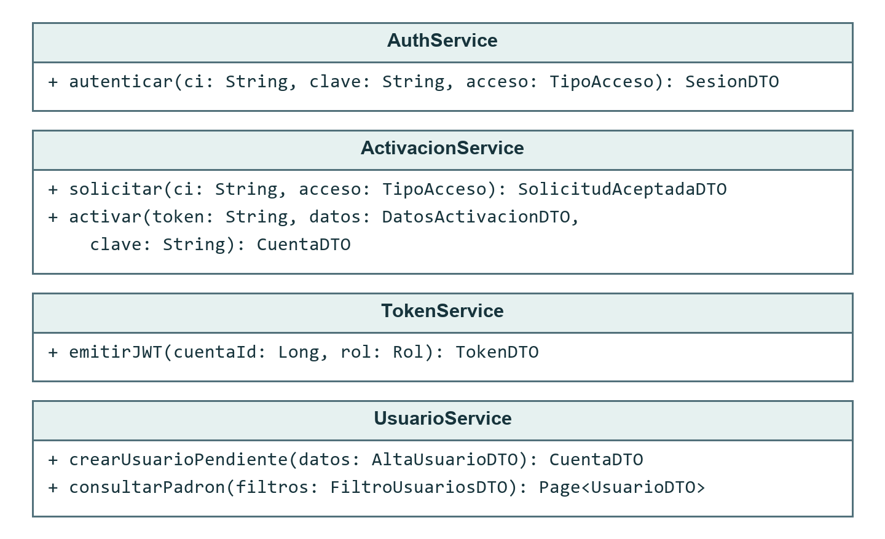

*Figura 1. Servicios de acceso, activación y gestión de cuentas (S01, S02, S17 y S19).*

AuthService autentica; ActivacionService gestiona el primer ingreso. TokenService emite el token y UsuarioService mantiene las cuentas del padrón.

## **2.2. Agenda, consultas, cancelaciones y llegada**

*Figura 2. Servicios de agenda, cancelación y aviso de llegada (S03-S05, S10, S12 y S23-S25).*

AgendaService concentra disponibilidad, reserva y consultas de agenda. En agendar, paseId puede ser nulo cuando la especialidad no exige pase. CancelacionService distingue los tres actores que pueden cancelar. CancelacionMedicoDTO incluye el alcance, el motivo y el identificador de la consulta o del turno afectado.

## **2.3. Planificación de turnos**

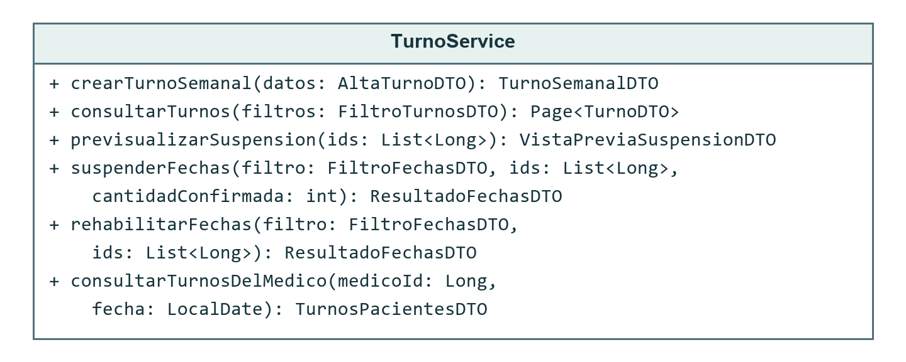

*Figura 3. Servicio de turnos semanales y fechas concretas (S07-S09, S11 y S13).*

La suspensión presenta previamente las fechas y la cantidad de consultas afectadas. Al confirmar, cantidadConfirmada permite detectar un cambio concurrente y solicitar una nueva confirmación, como muestra S08.

## **2.4. Atención clínica y pases**

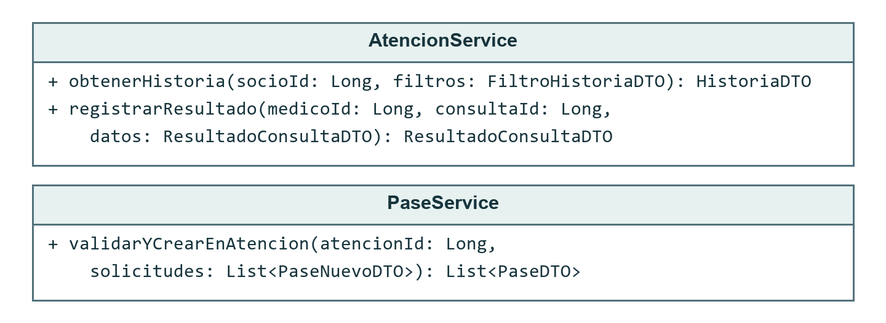

*Figura 4. Servicios de historia clínica, resultados y pases (S06, S14 y S15).*

AtencionService obtiene la historia desde las atenciones y registra el resultado de una consulta. PaseService valida y crea los pases dentro de la misma operación de atención.

## **2.5. Catálogos**

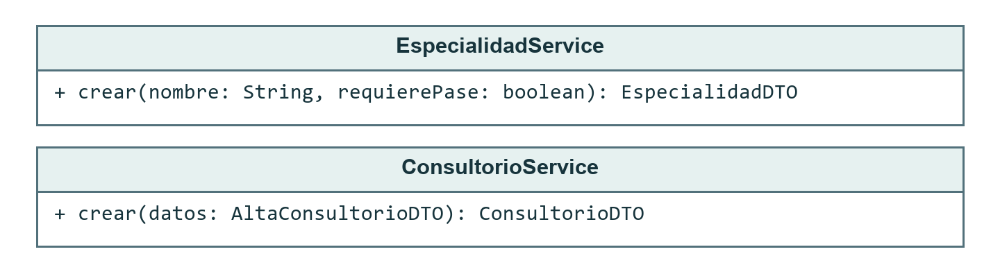

*Figura 5. Servicios de especialidades y consultorios (S16 y S18).*

Las altas aplican las reglas de unicidad de cada catálogo antes de confirmar su persistencia.

## **2.6. Estadísticas**

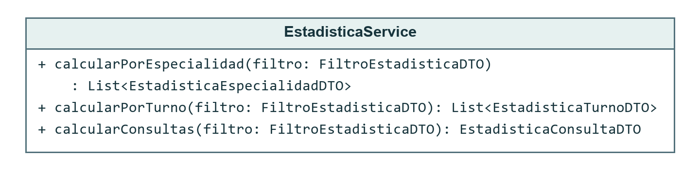

*Figura 6. Servicio de estadísticas (S20-S22).*

EstadisticaService reúne las tres consultas agregadas que utiliza el administrador.

##  

## **2.7. Notificaciones**

*Figura 7. Servicio de notificación utilizado por los flujos críticos.*

NotificacionService registra avisos pendientes; la entrega externa ocurre después de confirmar la operación de negocio.

# 3. Diagramas de secuencia de casos de uso críticos

En este capítulo se presentan los diagramas de secuencia de los casos de uso considerados críticos por el Grupo 4. Se utiliza la estructura Actor → Controlador → Servicio → Persistencia / subsistema colaborador, incluyendo el orden de los mensajes y las principales validaciones y operaciones transaccionales.

Se incorporan además las cancelaciones realizadas por socio, funcionario y médico (RF-10, RF-19 y RF-27), que se priorizaron para el diseño del backend. El nivel de detalle de los mensajes representa colaboraciones del servidor; no describe la presentación de pantallas web o móviles.

## 3.1. Todos los roles

### 3.1.1. CU 3.1.1 - Iniciar sesión

Actor: Todos los roles \| Requerimiento: RF-01 \| Subsistema: auth / security

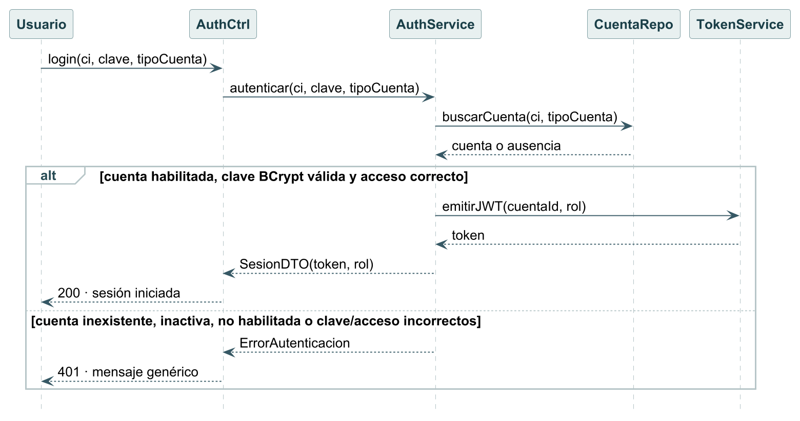

*Diagrama de secuencia S01 · CU 3.1.1 - Iniciar sesión*

> Descripción del flujo. El acceso comienza con la cédula, contraseña y tipo de cuenta. AuthService obtiene las credenciales, verifica BCrypt, comprueba el estado de habilitación y coordina la entrega de tokens al controlador.
>
> Regla de negocio. Alternativa: cuenta inexistente, inactiva o contraseña inválida → 401 genérico. El rol queda determinado por la cuenta, no por la pantalla.
>
> Variantes y validaciones. Si la contraseña es incorrecta, la cuenta no existe, no fue activada o se encuentra inhabilitada, la respuesta no revela datos de la identidad.

### 3.1.2. CU 3.1.2 - Primer ingreso

Actor: Socio o empleado \| Requerimiento: RF-02 \| Subsistema: auth / usuario

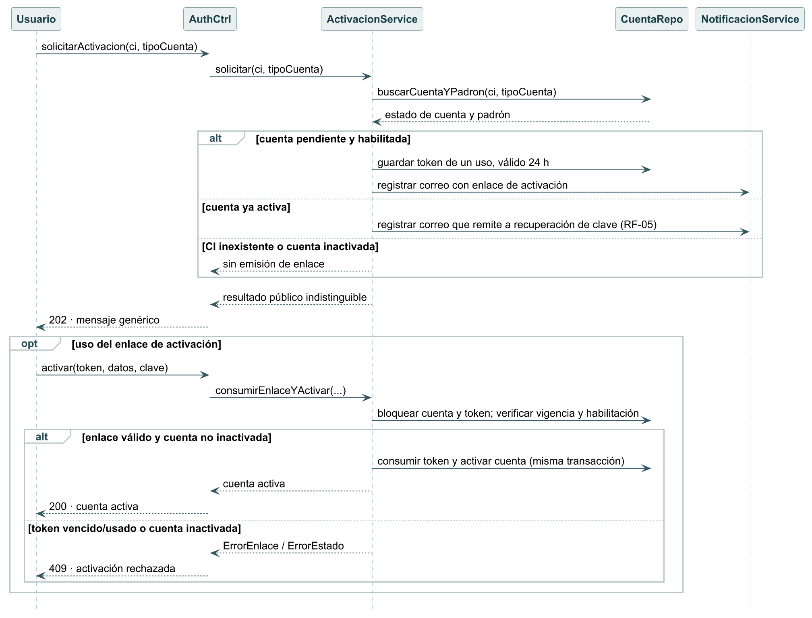

*Diagrama de secuencia S02 · CU 3.1.2 - Primer ingreso*

> Descripción del flujo. ActivacionService, únicamente a solicitud del titular y desde el acceso correcto, consulta el padrón, emite enlace de un solo uso de 24 horas y solicita encolado del correo. El sistema responde siempre con el mismo texto incluso cuando la CI no existe. Si la cuenta ya está activa, mantiene esa respuesta pública y el correo remite a la recuperación de contraseña prevista en RF-05. Al utilizar el enlace válido, consume token y activa cuenta en la misma transacción, verificando que no haya inactivación administrativa.
>
> Regla de negocio. Alternativa: enlace vencido/usado o cuenta inactivada → activación rechazada; ninguna respuesta inicial permite enumerar cédulas.
>
> Variantes y validaciones. El enlace vencido o ya utilizado no habilita la cuenta. El primer ingreso no modifica las inactivaciones realizadas por administración.

## 3.2. Rol Socio

### 3.2.1. CU 3.2.1 - Consultar disponibilidad

Actor: Socio \| Requerimiento: RF-08 \| Subsistema: consulta / turno

*Diagrama de secuencia S03 · CU 3.2.1 - Consultar disponibilidad*

> Descripción del flujo. AgendaService obtiene números de turnos activos dentro de la ventana admitida, consulta su ocupación y devuelve las alternativas que cumplen especialidad, profesional y fechas solicitadas.
>
> Regla de negocio. La disponibilidad es informativa. Los límites, la vigencia del pase y la ocupación se vuelven a comprobar al confirmar.
>
> Variantes y validaciones. Los filtros inválidos se rechazan. La consulta no bloquea números y no garantiza que sigan libres al confirmar.

### 3.2.2. CU 3.2.2 - Agendar consulta

Actor: Socio \| Requerimiento: RF-09 \| Subsistema: consulta / pase

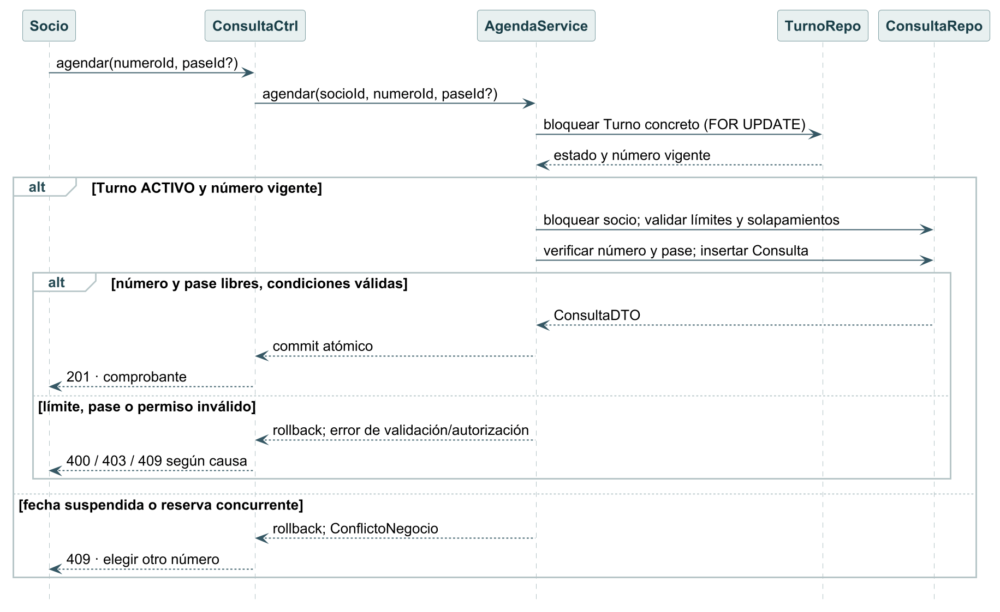

*Diagrama de secuencia S04 · CU 3.2.2 - Agendar consulta*

> Descripción del flujo. AgendaService inicia una transacción y adquiere bloqueo pesimista FOR UPDATE del Turno concreto antes de verificar que sigue ACTIVO. El mismo registro debe bloquearlo TurnoService al suspender fechas, con el mismo orden de bloqueo; después se protege la cuenta del socio y se validan límites, disponibilidad, pase y solapamientos. Solo entonces se inserta la consulta. Los índices únicos previenen reservas concurrentes restantes; cualquier conflicto revierte todo.
>
> Regla de negocio. Los índices únicos parciales resuelven la carrera por número y pase. Si falla una validación, se revierte toda la transacción.
>
> Variantes y validaciones. Si el número o el pase resultan ocupados, se deshacen los cambios y se responde con un conflicto de negocio.

Concurrencia adicional. La transacción de agendar y la de suspender adquieren el bloqueo del mismo Turno concreto (SELECT ... FOR UPDATE). Una lee el estado actualizado tras el commit de la otra. Si el turno quedó suspendido, agendar devuelve HTTP 409 y no crea la consulta.

### 3.2.3. CU 3.2.3 - Consultar historial de agendas

Actor: Socio \| Requerimiento: RF-11 \| Subsistema: consulta

*Diagrama de secuencia S05 · CU 3.2.3 - Consultar historial de agendas*

> Descripción del flujo. AgendaService recupera todas las consultas del socio con los filtros recibidos y complementa sus datos con la presencia diaria. Los estados de cierre de jornada se obtienen como valores calculados.
>
> Regla de negocio. NO_ASISTIO y NO_ATENDIDA son resultados derivados de la fecha y del aviso de llegada; no se almacenan como estados.
>
> Variantes y validaciones. El historial conserva cancelaciones y calcula “No asistió” o “No atendida” solamente después de finalizar el día.

### 3.2.4. CU 3.2.4 - Consultar historia clínica

Actor: Socio \| Requerimiento: RF-12 \| Subsistema: atencion

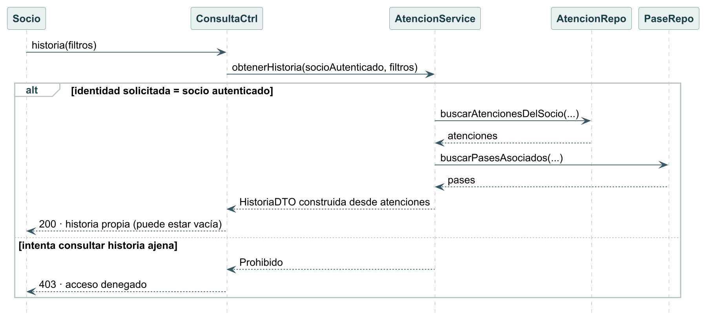

*Diagrama de secuencia S06 · CU 3.2.4 - Consultar historia clínica*

> Descripción del flujo. AtencionService autoriza la identidad del socio antes de recuperar sus atenciones y los pases asociados. La respuesta se construye sin una tabla duplicada de historia clínica.
>
> Regla de negocio. La historia se construye desde las atenciones. Ninguna solicitud puede acceder a datos clínicos de otra persona.
>
> Variantes y validaciones. Se rechaza cualquier solicitud que intente consultar la historia de una persona diferente de la autenticada.

### 3.2.5. RF-10 - Cancelar por el socio

Actor: Socio \| Requerimiento: RF-10 \| Subsistema: consulta / pase

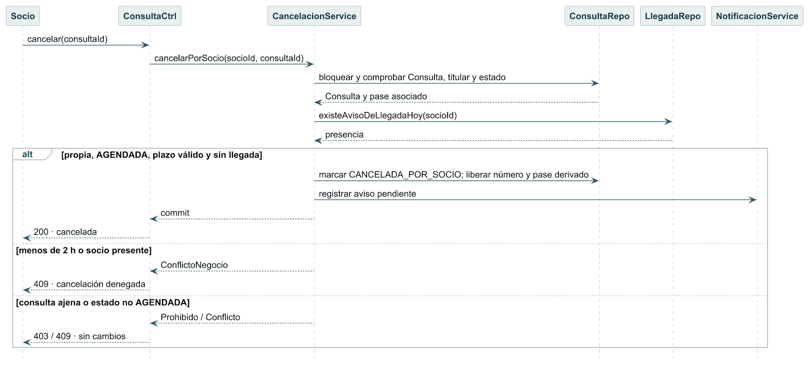

*Diagrama de secuencia S23 · RF-10 - Cancelar por el socio*

> Descripción del flujo. CancelacionService verifica que la reserva pertenezca al socio, su estado y su anticipación. Actualiza la consulta y deja disponible el pase por la regla de consumo derivado, si corresponde.
>
> Regla de negocio. Debe respetar la anticipación mínima y no existir llegada registrada ese día; se preserva el vínculo histórico con el pase.
>
> Variantes y validaciones. El socio debe cancelar dentro del plazo y sin aviso de llegada ese día; el pase sigue teniendo la misma fecha original de vencimiento.

## 3.3. Rol Funcionario

### 3.3.1. CU 3.3.1 - Alta de turno semanal

Actor: Funcionario \| Requerimiento: RF-13 \| Subsistema: turno

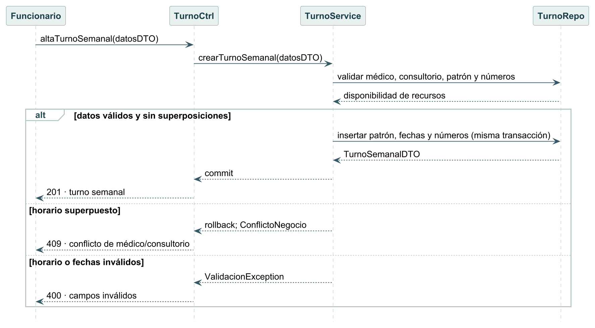

*Diagrama de secuencia S07 · CU 3.3.1 - Alta de turno semanal*

> Descripción del flujo. TurnoService valida el patrón semanal, los números y las condiciones del profesional y consultorio. Solo después persiste conjuntamente el patrón y las fechas concretas que genera.
>
> Regla de negocio. Se comprueban superposiciones por profesional y consultorio. El cupo es la cantidad de números definidos por turno.
>
> Variantes y validaciones. Si el horario se superpone con otro turno de médico o consultorio, se revierte el patrón completo.

### 3.3.2. CU 3.3.2 - Suspender fechas

Actor: Funcionario \| Requerimiento: RF-14 \| Subsistema: turno / consulta

*Diagrama de secuencia S08 · CU 3.3.2 - Suspender fechas*

> Descripción del flujo. El funcionario busca turnos concretos mediante RF-17 (médico, especialidad, rango de fechas y estado) y selecciona los turnos activos que desea suspender. Antes de confirmar, se muestran las fechas y la cantidad de consultas Agendadas que se cancelarán. Al confirmar, TurnoService bloquea los turnos seleccionados y comprueba nuevamente su estado y la cantidad de consultas afectadas; si esta cambió, se solicita una nueva confirmación antes de aplicar cambios. Luego registra la suspensión y solicita a ConsultasDelTurno las cancelaciones institucionales y la devolución de pases en una misma transacción. Los avisos se registran antes de confirmar esa transacción e incluyen la observación opcional.
>
> Regla de negocio. La suspensión es inmediata y transaccional; se conserva el patrón semanal y no se borran consultas históricas.
>
> Variantes y validaciones. La suspensión comprende los números de fechas seleccionadas y las cancelaciones institucionales correspondientes.

### 3.3.3. CU 3.3.3 - Rehabilitar fechas

Actor: Funcionario \| Requerimiento: RF-15 \| Subsistema: turno

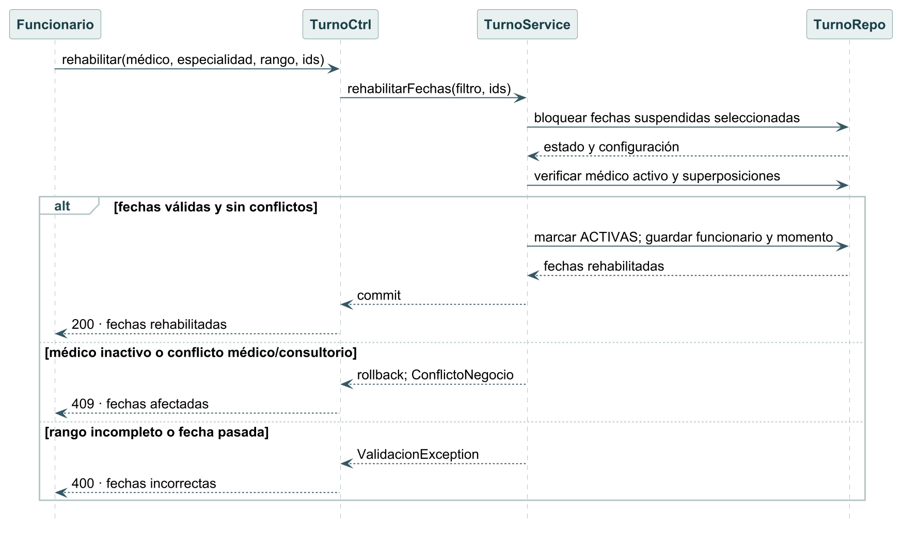

*Diagrama de secuencia S09 · CU 3.3.3 - Rehabilitar fechas*

> Descripción del flujo. TurnoService consulta el estado de cada fecha suspendida, comprueba que el médico esté activo y verifica nuevamente conflictos de médico y consultorio. Si no existen, registra el evento y rehabilita la fecha sin modificar números.
>
> Regla de negocio. Si existe un conflicto, se devuelve 409 sin modificar la fecha. Nunca se restauran las agendas canceladas por suspensión.
>
> Variantes y validaciones. Una superposición detectada al rehabilitar produce rechazo, sin cancelar agendas ajenas ni alterar horarios.

### 3.3.4. CU 3.3.4 - Registrar aviso de llegada

Actor: Funcionario \| Requerimiento: RF-16 \| Subsistema: consulta

*Diagrama de secuencia S10 · CU 3.3.4 - Registrar aviso de llegada*

> Descripción del flujo. LlegadaService identifica al socio por CI, descarta el conflicto de interés del funcionario y comprueba consultas agendadas en el día. El repositorio conserva el aviso inicial ante un segundo intento. La fecha del aviso se obtiene del servidor.
>
> Regla de negocio. La unicidad es por socio y día. Un registro repetido conserva la primera hora y el primer funcionario.
>
> Variantes y validaciones. Ante aviso duplicado se conserva el primer registro; sin reserva de hoy no se crea aviso.

Verificación adicional. Para crear la llegada se consulta ConsultaRepository.buscarAgendadasHoy(ci). En caso de registro duplicado, la clave única (socioId, fecha) conserva hora y funcionario originales; 200 con el registro existente, no sobreescritura.

### 3.3.5. CU 3.3.5 - Consultar turnos

Actor: Funcionario \| Requerimiento: RF-17 \| Subsistema: turno

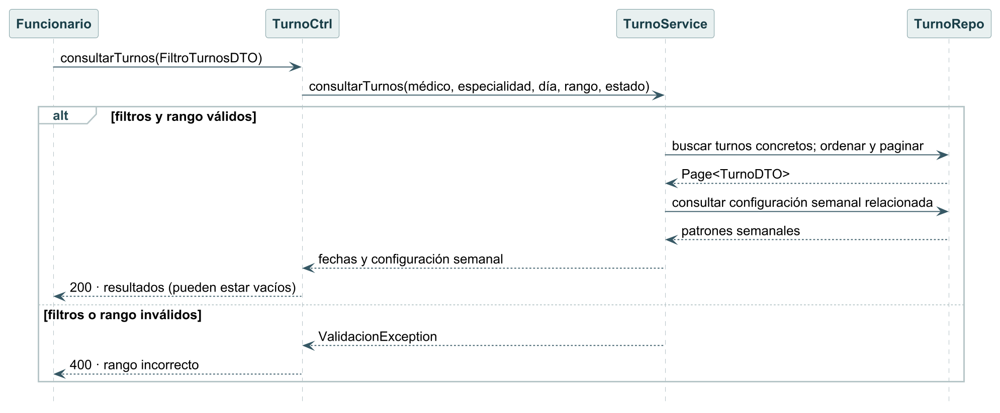

*Diagrama de secuencia S11 · CU 3.3.5 - Consultar turnos*

> Descripción del flujo. TurnoService recibe FiltroTurnosDTO con médico, especialidad, día de la semana, fechaDesde, fechaHasta y estado. TurnoRepository consulta el rango completo, ordena y pagina turnos concretos, y permite consultar la configuración semanal (RF-17).
>
> Regla de negocio. Consulta de solo lectura. Se distinguen configuraciones semanales de turnos concretos por fecha y estado.
>
> Variantes y validaciones. La respuesta distingue el patrón de las fechas generadas, con búsqueda y ordenamiento.

### 3.3.6. CU 3.3.6 - Consultar agendas

Actor: Funcionario \| Requerimiento: RF-18 \| Subsistema: consulta

*Diagrama de secuencia S12 · CU 3.3.6 - Consultar agendas*

> Descripción del flujo. AgendaService consulta agendas con FiltroAgendaDTO (CI, identificador de consulta, fecha, médico, estado, aviso de llegada), consulta LlegadaRepository por socio y fecha y devuelve el detalle operativo, sin exponer historia clínica (RF-18). No se inventa un requisito de rango para RF-18: el rango corresponde expresamente a RF-14, RF-15 y RF-17.
>
> Regla de negocio. Se muestra la información operativa de agenda y llegada, pero no se exponen anotaciones clínicas.
>
> Variantes y validaciones. El resultado expone situación administrativa y presencia del socio, sin datos clínicos.

### 3.3.7. RF-19 - Cancelar por funcionario

Actor: Funcionario \| Requerimiento: RF-19 \| Subsistema: consulta / pase

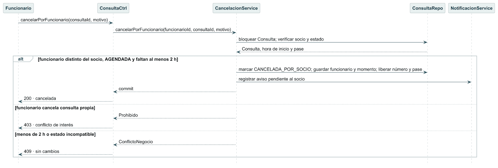

*Diagrama de secuencia S24 · RF-19 - Cancelar por funcionario*

> Descripción del flujo. CancelacionService ejecuta la cancelación solicitada por el socio mediante un funcionario distinto de esa persona, conservando quién realizó materialmente el cambio. Antes de cancelarla comprueba que la consulta siga Agendada y falten al menos dos horas para su inicio; devuelve el pase utilizado según RF-09 y registra la notificación al socio.
>
> Regla de negocio. Aunque la solicita el socio, el responsable material es el funcionario que la procesa.
>
> Variantes y validaciones. La operación a pedido del socio almacena al funcionario ejecutor, aunque la categoría de cancelación sea “por el socio”.

## 3.4. Rol Médico

### 3.4.1. CU 3.4.1 - Turnos y pacientes de una fecha

Actor: Médico \| Requerimiento: RF-21 \| Subsistema: turno / consulta

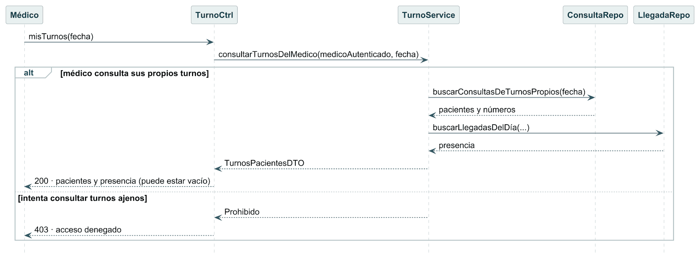

*Diagrama de secuencia S13 · CU 3.4.1 - Turnos y pacientes de una fecha*

> Descripción del flujo. TurnoService obtiene únicamente los turnos correspondientes al médico autenticado, consulta los pacientes asignados y agrega los avisos de llegada para el listado diario.
>
> Regla de negocio. El orden numérico no impone una cola rígida. El médico determina el orden de atención de los pacientes.
>
> Variantes y validaciones. El médico solo consulta turnos propios; la numeración sirve para identificar franjas y no fija un orden de llamado.

### 3.4.2. CU 3.4.2 - Registrar resultado

Actor: Médico \| Requerimiento: RF-23 \| Subsistema: atencion / consulta

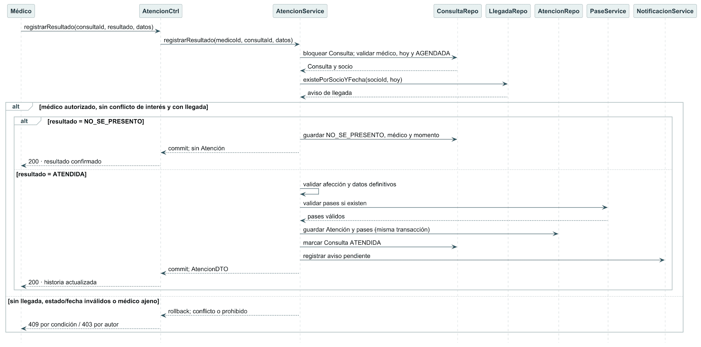

*Diagrama de secuencia S14 · CU 3.4.2 - Registrar resultado*

> Descripción del flujo. AtencionService bloquea la Consulta, valida médico asignado, fecha actual, estado AGENDADA y que el médico no sea el socio. Consulta explícitamente LlegadaRepository.existePorSocioYFecha(socioId, hoy), indispensable en ambas ramas. Con NO_SE_PRESENTO solo registra el estado definitivo, el médico y el momento; con ATENDIDA valida afección, guarda Atención y pases en la misma transacción y notifica después del commit.
>
> Regla de negocio. NO_SE_PRESENTO solo modifica el resultado definitivo. ATENDIDA guarda registro clínico y, si corresponde, sus pases.
>
> Variantes y validaciones. El resultado “No se presentó a la consulta” es definitivo y no crea Atención; el resultado “Atendida” sí la crea.

Secuencia alternativa explícita. ATENDIDA requiere afección y, si existen, pases válidos; NO_SE_PRESENTO solo actualiza Consulta con el resultado, el médico y el momento. Ambas requieren aviso de llegada de hoy; ausencia de llegada genera 409, y médico no autorizado 403.

### 3.4.3. CU 3.4.3 - Registrar pases

Actor: Médico \| Requerimiento: RF-24 \| Subsistema: atencion / pase

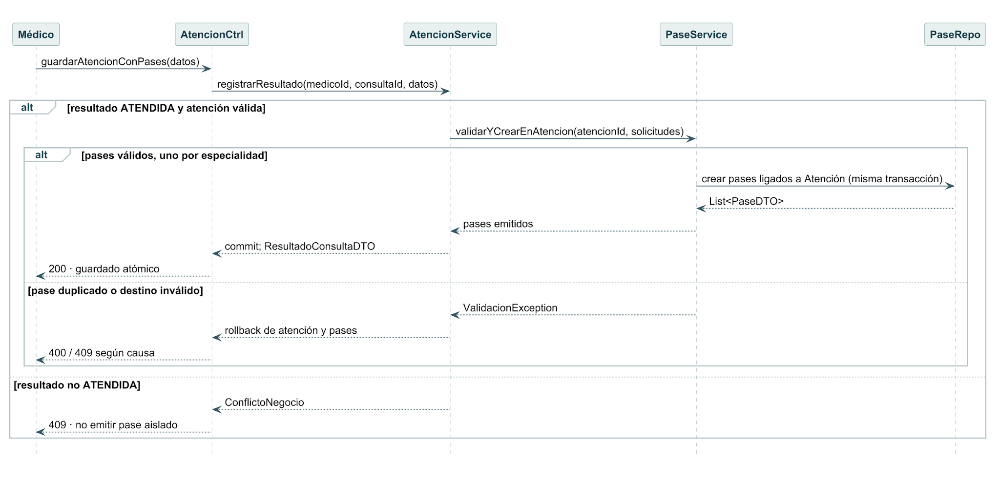

*Diagrama de secuencia S15 · CU 3.4.3 - Registrar pases*

> Descripción del flujo. La solicitud incluye los datos definitivos de atención y, opcionalmente, uno o más pases, con un máximo de uno por especialidad. PaseService valida destinos, vigencia y duplicados antes de insertar las autorizaciones en la misma transacción.
>
> Regla de negocio. Los pases nacen junto a la atención, no por alta aislada. Su vencimiento está asociado al permiso de especialidad.
>
> Variantes y validaciones. Los pases se insertan en el guardado definitivo de la atención; una validación fallida revierte también la atención.

### 3.4.4. RF-27 - Cancelación por médico

Actor: Médico \| Requerimiento: RF-27 \| Subsistema: consulta / turno

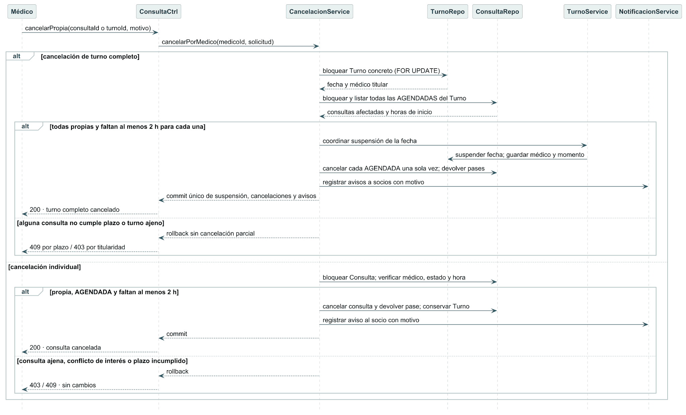

*Diagrama de secuencia S25 · RF-27 - Cancelación por médico*

> Descripción del flujo. CancelacionService valida que la consulta o el turno pertenezcan al médico autenticado y que cada consulta Agendada afectada respete las dos horas de anticipación. Para cancelar el turno completo, bloquea primero el Turno concreto y, en una misma transacción, suspende la fecha y cancela una sola vez sus consultas Agendadas, devuelve los pases utilizados y registra los avisos con el motivo. La cancelación individual no suspende la fecha.
>
> Regla de negocio. La cancelación individual no suspende el turno; la cancelación total puede suspender la fecha sin restituir agendas anteriores.
>
> Variantes y validaciones. Para cancelación total se valida cada número afectado. La suspensión de una fecha puede implicar cancelaciones institucionales.

## 3.5. Rol Administrador

### 3.5.1. CU 3.5.1 - Alta individual de especialidades

Actor: Administrador \| Requerimiento: RF-29 \| Subsistema: especialidad

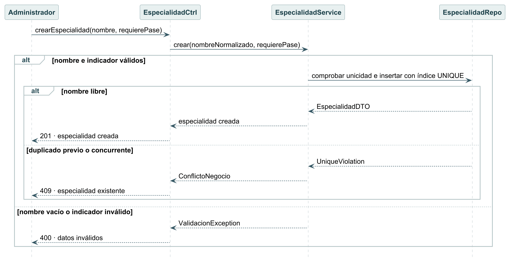

*Diagrama de secuencia S16 · CU 3.5.1 - Alta individual de especialidades*

> Descripción del flujo. EspecialidadService recibe el identificador de especialidad y la indicación de si requiere pase, verifica la unicidad y solicita su persistencia.
>
> Regla de negocio. El catálogo contiene el indicador requierePase, utilizado posteriormente para la validación del agendamiento.
>
> Variantes y validaciones. La operación rechaza un identificador duplicado y conserva el indicador de obligación de pase.

Concurrencia adicional. Un índice UNIQUE sobre la clave normalizada de especialidad es obligatorio; dos inserciones simultáneas del mismo valor producen una sola alta y HTTP 409 para la perdedora, además de la comprobación previa.

### 3.5.2. CU 3.5.2 - Alta individual de usuarios

Actor: Administrador \| Requerimiento: RF-31 \| Subsistema: usuario

*Diagrama de secuencia S17 · CU 3.5.2 - Alta individual de usuarios*

> Descripción del flujo. UsuarioService valida CI, identidad y roles previos; reutiliza Persona cuando existe y persiste la Cuenta pendiente de primer ingreso en transacción. Devuelve 201 sin mandar correo. La solicitud de activación y el envío se encuentran en S02 (RF-02), no en S17 (RF-31).
>
> Regla de negocio. Una misma Persona puede tener cuenta de socio y de empleado, según las restricciones del padrón. RF-31 NO envía correo: la cuenta queda pendiente. Solo cuando el titular solicita el primer ingreso (RF-02), ActivacionService emite y NotificacionService encola el enlace de uso único válido por 24 horas.
>
> Variantes y validaciones. Se permite la misma Persona con cuenta socio y empleado, sin crear identidades distintas; se evita la duplicación de empleado habilitado.

### 3.5.3. CU 3.5.3 - Alta individual de consultorios

Actor: Administrador \| Requerimiento: RF-33 \| Subsistema: consultorio

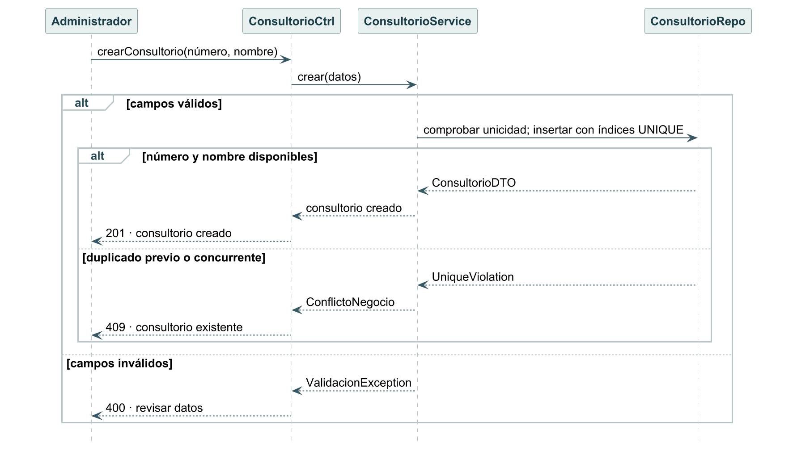

*Diagrama de secuencia S18 · CU 3.5.3 - Alta individual de consultorios*

> Descripción del flujo. ConsultorioService comprueba el identificador y el nombre o número único del consultorio antes de su alta, manteniéndolo disponible para la planificación médica.
>
> Regla de negocio. El consultorio es un recurso sujeto a control de superposición en la planificación semanal.
>
> Variantes y validaciones. Se valida la unicidad del identificador del consultorio antes de guardar.

Concurrencia adicional. El nombre y/o número único normalizados se protegen mediante restricciones UNIQUE persistidas en PostgreSQL. Se captura el error de unicidad y se devuelve HTTP 409, sin crear duplicados.

### 3.5.4. CU 3.5.4 - Consultar usuarios

Actor: Administrador \| Requerimiento: RF-35 \| Subsistema: usuario

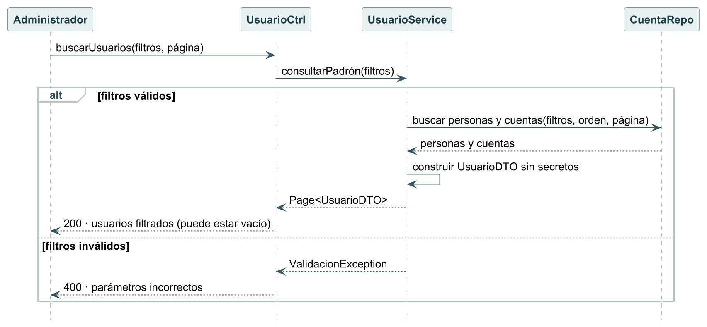

*Diagrama de secuencia S19 · CU 3.5.4 - Consultar usuarios*

> Descripción del flujo. UsuarioService aplica criterios de consulta sobre personas y cuentas; el repositorio ejecuta filtros, orden y paginación y se construyen DTO con información autorizada.
>
> Regla de negocio. No se envían hashes, tokens de activación ni otros secretos en los DTO de salida.
>
> Variantes y validaciones. El DTO nunca entrega hashes, claves ni valores de enlace para activación.

### 3.5.5. CU 3.5.5 - Estadísticas por especialidad

Actor: Administrador \| Requerimiento: RF-39 \| Subsistema: estadistica

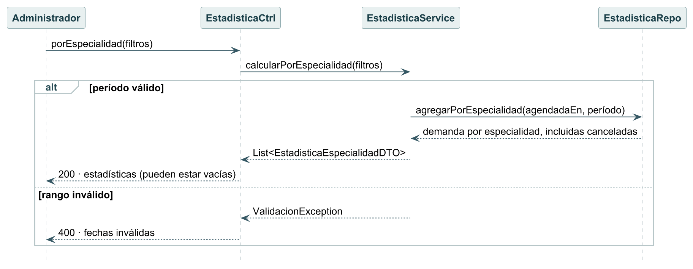

*Diagrama de secuencia S20 · CU 3.5.5 - Estadísticas por especialidad*

> Descripción del flujo. EstadisticaService valida el período y consulta agregaciones por especialidad utilizando las fechas de agendamiento, para presentar indicadores de demanda.
>
> Regla de negocio. La demanda contempla las consultas canceladas según el criterio de agendadaEn del RF-39.
>
> Variantes y validaciones. La agrupación utiliza la fecha de agenda de la consulta; las cancelaciones pueden integrar la demanda según RF-39.

### 3.5.6. CU 3.5.6 - Estadísticas por turno

Actor: Administrador \| Requerimiento: RF-40 \| Subsistema: estadistica

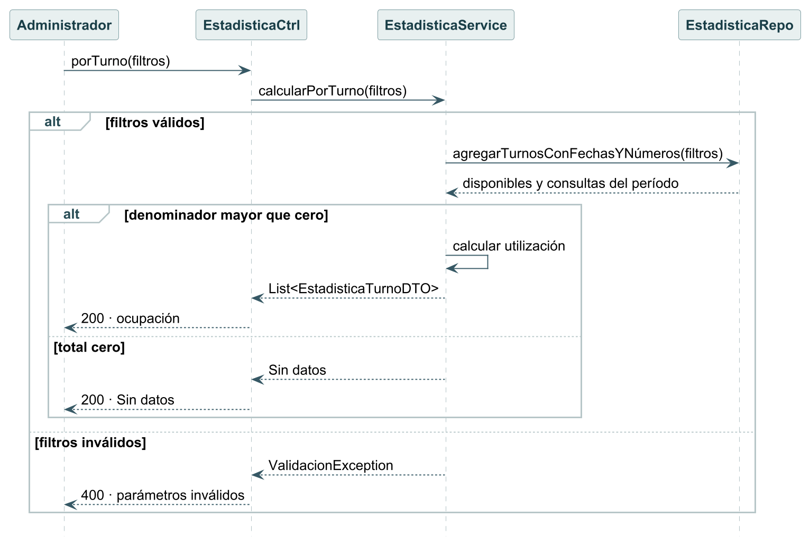

*Diagrama de secuencia S21 · CU 3.5.6 - Estadísticas por turno*

> Descripción del flujo. EstadisticaService cruza las fechas de turnos y los números disponibles con las consultas del período; a partir de los resultados calcula la utilización definida por el requerimiento.
>
> Regla de negocio. La ocupación considera la disponibilidad y las fechas concretas. Si el total es cero se devuelve “Sin datos”.
>
> Variantes y validaciones. Si un período no ofrece denominador válido, el servicio responde “Sin datos” en lugar de dividir entre cero.

### 3.5.7. CU 3.5.7 - Estadísticas de consultas

Actor: Administrador \| Requerimiento: RF-41 \| Subsistema: estadistica

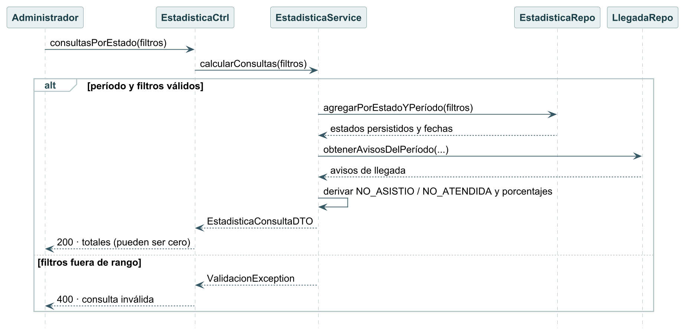

*Diagrama de secuencia S22 · CU 3.5.7 - Estadísticas de consultas*

> Descripción del flujo. EstadisticaService agrupa resultados administrativos y completa la clasificación con los avisos de llegada; calcula porcentajes sin persistir los estados derivados.
>
> Regla de negocio. El cálculo incluye NO_ASISTIO y NO_ATENDIDA sin persistir esos valores en Consulta.estado.
>
> Variantes y validaciones. Los resultados finales se calculan mediante el estado registrado, el vencimiento del día y los avisos de llegada.

# 4. Decisiones transversales del backend

## 4.1. Transacciones y concurrencia

Las operaciones que involucran más de una entidad se agrupan en transacciones de negocio. Los parámetros configurables se obtienen de la tabla parametros_sistema. El servicio delimita el trabajo atómico y los repositorios ejecutan SQL explícito bajo el contexto transaccional de Spring. La validación previa por sí sola no garantiza exclusividad: PostgreSQL debe imponer índices únicos parciales para número y pase cuando la consulta no esté cancelada.

Política de bloqueo de agenda y suspensión: ambas rutas adquieren en primer lugar los registros Turno concretos en orden ascendente de ID, mediante SELECT ... FOR UPDATE. Para agendar, después se bloquea el socio y, cuando aplique, el pase. Los bloqueos transaccionales se liberan al commit/rollback. Esta convención previene el cruce entre reservar y suspender y reduce interbloqueos. La condición de Turno activo se comprueba dentro de la sección crítica.

## 

| **Operación**         | **Efecto atómico**                                                                                               |
|-----------------------|------------------------------------------------------------------------------------------------------------------|
| Alta de turno semanal | Persistencia de patrón, números semanales, fechas concretas y números concretos.                                 |
| Agendar consulta      | Bloqueo del socio, validación de límites y pase, inserción de consulta y avisos pendientes.                      |
| Cancelar consulta     | Actualización del estado, autor y momento; liberación lógica del número/pase y registro de avisos.               |
| Suspender fechas      | Cambio de estado, registro del funcionario y del momento y cancelación institucional de las consultas afectadas. |
| Atender consulta      | Registro del resultado, atención clínica, pases y notificación de actualización.                                 |
| Primer ingreso        | Consumo de enlace de un uso, hash de contraseña, datos obligatorios y activación.                                |

##  

## 4.2. Estados e historial

Los estados persistidos de Consulta son Agendada, Atendida, Cancelada por el socio, Cancelada por la institución y No se presentó a la consulta. Los estados No asistió y No atendida se derivan después de que termine el día cuando no exista resultado definitivo, tomando en cuenta el aviso de llegada. La cancelación conserva el registro histórico; no implica eliminación física.

## 4.3. Seguridad y protección de información clínica

Spring Security controla el acceso por rol y el estado actual de habilitación de la cuenta en cada solicitud protegida. Los JWT firmados no sustituyen la comprobación de una cuenta o sesión revocada. Se aplica BCrypt para las contraseñas; los tokens de recuperación se guardan mediante hashes. Las decisiones de autorización para datos clínicos se evalúan en los servicios y no únicamente en la interfaz.

El médico puede consultar historia clínica de un paciente con consulta propia agendada cuyo día todavía no ha finalizado, aun sin aviso de llegada. Para registrar la atención, en cambio, se exige la consulta correspondiente al día y la presencia previamente registrada. Los registros técnicos no contienen secretos ni anotaciones clínicas.

## 4.4. Notificaciones y horarios

La generación de notificaciones se registra con la operación de negocio; las entregas por SMTP y Firebase se procesan tras confirmar la transacción. Una falla del proveedor externo no revierte cambios ya confirmados. El sistema emplea America/Montevideo para reglas del calendario asistencial y conserva las fechas y horas registradas con información de zona horaria.

## 4.5. Interacción con la API y errores

Los controladores reciben DTO validados y devuelven JSON sin exponer entidades internas ni hashes. Las respuestas de error distinguen entrada inválida (400), autenticación (401), autorización (403), recurso no visible (404), conflicto de negocio o unicidad (409) y error interno (500). El mensaje de error evita revelar SQL o datos clínicos.

Códigos de error en fragmentos UML alt: 400 para datos inválidos; 401 autenticación fallida; 403 rol o propiedad del recurso no autorizado; 404 recurso inexistente si procede; 409 para estado incompatible, disponibilidad concurrente y unicidad; 500 solo para fallas inesperadas. Los controladores mapean excepciones tipadas sin exponer información privada.

# 5. Trazabilidad y verificación

## 5.1. Correspondencia entre casos críticos y diagramas

## 

| **Caso** | **RF** | **Caso de uso**                   | **Módulo**          | **DSS** |
|----------|--------|-----------------------------------|---------------------|---------|
| CU 3.1.1 | RF-01  | Iniciar sesión                    | auth / security     | S01     |
| CU 3.1.2 | RF-02  | Primer ingreso                    | auth / usuario      | S02     |
| CU 3.2.1 | RF-08  | Consultar disponibilidad          | consulta / turno    | S03     |
| CU 3.2.2 | RF-09  | Agendar consulta                  | consulta / pase     | S04     |
| CU 3.2.3 | RF-11  | Consultar historial de agendas    | consulta            | S05     |
| CU 3.2.4 | RF-12  | Consultar historia clínica        | atencion            | S06     |
| RF-10    | RF-10  | Cancelar por el socio             | consulta / pase     | S23     |
| CU 3.3.1 | RF-13  | Alta de turno semanal             | turno               | S07     |
| CU 3.3.2 | RF-14  | Suspender fechas                  | turno / consulta    | S08     |
| CU 3.3.3 | RF-15  | Rehabilitar fechas                | turno               | S09     |
| CU 3.3.4 | RF-16  | Registrar aviso de llegada        | consulta            | S10     |
| CU 3.3.5 | RF-17  | Consultar turnos                  | turno               | S11     |
| CU 3.3.6 | RF-18  | Consultar agendas                 | consulta            | S12     |
| RF-19    | RF-19  | Cancelar por funcionario          | consulta / pase     | S24     |
| CU 3.4.1 | RF-21  | Turnos y pacientes de una fecha   | turno / consulta    | S13     |
| CU 3.4.2 | RF-23  | Registrar resultado               | atencion / consulta | S14     |
| CU 3.4.3 | RF-24  | Registrar pases                   | atencion / pase     | S15     |
| RF-27    | RF-27  | Cancelación por médico            | consulta / turno    | S25     |
| CU 3.5.1 | RF-29  | Alta individual de especialidades | especialidad        | S16     |
| CU 3.5.2 | RF-31  | Alta individual de usuarios       | usuario             | S17     |
| CU 3.5.3 | RF-33  | Alta individual de consultorios   | consultorio         | S18     |
| CU 3.5.4 | RF-35  | Consultar usuarios                | usuario             | S19     |
| CU 3.5.5 | RF-39  | Estadísticas por especialidad     | estadistica         | S20     |
| CU 3.5.6 | RF-40  | Estadísticas por turno            | estadistica         | S21     |
| CU 3.5.7 | RF-41  | Estadísticas de consultas         | estadistica         | S22     |

## 5.2. Escenarios de validación

| **Escenario**                                         | **Resultados esperados**                                                                                                                                                                                                                                  |
|-------------------------------------------------------|-----------------------------------------------------------------------------------------------------------------------------------------------------------------------------------------------------------------------------------------------------------|
| Doble reserva del mismo número                        | Solo una transacción es confirmada; la otra se rechaza por conflicto.                                                                                                                                                                                     |
| Dos reservas simultáneas del mismo socio              | No se superan los límites de tres activas ni una por especialidad.                                                                                                                                                                                        |
| Pase usado y cancelación válida                       | Se conserva historial y solo se puede reutilizar mientras siga vigente.                                                                                                                                                                                   |
| Consulta Atendida o No se presentó                    | No se libera el número ni el pase asociado.                                                                                                                                                                                                               |
| Suspensión con reservas                               | Se cancelan todas las agendas afectadas o se revierte la operación completa.                                                                                                                                                                              |
| Rehabilitación con superposición                      | Se rechaza sin alterar agendas de otro médico o consultorio.                                                                                                                                                                                              |
| Aviso de llegada duplicado                            | No cambian la hora ni el funcionario original.                                                                                                                                                                                                            |
| Cuenta inactivada con JWT vigente                     | La siguiente solicitud protegida es rechazada.                                                                                                                                                                                                            |
| Proveedor de correo o push caído                      | La operación de negocio permanece confirmada y el envío queda pendiente.                                                                                                                                                                                  |
| Historia clínica de otra persona                      | El servicio rechaza acceso no autorizado.                                                                                                                                                                                                                 |
| Reserva concurrente con suspensión de fecha           | Ambas transacciones bloquean el mismo Turno (FOR UPDATE); si la suspensión se confirma primero, agendar rechaza HTTP 409; si agenda primero, la suspensión la cancela institucionalmente en una operación atómica y se devuelve el pase conforme a RF-09. |
| Dos administradores dan de alta la misma especialidad | Una inserción se confirma y la otra recibe violación UNIQUE normalizada, traducida a HTTP 409. No quedan dos especialidades equivalentes.                                                                                                                 |
| Dos administradores dan de alta el mismo consultorio  | La restricción UNIQUE en número/nombre normalizado produce una sola alta; la otra devuelve HTTP 409 sin persistencia parcial.                                                                                                                             |
| Resultado clínico con y sin aviso de llegada          | AtencionService comprueba LlegadaRepository por socio y fecha; sin aviso devuelve HTTP 409; si el resultado es NO_SE_PRESENTO no crea Atención, y si es ATENDIDA guarda Atención y pases en la misma transacción.                                         |
| Alta de cuenta vs solicitud de primer ingreso         | RF-31 crea Cuenta PENDIENTE y responde 201 sin enviar correo. Solo RF-02 a petición del titular encola enlace de uso único por 24 horas y responde de forma no enumerable.                                                                                |
| Filtros por rango, médico y especialidad              | RF-14/RF-15 reciben fechaDesde/fechaHasta, médico y especialidad; RF-17 utiliza rango y filtros de turno; RF-18 utiliza los filtros de agenda descritos en Requerimientos, incluida fecha y médico. No se cruzan las numeraciones.                        |

# 6. Mockups

Esta sección reúne prototipos de las interfaces web y móviles para flujos seleccionados del sistema. Las imágenes muestran una propuesta de organización visual e interacción para esos recorridos; no representan funcionalidades ya implementadas.

Cada pantalla se presenta junto con los requerimientos funcionales que cubre, según las referencias RF al Documento de Requerimientos. Esta correspondencia permite relacionar los prototipos con el análisis funcional y complementar el diseño del backend presentado en las secciones anteriores.

## 6.1. Web

<u>Funcionalidades comunes a todos los empleados</u>

### 6.1.1. Iniciar sesión

*Cubre: RF-01, RF-02*

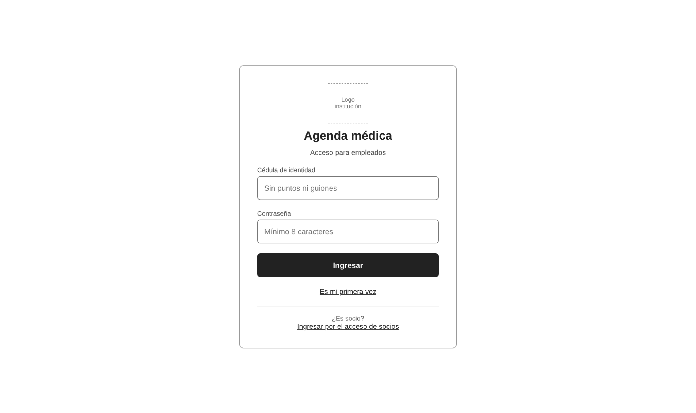

<u>Funcionalidades del funcionario</u>

### 6.1.2. Registrar aviso de llegada

*Cubre: RF-16*

### 6.1.3. Alta de turno semanal

*Cubre: RF-13*

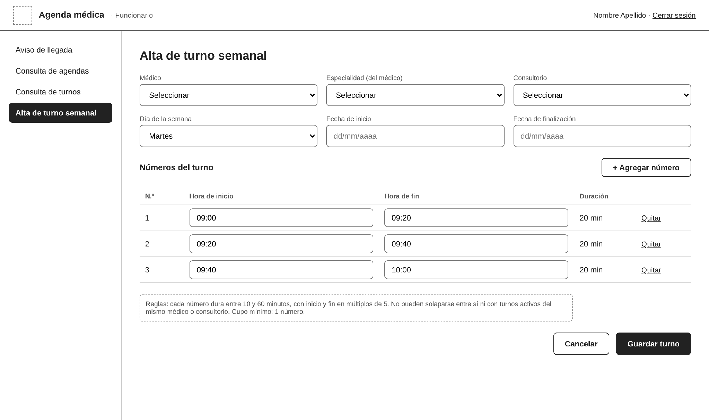

### 6.1.4. Consultar turnos, suspender y rehabilitar fechas

*Cubre: RF-14, RF-15, RF-17*

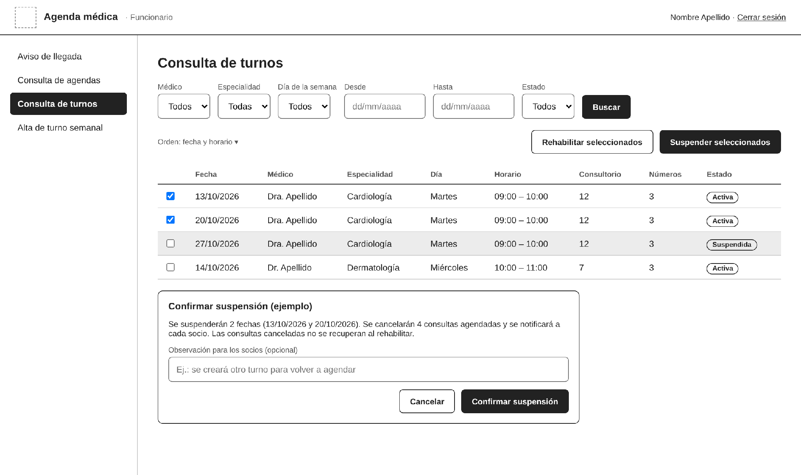

### 6.1.5. Consultar agendas

*Cubre: RF-18*

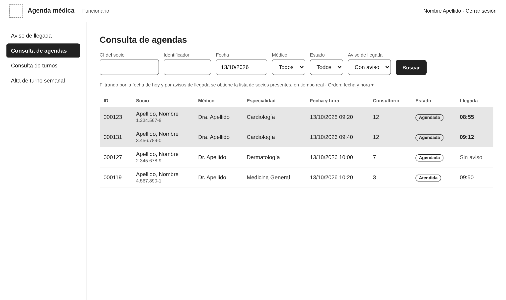

<u>Funcionalidades del médico</u>

### 6.1.6. Consultar turnos y pacientes de una fecha

*Cubre: RF-21*

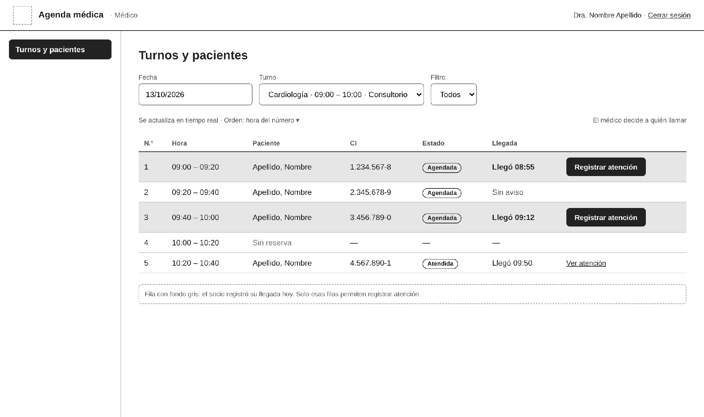

### 6.1.7. Registrar atención y emitir pases

*Cubre: RF-23, RF-24*

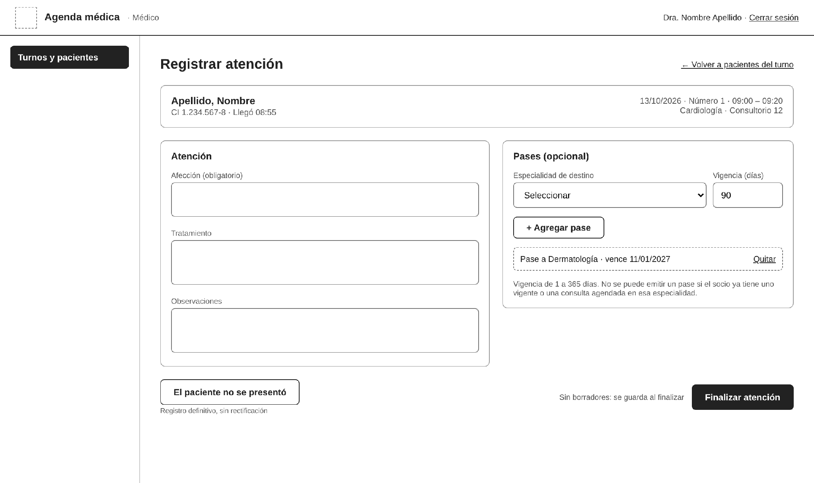

<u>Funcionalidades del administrador</u>

### 6.1.8. Registrar y consultar usuarios

*Cubre: RF-31, RF-35*

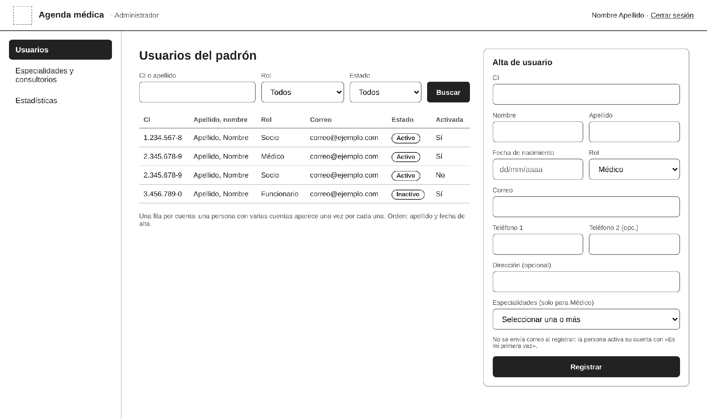

### 6.1.9. Registrar especialidades y consultorios

*Cubre: RF-29, RF-33*

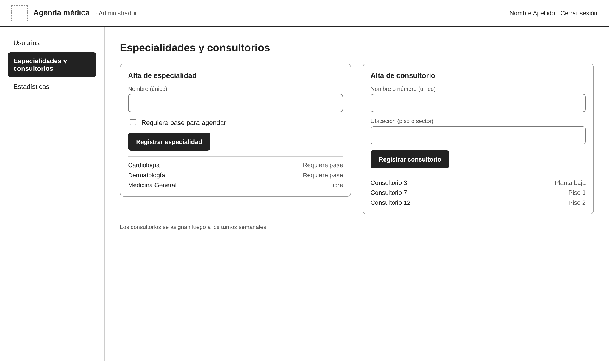

### 6.1.10. Consultar estadísticas

*Cubre: RF-39, RF-40, RF-41*

## 6.2. Mobile

<u>Funcionalidades del socio</u>

### 6.2.1. Iniciar sesión y primer ingreso

*Cubre: RF-01, RF-02*

### 6.2.2. Consultar disponibilidad

*Cubre: RF-08*

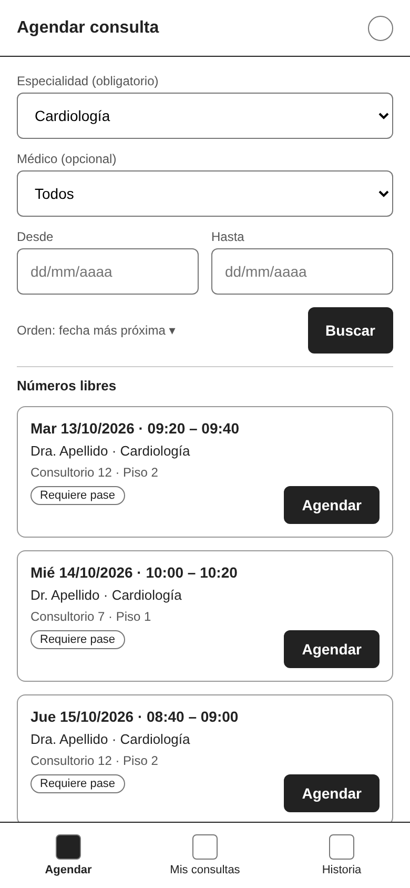

### 6.2.3. Agendar consulta

*Cubre: RF-09*

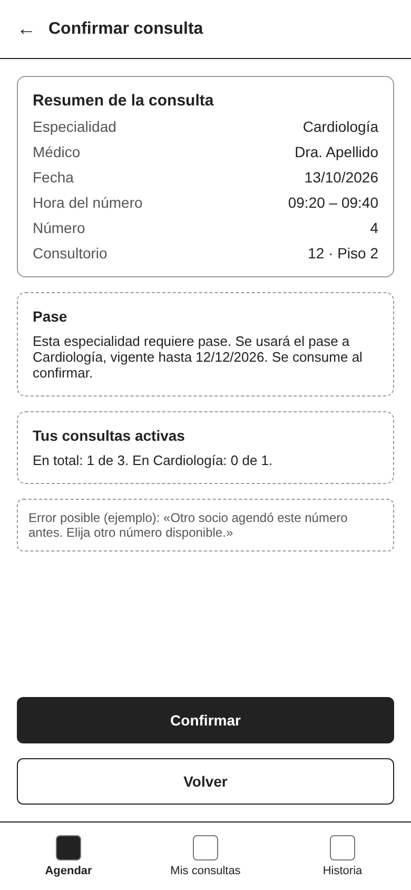

### 6.2.4. Consultar histórico de agendas

*Cubre: RF-11*

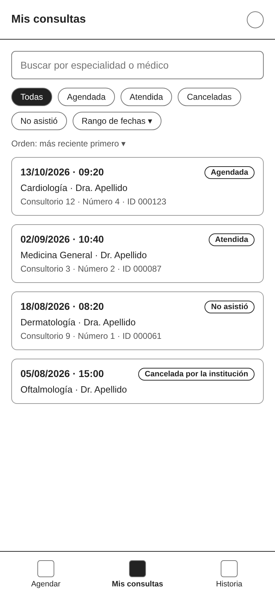

### 6.2.5. Consultar historia clínica

*Cubre: RF-12*

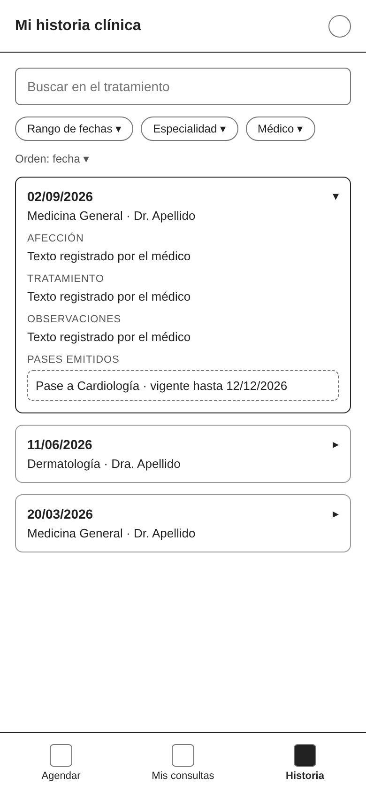
