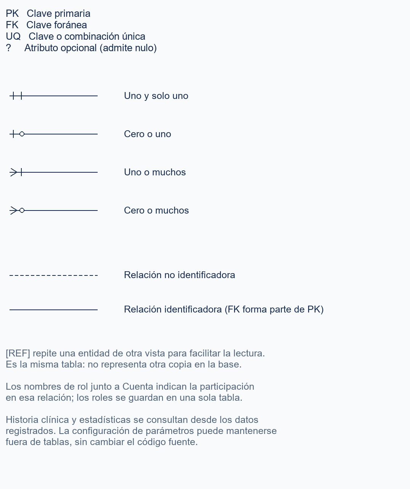
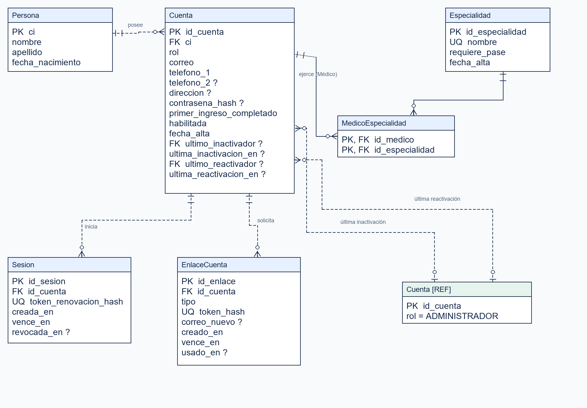
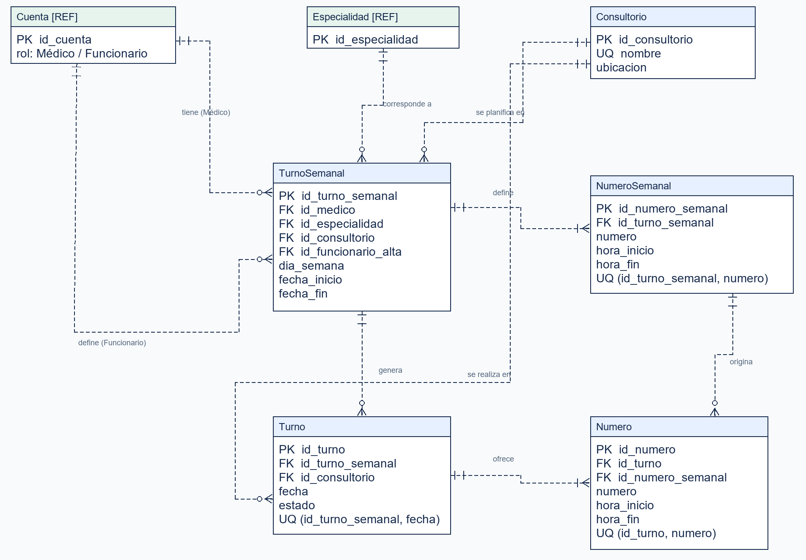
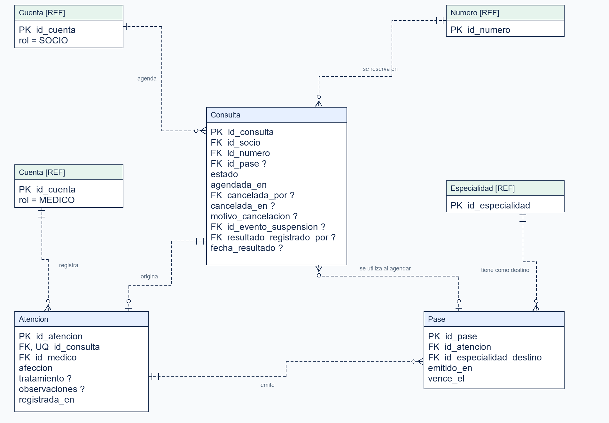
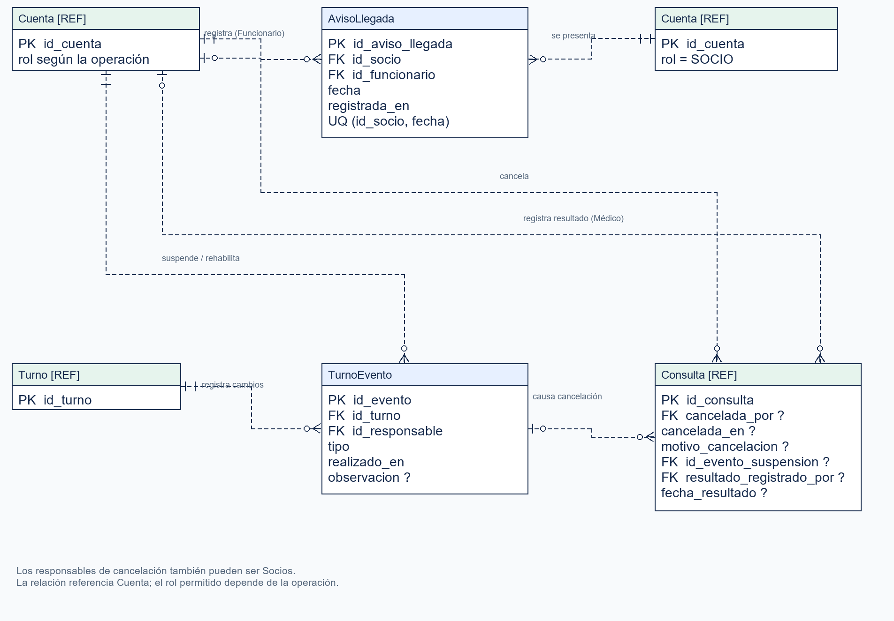
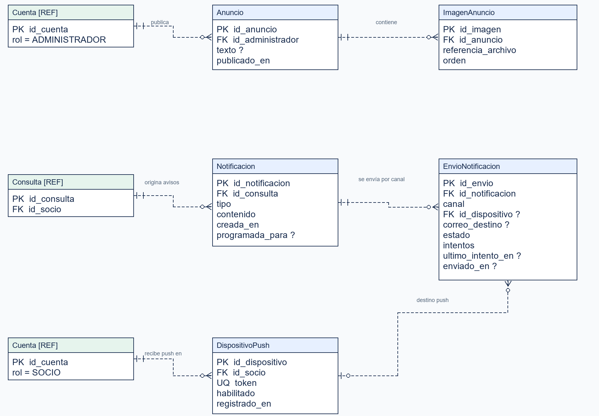

[1. Objetivo y alcance 3](#)

[2. Modelo entidad–relación 4](#)

> [2.1. Cómo leer el MER 4](#cómo-leer-el-mer)
>
> [2.2. Identidad, cuentas y acceso 5](#)
>
> [2.3. Planificación semanal y fechas concretas 6](#)
>
> [2.4. Consultas, atención y pases 7](#)
>
> [2.5. Aviso de llegada y responsables de acciones 8](#)
>
> [2.6. Cartelera y notificaciones 9](#)

[3. Correspondencia con el Modelo de Dominio 10](#)

[4. Diccionario de datos 12](#)

> [4.1. Identidad, cuentas y acceso 12](#)
>
> [4.2. Planificación semanal y fechas concretas 16](#)
>
> [4.3. Consultas, atención y pases 18](#)
>
> [4.4. Aviso de llegada y responsables de acciones 21](#)
>
> [4.5. Cartelera y notificaciones 22](#)

[5. Restricciones y decisiones de persistencia 25](#)

> [5.1. Identidad, cuentas y catálogos 25](#)
>
> [5.2. Turnos y disponibilidad 26](#)
>
> [5.3. Agenda, llegada y estados 27](#)
>
> [5.4. Atención e historia clínica 28](#)
>
> [5.5. Pases 29](#)
>
> [5.6. Notificaciones y configuración 29](#)
>
> [5.7. Conservación, seguridad y consultas 30](#)

[6. Trazabilidad con requerimientos y casos de uso 32](#)

# 1. Objetivo y alcance

Este documento define la estructura de datos del sistema de agenda y atención médica. Describe qué información se conserva, cómo se relaciona y qué condiciones deben cumplirse para mantenerla consistente durante el uso del sistema.

El modelo comprende identidad y acceso de los usuarios, planificación de turnos, agenda de consultas, registro de llegada, atención e historia clínica, emisión y uso de pases, cartelera y notificaciones. Se basa en el Documento de Requerimientos, el Documento de Casos de Uso y el Documento de Modelo de Dominio; contempla tanto los requerimientos críticos como los no críticos.

La estructura se presenta mediante un modelo entidad–relación dividido en cinco vistas. Cada vista se acompaña de un diccionario de datos. Las reglas que requieren condiciones adicionales a las claves y cardinalidades se explican en una sección independiente, y la trazabilidad vincula las tablas con los requerimientos y casos de uso correspondientes.

Se utiliza PostgreSQL 17, conforme a Requerimientos. Los tipos de datos se expresan con su nomenclatura. La integridad se resuelve mediante claves, unicidades y verificaciones en la base de datos, junto con validaciones y operaciones transaccionales del servicio cuando la regla depende de varias tablas o del contexto de una acción.

# 2. Modelo entidad–relación

Las vistas pertenecen a un único esquema relacional. Una entidad identificada con \[REF\] se repite para facilitar la lectura de sus relaciones: representa la misma tabla que en su vista principal. Las restricciones de la sección 5 completan lo expresado gráficamente.

## 2.1. Cómo leer el MER

Figura 1. Claves, cardinalidades y referencias del MER.

## 2.2. Identidad, cuentas y acceso

Figura 2. Identidad, cuentas y acceso.

Persona conserva la identidad común, con la CI como clave primaria. Cuenta reúne el acceso y el rol; las tablas asociadas resuelven especialidades, sesiones y enlaces de cuenta.

##  

## 2.3. Planificación semanal y fechas concretas

Figura 3. Planificación semanal y fechas concretas.

El patrón semanal define números y franjas; Turno y Numero conservan sus instancias por fecha, incluido el consultorio de cada turno.

## 2.4. Consultas, atención y pases

Figura 4. Consultas, atención y pases.

Consulta conserva la reserva y su resultado. Atencion registra los datos clínicos; Pase nace de una atención y puede vincularse a consultas históricas.

## 2.5. Aviso de llegada y responsables de acciones

Figura 5. Aviso de llegada y responsables de acciones.

AvisoLlegada se registra una vez por socio y día. TurnoEvento conserva suspensiones y rehabilitaciones; Consulta identifica responsables de cancelación y resultado.

## 2.6. Cartelera y notificaciones

Figura 6. Cartelera y notificaciones.

Anuncio e ImagenAnuncio representan la cartelera. Notificacion conserva el aviso, EnvioNotificacion su entrega por canal y DispositivoPush el destino técnico del socio.

# 3. Correspondencia con el Modelo de Dominio

Persona representa la identidad de una persona mediante su CI. Cuenta representa su vínculo de acceso con un rol. Socio, Funcionario, Médico y Administrador se almacenan en una misma tabla Cuenta, con un rol inmutable. Una persona puede tener una cuenta de socio y cuentas de empleado históricas; solo una cuenta de empleado puede estar habilitada a la vez, incluso si aún no completó el primer ingreso.

El alta contempla al usuario con su rol, de forma individual o mediante carga masiva. La pertenencia institucional y los datos de origen se determinan fuera de la aplicación; la carga interna vincula o crea Persona y genera Cuenta en una misma operación. La separación en tablas no implica un registro independiente de personas como función de la interfaz. En el primer ingreso el usuario completa las condiciones de acceso de su cuenta.

Cuenta distingue el primer ingreso de la habilitación administrativa y conserva el último responsable y momento de cada inactivación y reactivación. Las condiciones de acceso y conservación se detallan en el diccionario y en la sección 5.1.

Tabla 1. Correspondencia entre conceptos del dominio y tablas.

| Conceptos del dominio          | Representación en el modelo de datos                              |
|--------------------------------|-------------------------------------------------------------------|
| Persona                        | Persona; CI como clave primaria.                                  |
| Cuenta y sus roles             | Cuenta; rol y condiciones de acceso.                              |
| Médico y Especialidad          | Cuenta, Especialidad y MedicoEspecialidad.                        |
| Consultorio                    | Consultorio.                                                      |
| Turno semanal y Número semanal | TurnoSemanal y NumeroSemanal.                                     |
| Turno y Número de una fecha    | Turno y Numero.                                                   |
| Consulta                       | Consulta; reserva, cancelación y resultado.                       |
| Aviso de llegada               | AvisoLlegada; socio y fecha.                                      |
| Atención e historia clínica    | Atencion; la historia se consulta desde las atenciones del socio. |
| Pase                           | Pase; socio y emisor derivados de su atención.                    |
| Anuncio                        | Anuncio e ImagenAnuncio.                                          |
| Notificación                   | Notificacion, EnvioNotificacion y DispositivoPush.                |

Sesion y EnlaceCuenta sostienen el acceso seguro y los enlaces de un solo uso. TurnoEvento conserva las acciones sobre turnos. Las tablas de soporte materializan funciones previstas en Requerimientos. Los estados calculados, las estadísticas y los valores de configuración no requieren entidades adicionales en el MER.

# 4. Diccionario de datos

Las tablas se agrupan según las cinco vistas del MER. Los nombres y campos coinciden con el diagrama. PK indica clave primaria; FK, clave foránea; UQ, unicidad. “Nulo: Sí” identifica un campo opcional. Los identificadores bigint se generan en la base de datos; la CI se ingresa como identificador nacional y se normaliza antes de utilizarse.

El tipo timestamptz conserva un instante con referencia temporal; date, una fecha; time, una hora de atención. Las fechas y horas operativas se interpretan en la zona horaria de Uruguay. Los límites, dominios y unicidades compuestas se detallan también en la sección 5.

## 4.1. Identidad, cuentas y acceso

### Persona

Identidad compartida por las cuentas de una misma persona.

Tabla 2. Persona.

| Campo            | Tipo         | Clave | Nulo | Descripción                                 |
|------------------|--------------|-------|------|---------------------------------------------|
| ci               | varchar(12)  | PK    | No   | Cédula de identidad normalizada y validada. |
| nombre           | varchar(100) | —     | No   | Nombre de la persona.                       |
| apellido         | varchar(100) | —     | No   | Apellido de la persona.                     |
| fecha_nacimiento | date         | —     | No   | Fecha de nacimiento.                        |

### 

### Cuenta

Acceso, rol y datos de contacto de un usuario.

Tabla 3. Cuenta.

| Campo                     | Tipo         | Clave | Nulo | Descripción                                                                |
|---------------------------|--------------|-------|------|----------------------------------------------------------------------------|
| id_cuenta                 | bigint       | PK    | No   | Identificador de la cuenta.                                                |
| ci                        | varchar(12)  | FK    | No   | Referencia a Persona.ci.                                                   |
| rol                       | varchar(20)  | —     | No   | SOCIO, FUNCIONARIO, MEDICO o ADMINISTRADOR; inmutable.                     |
| correo                    | varchar(254) | —     | No   | Correo de contacto; no es único.                                           |
| telefono_1                | varchar(30)  | —     | No   | Teléfono principal.                                                        |
| telefono_2                | varchar(30)  | —     | Sí   | Teléfono alternativo.                                                      |
| direccion                 | text         | —     | Sí   | Dirección; opcional antes del primer ingreso y obligatoria al completarlo. |
| contrasena_hash           | text         | —     | Sí   | Hash de contraseña; obligatorio al completar el primer ingreso.            |
| primer_ingreso_completado | boolean      | —     | No   | Inicialmente false; indica que se completó el primer ingreso.              |
| habilitada                | boolean      | —     | No   | Inicialmente true; la inactivación administrativa la cambia a false.       |
| fecha_alta                | timestamptz  | —     | No   | Momento del alta.                                                          |
| ultimo_inactivador        | bigint       | FK    | Sí   | Cuenta del último administrador que inactivó al usuario.                   |
| ultima_inactivacion_en    | timestamptz  | —     | Sí   | Momento de la última inactivación.                                         |
| ultimo_reactivador        | bigint       | FK    | Sí   | Cuenta del último administrador que reactivó al usuario.                   |
| ultima_reactivacion_en    | timestamptz  | —     | Sí   | Momento de la última reactivación.                                         |

Las referencias a responsables apuntan a Cuenta.id_cuenta. Una cuenta pendiente de primer ingreso no es equivalente a una cuenta inactivada administrativamente.

### Especialidad

Catálogo de especialidades médicas.

Tabla 4. Especialidad.

| Campo           | Tipo         | Clave | Nulo | Descripción                                  |
|-----------------|--------------|-------|------|----------------------------------------------|
| id_especialidad | bigint       | PK    | No   | Identificador de la especialidad.            |
| nombre          | varchar(120) | UQ    | No   | Nombre único sin distinguir mayúsculas.      |
| requiere_pase   | boolean      | —     | No   | Indica si las nuevas agendas requieren pase. |
| fecha_alta      | timestamptz  | —     | No   | Momento del alta.                            |

### 

### MedicoEspecialidad

Especialidades que una cuenta con rol MEDICO puede ejercer.

Tabla 5. MedicoEspecialidad.

| Campo           | Tipo   | Clave  | Nulo | Descripción                                    |
|-----------------|--------|--------|------|------------------------------------------------|
| id_medico       | bigint | PK, FK | No   | Referencia a Cuenta.id_cuenta, con rol MEDICO. |
| id_especialidad | bigint | PK, FK | No   | Referencia a Especialidad.id_especialidad.     |

La clave primaria es compuesta: (id_medico, id_especialidad).

### 

### Sesion

Sesión de acceso con renovación y revocación.

Tabla 6. Sesion.

| Campo                 | Tipo        | Clave | Nulo | Descripción                                               |
|-----------------------|-------------|-------|------|-----------------------------------------------------------|
| id_sesion             | bigint      | PK    | No   | Identificador de la sesión.                               |
| id_cuenta             | bigint      | FK    | No   | Cuenta que inicia la sesión.                              |
| token_renovacion_hash | text        | UQ    | No   | Resumen del token de renovación; nunca el token en claro. |
| creada_en             | timestamptz | —     | No   | Momento de creación.                                      |
| vence_en              | timestamptz | —     | No   | Momento de vencimiento.                                   |
| revocada_en           | timestamptz | —     | Sí   | Momento de revocación, si corresponde.                    |

### 

### EnlaceCuenta

Enlace de un solo uso para primer ingreso, recuperación o cambio de correo.

Tabla 7. EnlaceCuenta.

| Campo        | Tipo         | Clave | Nulo | Descripción                                   |
|--------------|--------------|-------|------|-----------------------------------------------|
| id_enlace    | bigint       | PK    | No   | Identificador del enlace.                     |
| id_cuenta    | bigint       | FK    | No   | Cuenta destinataria.                          |
| tipo         | varchar(24)  | —     | No   | PRIMER_INGRESO, RECUPERACION o CAMBIO_CORREO. |
| token_hash   | text         | UQ    | No   | Resumen único del token.                      |
| correo_nuevo | varchar(254) | —     | Sí   | Correo a confirmar; solo para CAMBIO_CORREO.  |
| creado_en    | timestamptz  | —     | No   | Momento de emisión.                           |
| vence_en     | timestamptz  | —     | No   | Momento de vencimiento.                       |
| usado_en     | timestamptz  | —     | Sí   | Momento de consumo del enlace.                |

## 4.2. Planificación semanal y fechas concretas

### Consultorio

Lugar de atención asociado a los turnos.

Tabla 8. Consultorio.

| Campo          | Tipo         | Clave | Nulo | Descripción                    |
|----------------|--------------|-------|------|--------------------------------|
| id_consultorio | bigint       | PK    | No   | Identificador del consultorio. |
| nombre         | varchar(120) | UQ    | No   | Nombre o número único.         |
| ubicacion      | varchar(200) | —     | No   | Descripción de su ubicación.   |

### 

### TurnoSemanal

Configuración recurrente de atención de un médico y una especialidad.

Tabla 9. TurnoSemanal.

| Campo               | Tipo     | Clave | Nulo | Descripción                                 |
|---------------------|----------|-------|------|---------------------------------------------|
| id_turno_semanal    | bigint   | PK    | No   | Identificador del patrón.                   |
| id_medico           | bigint   | FK    | No   | Cuenta del médico.                          |
| id_especialidad     | bigint   | FK    | No   | Especialidad del turno.                     |
| id_consultorio      | bigint   | FK    | No   | Consultorio configurado.                    |
| id_funcionario_alta | bigint   | FK    | No   | Cuenta del funcionario que define el turno. |
| dia_semana          | smallint | —     | No   | 1: lunes; 2: martes; …; 7: domingo.         |
| fecha_inicio        | date     | —     | No   | Primer día de vigencia del patrón.          |
| fecha_fin           | date     | —     | No   | Último día de vigencia.                     |

La combinación médico–especialidad debe existir en MedicoEspecialidad.

### NumeroSemanal

Número y franja horaria del patrón semanal.

Tabla 10. NumeroSemanal.

| Campo             | Tipo    | Clave | Nulo | Descripción                               |
|-------------------|---------|-------|------|-------------------------------------------|
| id_numero_semanal | bigint  | PK    | No   | Identificador de la franja del patrón.    |
| id_turno_semanal  | bigint  | FK    | No   | Patrón al que pertenece.                  |
| numero            | integer | —     | No   | Número positivo dentro del turno semanal. |
| hora_inicio       | time    | —     | No   | Inicio de la franja.                      |
| hora_fin          | time    | —     | No   | Fin de la franja.                         |

UQ (id_turno_semanal, numero).

### 

### Turno

Instancia de un turno semanal para una fecha.

Tabla 11. Turno.

| Campo            | Tipo        | Clave | Nulo | Descripción                               |
|------------------|-------------|-------|------|-------------------------------------------|
| id_turno         | bigint      | PK    | No   | Identificador del turno concreto.         |
| id_turno_semanal | bigint      | FK    | No   | Patrón de origen.                         |
| id_consultorio   | bigint      | FK    | No   | Consultorio conservado para esta fecha.   |
| fecha            | date        | —     | No   | Día concreto de atención.                 |
| estado           | varchar(12) | —     | No   | ACTIVO o SUSPENDIDO; inicialmente ACTIVO. |

UQ (id_turno_semanal, fecha).

### Numero

Número y franja horaria de un turno concreto.

Tabla 12. Numero.

| Campo             | Tipo    | Clave | Nulo | Descripción                        |
|-------------------|---------|-------|------|------------------------------------|
| id_numero         | bigint  | PK    | No   | Identificador del número concreto. |
| id_turno          | bigint  | FK    | No   | Turno al que pertenece.            |
| id_numero_semanal | bigint  | FK    | No   | Franja del patrón de origen.       |
| numero            | integer | —     | No   | Número positivo dentro del turno.  |
| hora_inicio       | time    | —     | No   | Inicio de la franja de esta fecha. |
| hora_fin          | time    | —     | No   | Fin de la franja de esta fecha.    |

UQ (id_turno, numero). Las horas concretas conservan la planificación histórica.

## 

## 4.3. Consultas, atención y pases

### Consulta

Reserva histórica de un número por un socio, con cancelación y resultado.

Tabla 13. Consulta.

| Campo                    | Tipo        | Clave | Nulo | Descripción                                                                  |
|--------------------------|-------------|-------|------|------------------------------------------------------------------------------|
| id_consulta              | bigint      | PK    | No   | Identificador único de la consulta.                                          |
| id_socio                 | bigint      | FK    | No   | Cuenta del socio que agenda.                                                 |
| id_numero                | bigint      | FK    | No   | Número reservado.                                                            |
| id_pase                  | bigint      | FK    | Sí   | Pase utilizado al agendar, si corresponde.                                   |
| estado                   | varchar(32) | —     | No   | AGENDADA, ATENDIDA, CANCELADA_SOCIO, CANCELADA_INSTITUCION o NO_SE_PRESENTO. |
| agendada_en              | timestamptz | —     | No   | Momento de la agenda.                                                        |
| cancelada_por            | bigint      | FK    | Sí   | Cuenta que realizó la cancelación.                                           |
| cancelada_en             | timestamptz | —     | Sí   | Momento de cancelación.                                                      |
| motivo_cancelacion       | text        | —     | Sí   | Motivo cuando corresponde a cancelación institucional.                       |
| id_evento_suspension     | bigint      | FK    | Sí   | TurnoEvento que causó la cancelación por suspensión.                         |
| resultado_registrado_por | bigint      | FK    | Sí   | Cuenta del médico que registró el resultado.                                 |
| fecha_resultado          | timestamptz | —     | Sí   | Momento en que se registró el resultado.                                     |

Las referencias de personas apuntan a Cuenta; id_evento_suspension apunta a TurnoEvento. No asistió y No atendida son estados calculados, no valores adicionales guardados en estado.

### 

### Atencion

Registro clínico definitivo asociado a una consulta.

Tabla 14. Atencion.

| Campo         | Tipo        | Clave  | Nulo | Descripción                                             |
|---------------|-------------|--------|------|---------------------------------------------------------|
| id_atencion   | bigint      | PK     | No   | Identificador de la atención.                           |
| id_consulta   | bigint      | FK, UQ | No   | Consulta atendida; a lo sumo una atención por consulta. |
| id_medico     | bigint      | FK     | No   | Cuenta del médico que registra la atención.             |
| afeccion      | text        | —      | No   | Afección registrada.                                    |
| tratamiento   | text        | —      | Sí   | Tratamiento indicado.                                   |
| observaciones | text        | —      | Sí   | Observaciones clínicas.                                 |
| registrada_en | timestamptz | —      | No   | Momento del registro definitivo.                        |

### 

### Pase

Autorización emitida dentro de una atención para una especialidad destino.

Tabla 15. Pase.

| Campo                   | Tipo        | Clave | Nulo | Descripción                               |
|-------------------------|-------------|-------|------|-------------------------------------------|
| id_pase                 | bigint      | PK    | No   | Identificador del pase.                   |
| id_atencion             | bigint      | FK    | No   | Atención que lo origina.                  |
| id_especialidad_destino | bigint      | FK    | No   | Especialidad a la que habilita a agendar. |
| emitido_en              | timestamptz | —     | No   | Momento de emisión.                       |
| vence_el                | date        | —     | No   | Fecha de vencimiento del pase.            |

Socio y médico emisor se obtienen de Atencion y Consulta. La situación del pase se calcula a partir del vencimiento y de su uso.

## 4.4. Aviso de llegada y responsables de acciones

### AvisoLlegada

Llegada de un socio para todas sus consultas de un mismo día.

Tabla 16. AvisoLlegada.

| Campo            | Tipo        | Clave | Nulo | Descripción                          |
|------------------|-------------|-------|------|--------------------------------------|
| id_aviso_llegada | bigint      | PK    | No   | Identificador del aviso.             |
| id_socio         | bigint      | FK    | No   | Cuenta del socio que llega.          |
| id_funcionario   | bigint      | FK    | No   | Cuenta del funcionario que registra. |
| fecha            | date        | —     | No   | Día de las consultas.                |
| registrada_en    | timestamptz | —     | No   | Instante del primer aviso.           |

UQ (id_socio, fecha). Un nuevo intento conserva el registro original.

### 

### TurnoEvento

Acción de suspensión o rehabilitación sobre un turno concreto.

Tabla 17. TurnoEvento.

| Campo          | Tipo        | Clave | Nulo | Descripción                   |
|----------------|-------------|-------|------|-------------------------------|
| id_evento      | bigint      | PK    | No   | Identificador del evento.     |
| id_turno       | bigint      | FK    | No   | Turno afectado.               |
| id_responsable | bigint      | FK    | No   | Cuenta que realizó la acción. |
| tipo           | varchar(20) | —     | No   | SUSPENSION o REHABILITACION.  |
| realizado_en   | timestamptz | —     | No   | Momento de la acción.         |
| observacion    | text        | —     | Sí   | Observación de la operación.  |

## 4.5. Cartelera y notificaciones

### Anuncio

Publicación de la cartelera.

Tabla 18. Anuncio.

| Campo            | Tipo        | Clave | Nulo | Descripción                                       |
|------------------|-------------|-------|------|---------------------------------------------------|
| id_anuncio       | bigint      | PK    | No   | Identificador de la publicación.                  |
| id_administrador | bigint      | FK    | No   | Cuenta del administrador que publica.             |
| texto            | text        | —     | Sí   | Contenido textual; puede acompañarse de imágenes. |
| publicado_en     | timestamptz | —     | No   | Momento de publicación.                           |

Debe contener texto o al menos una imagen.

### 

### ImagenAnuncio

Imagen vinculada a una publicación.

Tabla 19. ImagenAnuncio.

| Campo              | Tipo    | Clave | Nulo | Descripción                               |
|--------------------|---------|-------|------|-------------------------------------------|
| id_imagen          | bigint  | PK    | No   | Identificador de la imagen.               |
| id_anuncio         | bigint  | FK    | No   | Anuncio al que pertenece.                 |
| referencia_archivo | text    | —     | No   | Referencia al archivo de imagen.          |
| orden              | integer | —     | No   | Orden de presentación dentro del anuncio. |

El archivo se conserva fuera de la tabla. El mecanismo de almacenamiento se establece en infraestructura.

### Notificacion

Aviso de una consulta dirigido al socio y visible en la interfaz.

Tabla 20. Notificacion.

| Campo           | Tipo        | Clave | Nulo | Descripción                                                           |
|-----------------|-------------|-------|------|-----------------------------------------------------------------------|
| id_notificacion | bigint      | PK    | No   | Identificador del aviso.                                              |
| id_consulta     | bigint      | FK    | No   | Consulta que origina la notificación.                                 |
| tipo            | varchar(40) | —     | No   | AGENDA, CANCELACION, SUSPENSION, HISTORIA_ACTUALIZADA o RECORDATORIO. |
| contenido       | text        | —     | No   | Texto del aviso.                                                      |
| creada_en       | timestamptz | —     | No   | Momento de creación.                                                  |
| programada_para | timestamptz | —     | Sí   | Instante previsto para un aviso diferido.                             |

El destinatario se obtiene de Consulta.id_socio.

### 

### EnvioNotificacion

Entrega y resultado de una notificación por canal y destino.

Tabla 21. EnvioNotificacion.

| Campo             | Tipo         | Clave | Nulo | Descripción                            |
|-------------------|--------------|-------|------|----------------------------------------|
| id_envio          | bigint       | PK    | No   | Identificador del envío.               |
| id_notificacion   | bigint       | FK    | No   | Aviso que se entrega.                  |
| canal             | varchar(12)  | —     | No   | CORREO o PUSH.                         |
| id_dispositivo    | bigint       | FK    | Sí   | DispositivoPush de destino, para PUSH. |
| correo_destino    | varchar(254) | —     | Sí   | Dirección de entrega, para CORREO.     |
| estado            | varchar(20)  | —     | No   | PENDIENTE, ENVIADO o FALLIDO.          |
| intentos          | integer      | —     | No   | Cantidad de intentos; inicialmente 0.  |
| ultimo_intento_en | timestamptz  | —     | Sí   | Instante del último intento.           |
| enviado_en        | timestamptz  | —     | Sí   | Instante del envío completado.         |

El canal de interfaz se representa por Notificacion. Los reintentos actualizan el mismo envío; un fallo no revierte la operación de negocio.

### 

### DispositivoPush

Destino técnico para avisos en la aplicación Android del socio.

Tabla 22. DispositivoPush.

| Campo          | Tipo        | Clave | Nulo | Descripción                                |
|----------------|-------------|-------|------|--------------------------------------------|
| id_dispositivo | bigint      | PK    | No   | Identificador del dispositivo registrado.  |
| id_socio       | bigint      | FK    | No   | Cuenta del socio destinatario.             |
| token          | text        | UQ    | No   | Token del servicio push.                   |
| habilitado     | boolean     | —     | No   | Indica si el destino puede recibir avisos. |
| registrado_en  | timestamptz | —     | No   | Momento de registro.                       |

# 5. Restricciones y decisiones de persistencia

Las cardinalidades indican cómo se vinculan los registros, pero no expresan todas las reglas del sistema. Esta sección especifica las condiciones adicionales: unicidades condicionadas, roles permitidos, horarios, estados, conservación y operaciones que deben registrarse conjuntamente. R-MDAT identifica una regla de este documento; R-MD remite a las restricciones del Modelo de Dominio.

Las claves primarias, foráneas, campos obligatorios, unicidades y dominios se implementan en la base de datos. Las condiciones entre varias tablas y las autorizaciones se verifican en el servicio dentro de transacciones, con bloqueo o aislamiento adecuado para impedir que solicitudes concurrentes eludan la validación. Una comprobación de la interfaz no sustituye estas garantías.

## 5.1. Identidad, cuentas y catálogos

**R-MDAT-01** - Identidad y alta. La CI de Persona es la clave primaria y se valida con su dígito verificador, en un formato normalizado. Cuenta.ci referencia esa identidad. El alta individual o masiva de un usuario crea o vincula Persona y crea Cuenta con el rol en una misma operación. Si la CI ya existe, nombre, apellido y fecha de nacimiento deben coincidir con los datos registrados; de lo contrario, se rechaza el alta y el administrador corrige primero la identidad (RF-31 y RF-38). Los datos de identidad son comunes a sus cuentas y solo los corrige el administrador; una corrección de CI propaga la referencia mediante ON UPDATE CASCADE, conservando las cuentas y sus antecedentes (sección 3.1.1 de Requerimientos; R-MD-01).

**R-MDAT-02** - Unicidad de cuentas. Se exige una sola cuenta SOCIO por CI, y una sola cuenta de empleado habilitada por CI, considerando los roles FUNCIONARIO, MEDICO y ADMINISTRADOR. La segunda condición incluye las cuentas pendientes de primer ingreso. Se implementa con índices únicos parciales sobre Cuenta.ci. Las cuentas de empleado inactivadas permanecen; el rol no se modifica. El correo no es único y no se usa como identificador de la persona (RF-31, RF-35 y RF-45; R-MD-01 y R-MD-03).

**R-MDAT-03** - Activación, inactivación y reactivación. Para iniciar sesión u operar se requieren primer_ingreso_completado = true y habilitada = true. El alta deja la cuenta pendiente del primer ingreso. Al completarlo se exigen dirección, al menos un teléfono y contraseña; el correo no se modifica durante ese circuito. Estos datos se validan junto con la activación, que no puede cambiar habilitada de false a true. Los campos de responsable y fecha de cada última inactivación o reactivación se actualizan juntos, con una Cuenta de rol ADMINISTRADOR. Se conserva el último registro de cada acción. Inactivar una cuenta invalida sus sesiones y la habilitación se comprueba también durante las operaciones del servidor (RF-01, RF-02 y RF-45; R-MD-03).

**R-MDAT-04** - Roles y catálogos. Cada referencia a Cuenta respeta el rol indicado en el MER y el permiso de la operación. MedicoEspecialidad solo admite cuentas MEDICO; un médico tiene al menos una especialidad. No se retira una especialidad vinculada a sus turnos activos o consultas futuras. El nombre de Especialidad es único sin distinguir mayúsculas y el nombre o número de Consultorio es único. Cambiar requiere_pase afecta nuevas agendas, conservando las consultas ya confirmadas. Los dominios se controlan con CHECK; las condiciones de rol y relaciones se verifican en la transacción, con controles de base adicionales cuando corresponda (RF-29 a RF-38; R-MD-02).

**R-MDAT-05** - Inactivación del médico. La inactivación de un médico exige que no queden turnos activos de fechas actuales o futuras ni consultas Agendadas cuyo día todavía no terminó. Las suspensiones y cancelaciones necesarias se realizan por sus operaciones previstas. Reactivar su cuenta no rehabilita automáticamente los turnos suspendidos (RF-45; R-MD-03).

## 5.2. Turnos y disponibilidad

**R-MDAT-06** - Patrones e instancias. TurnoSemanal exige fecha_fin ≥ fecha_inicio y dia_semana entre 1 y 7. Tiene al menos un NumeroSemanal, con número positivo y único dentro del patrón. Las fechas de Turno corresponden a ese día de la semana y a la vigencia del patrón; solo existe una instancia por patrón y fecha. Numero conserva una franja del mismo patrón que su Turno y su número es único dentro del turno. Las claves y unicidades aseguran la identidad de las filas; la correspondencia entre el número semanal y el patrón del turno se verifica en la transacción. La capacidad surge de los números; no se agrega un campo de cupo (RF-13; R-MD-04 a R-MD-06).

**R-MDAT-07** - Horarios y solapamientos. La hora de inicio precede a la de fin. Los extremos están en múltiplos de cinco minutos y la duración inicial admitida es de 10 a 60 minutos, en pasos de cinco, según configuración. No se solapan franjas del mismo turno ni franjas de turnos activos de una misma fecha para el mismo médico o consultorio. La validación abarca todas las fechas de vigencia al crear; al modificar el consultorio abarca solo las fechas ACTIVAS seleccionadas, y al rehabilitar abarca las fechas a reactivar. Se combina CHECK para condiciones locales con verificaciones transaccionales de cruces, bloqueando los recursos afectados para evitar dos altas concurrentes incompatibles (RF-13, RF-15 y RF-20; R-MD-05 a R-MD-07).

**R-MDAT-08** - Suspensión y rehabilitación. Suspender una fecha registra Turno.estado = SUSPENDIDO, el TurnoEvento con responsable y momento, la cancelación institucional de sus consultas Agendadas y las notificaciones correspondientes en una transacción. Consulta.id_evento_suspension identifica el evento que causó la cancelación. Rehabilitar crea otro evento y vuelve el turno a ACTIVO solo si supera los controles de disponibilidad. No restaura reservas canceladas ni altera el registro de fechas anteriores (RF-14 y RF-15; R-MD-07).

**R-MDAT-09** - Cambio de consultorio. RF-20 permite seleccionar todas o algunas fechas concretas de hoy en adelante dentro del patrón. Una vista previa no persistente informa consultas Agendadas, consultorio actual y solapamientos por fecha y número. Ningún solapamiento con un turno ACTIVO puede forzarse; las fechas SUSPENDIDAS conservan su estado y se revisan al rehabilitar (RF-15). Si alguna fecha elegida tiene consultas Agendadas, se exige confirmación explícita sin cancelar ni trasladar reservas; no se avisa automáticamente al socio en esta versión. Las fechas no elegidas e históricas no se modifican. El consultorio del patrón cambia solo si se seleccionan todas las fechas actuales y futuras; el detalle indica cuando los consultorios futuros son diferentes. Médico, especialidad, día de semana y horarios no se modifican (RF-20; R-MD-04 y R-MD-07).

## 5.3. Agenda, llegada y estados

**R-MDAT-10** - Unicidad histórica de reservas y pases. Numero puede conservar varias consultas históricas, pero solo una no cancelada. Un índice único parcial sobre Consulta.id_numero excluye CANCELADA_SOCIO y CANCELADA_INSTITUCION. Otro índice único parcial sobre id_pase, cuando no es nulo, utiliza la misma condición. ATENDIDA y NO_SE_PRESENTO conservan la ocupación del número y el uso del pase. La unicidad se garantiza en la base incluso ante solicitudes concurrentes (RF-09; RNF-13; R-MD-08 y R-MD-13).

**R-MDAT-11** - Condiciones de agenda. Al confirmar se comprueban socio habilitado, turno activo, número disponible, especialidad y pase cuando corresponda. La anticipación inicial es de hasta 30 días y de al menos 2 horas antes del número. Los límites iniciales son una consulta activa por especialidad y tres en total; activa significa AGENDADA cuyo día no terminó. La transacción serializa la validación de límites por socio, para que dos agendas simultáneas no los superen, y vuelve a verificar el número y el pase. También impide que la franja elegida se solape con otra consulta Agendada del mismo socio (RF-08 y RF-09; sección 3.1.3; R-MD-08 y R-MD-09).

**R-MDAT-12** - Llegada diaria. AvisoLlegada es único por (id_socio, fecha), se registra por un funcionario y exige al menos una consulta AGENDADA del socio para ese día. Una repetición conserva el primer momento y responsable. El aviso vale para todas las consultas de ese socio hasta el fin del día, sin duplicarse por consulta y sin convertirse en estado de Consulta (RF-16; R-MD-10).

**R-MDAT-13** - Estados guardados y calculados. Consulta.estado admite únicamente AGENDADA, ATENDIDA, CANCELADA_SOCIO, CANCELADA_INSTITUCION y NO_SE_PRESENTO. Al terminar el día, una consulta que permanece AGENDADA se muestra como No asistió si no hay aviso de llegada y como No atendida si lo hay. El día termina a las 24:00, hora oficial de Uruguay. Los valores calculados no cambian la fila. NO_SE_PRESENTO es un resultado definitivo registrado por el médico para un socio con llegada ese día; conserva responsable y fecha, no admite rectificación ni reapertura, y mantiene el aviso para las demás consultas (sección 3.1.2; RF-23; R-MD-14).

**R-MDAT-14** - Cancelación y responsables. La cancelación directa por el socio exige una consulta Agendada propia, al menos 2 horas de anticipación y que no haya registrado su llegada ese día (RF-10). La cancelación por un funcionario, a pedido del socio, exige una consulta Agendada y al menos 2 horas de anticipación, conforme a RF-19. Ambas dejan CANCELADA_SOCIO y conservan quién actuó y cuándo. La cancelación por médico, individual o de todas las consultas de un turno, deja CANCELADA_INSTITUCION, exige motivo y respeta el límite de 2 horas antes de cada número afectado. Cancelar todo el turno suspende esa fecha. La suspensión institucional realizada por un funcionario es inmediata y vincula el evento del mismo turno. Cancelar libera el número y el pase cuando corresponde, conserva el historial y genera la notificación en la misma transacción; el número vuelve a ofrecerse si cumple la anticipación de agenda (RF-10, RF-11, RF-14, RF-19 y RF-27; R-MD-13 y R-MD-15).

**R-MDAT-15** - Conflicto de interés. Se compara la CI de Persona a través de las cuentas intervinientes. Un funcionario no registra su propia llegada ni cancela su consulta usando la cuenta de empleado; un médico no cancela ni registra el resultado de su propia consulta. El control usa la identidad común y no solo el identificador de Cuenta (sección 3.1.5; RF-16, RF-19, RF-23 y RF-27).

## 5.4. Atención e historia clínica

**R-MDAT-16** - Registro conjunto de atención. Atencion.id_consulta es único. Solo se registra para una consulta AGENDADA de hoy, del médico que actúa y con llegada del socio. Se exige afección; tratamiento y observaciones son opcionales. La atención, sus pases, el estado ATENDIDA, el responsable y momento del resultado y la notificación se guardan conjuntamente. El resultado NO_SE_PRESENTO no genera Atencion ni exige datos clínicos (RF-23 y RF-24; R-MD-11 y R-MD-12).

**R-MDAT-17** - Acceso a historia clínica. La historia se obtiene de las atenciones de las consultas del socio, sin duplicar su contenido en otra tabla. El socio consulta su propia historia. El médico accede a la historia completa cuando tiene una consulta AGENDADA con ese socio cuyo día todavía no terminó; no se exige llegada para esa lectura. También puede consultar el historial de las atenciones que él registró, conforme a RF-25. La autorización se comprueba en el servidor en cada acceso (RF-12, RF-22 y RF-25; RNF-05 y RNF-11).

## 5.5. Pases

**R-MDAT-18** - Emisión de pases. Los pases se emiten dentro del registro de una atención y quedan guardados con ella, sin emisión posterior independiente. El destino puede coincidir con la especialidad de la atención. Dentro de una misma atención no se duplica el destino. Antes de emitir se comprueba que no exista para ese socio y destino otro pase vigente sin utilizar ni una consulta activa que impida la emisión; la consulta que se está completando se evalúa con su resultado final. La vigencia inicial es de 90 días y el médico puede fijarla entre 1 y 365, según configuración (RF-24; CU 3.4.3; R-MD-12).

**R-MDAT-19** - Uso y situación del pase. El pase corresponde al socio de su atención de origen y a la especialidad destino, independientemente del médico elegido. Su vencimiento debe cubrir la fecha de la consulta. Se considera utilizado si está vinculado a una consulta no cancelada; en caso contrario es disponible si sigue vigente o vencido sin utilizar si venció. Solo CANCELADA_SOCIO y CANCELADA_INSTITUCION devuelven el pase, manteniendo su vencimiento original. ATENDIDA, NO_SE_PRESENTO y las situaciones calculadas No asistió y No atendida no lo devuelven (RF-09, RF-24 y RF-26; R-MD-13).

## 5.6. Notificaciones y configuración

**R-MDAT-20** - Entrega por canales. La operación de agenda, cancelación, suspensión o atención conserva su notificación y los envíos pendientes antes de intentar la entrega externa. Un fallo de correo o push no revierte la operación. EnvioNotificacion actualiza estado, intentos y momentos sobre el mismo envío. Para CORREO se exige correo_destino y no id_dispositivo; para PUSH se exige un DispositivoPush del socio de la consulta y no correo_destino. Se evita duplicar un envío para la misma notificación, canal y destino. La interfaz consulta Notificacion. Los avisos de historia clínica no incluyen datos clínicos sensibles (RNF-24 a RNF-26).

**R-MDAT-21** - Recordatorios. Se genera a lo sumo un recordatorio por consulta. La unicidad del tipo RECORDATORIO para id_consulta se asegura con un índice único parcial. Su antelación inicial es de 24 horas; no se genera un recordatorio tardío para una agenda realizada con menor anticipación. Antes del envío se comprueba que la consulta siga AGENDADA. programada_para conserva el instante previsto (RNF-26; sección 3.1.3).

**R-MDAT-22** - Configuración y cargas masivas. Los parámetros de Requerimientos se mantienen como configuración modificable sin cambiar el código, sin pantalla de administración. Su almacenamiento no está representado en el MER; no se fijan tablas auxiliares ni nombres de parámetros de persistencia. Comprende anticipaciones, límites de agenda, duraciones, vigencia de pases y enlaces, antelación del recordatorio y longitud mínima de contraseña. Los enlaces tienen inicialmente 24 horas de vigencia y un solo uso; la contraseña exige inicialmente ocho caracteres. Las cargas CSV respetan formato, previsualización, validación por fila y descarga de errores: se incorporan las filas válidas, se rechazan duplicados, se conserva la primera aparición y no se actualizan registros existentes. La previsualización y los informes de importación no requieren tablas permanentes adicionales (secciones 3.1.3 y 3.1.4).

## 5.7. Conservación, seguridad y consultas

**R-MDAT-23** - Conservación y credenciales. Se conserva el historial de consultas, atenciones, pases y eventos. Las referencias históricas usan borrado restringido; inactivar cuentas no elimina sus registros ni los clínicos. Las contraseñas se guardan como hash adaptativo con sal y los tokens de sesión y enlaces como resúmenes. Las credenciales de base, claves de firma y secretos externos pertenecen a la configuración del entorno. No se incluyen contraseñas, tokens en claro ni contenido clínico sensible en registros técnicos (RNF-05, RNF-06, RNF-08, RNF-09, RNF-11, RNF-12, RNF-14 y RNF-15; R-MD-15).

Las consultas de disponibilidad y agenda utilizan Turno, Numero y Consulta, junto con médico, especialidad y consultorio del patrón. Se prevén índices sobre las claves foráneas y sobre las combinaciones de fecha, socio, médico y estado utilizadas en las búsquedas, además de los índices únicos definidos. Su selección se verifica con las consultas reales y los objetivos de rendimiento de Requerimientos.

Las estadísticas se obtienen de las consultas, sus resultados guardados o calculados, turnos, especialidades y pases. La utilización por turno considera los números ofrecidos en las fechas del período que estuvieron activas; TurnoEvento permite reconstruir suspensiones y rehabilitaciones (RF-40). La demanda por especialidad se cuenta por agendada_en e incluye consultas luego canceladas (RF-39); los pases, por emitido_en (RF-43). Los demás indicadores usan la fecha de la consulta y las reglas particulares de ocupación, resultado e inasistencia. Las franjas pico ubican las consultas por su hora de inicio y las consultas con llegada por registrada_en de AvisoLlegada, contando cada consulta a la que ese aviso aplica (RF-44). Un denominador cero se muestra como Sin datos; con denominador positivo y numerador cero se muestra 0 %. No se mantiene una tabla paralela de contadores que pueda divergir de los registros originales (RF-39 a RF-44).

La estructura se reconstruye mediante scripts o migraciones versionadas, incluyendo restricciones e índices. Se prevén respaldo y restauración de la base de datos conforme a RNF-19 y RNF-20; estos mecanismos forman parte de la operación y no agregan entidades al MER.

# 6. Trazabilidad con requerimientos y casos de uso

La tabla vincula cada grupo de datos con los requerimientos y las fichas críticas del Documento de Casos de Uso, siguiendo la presentación utilizada en el Modelo de Dominio. Los requerimientos no críticos conservan su referencia aunque no tengan una ficha desarrollada. Las reglas generales y los requerimientos no funcionales relevantes se incluyen cuando condicionan la persistencia.

Tabla 23. Trazabilidad del modelo de datos.

| Grupo de tablas                                   | Requerimientos                                                                  | Casos de uso                                                                                                       |
|---------------------------------------------------|---------------------------------------------------------------------------------|--------------------------------------------------------------------------------------------------------------------|
| Persona y Cuenta                                  | RF-01, RF-02, RF-06, RF-31, RF-32, RF-35, RF-38 y RF-45; sección 3.1.1; RNF-05. | CU 3.1.1, 3.1.2, 3.5.2 y 3.5.4. RF-06, RF-32, RF-38 y RF-45: sin ficha crítica.                                    |
| Sesion y EnlaceCuenta                             | RF-01 a RF-06; RNF-06 y RNF-08; sección 3.1.3.                                  | CU 3.1.1 y 3.1.2. RF-03 a RF-06: sin ficha crítica.                                                                |
| Especialidad, Consultorio y MedicoEspecialidad    | RF-29 a RF-38; sección 3.1.4.                                                   | CU 3.5.1, 3.5.2 y 3.5.3. RF-30, RF-32, RF-34 y RF-36 a RF-38: sin ficha crítica.                                   |
| TurnoSemanal, NumeroSemanal, Turno y Numero       | RF-08, RF-13, RF-15, RF-17, RF-20 y RF-21; RNF-13.                              | CU 3.2.1, 3.3.1, 3.3.3, 3.3.5 y 3.4.1. RF-20: sin ficha crítica.                                                   |
| Consulta                                          | RF-09 a RF-11, RF-18, RF-19, RF-21 y RF-27; RNF-13 y RNF-14.                    | CU 3.2.2, 3.2.3, 3.3.6 y 3.4.1. RF-10, RF-19 y RF-27: sin ficha crítica.                                           |
| AvisoLlegada y estados calculados                 | Sección 3.1.2; RF-11, RF-16, RF-18, RF-21 y RF-23; RNF-15 y RNF-16.             | CU 3.2.3, 3.3.4, 3.3.6, 3.4.1 y 3.4.2.                                                                             |
| TurnoEvento y responsables en Consulta            | RF-14, RF-15, RF-19 y RF-27; RNF-15; sección 3.1.5.                             | CU 3.3.2 y 3.3.3. RF-19 y RF-27: sin ficha crítica.                                                                |
| Atencion e historia clínica                       | RF-12, RF-22, RF-23 y RF-25; RNF-05, RNF-11 y RNF-14.                           | CU 3.2.4 y 3.4.2. RF-22 y RF-25: sin ficha crítica.                                                                |
| Pase                                              | RF-09, RF-24 y RF-26.                                                           | CU 3.2.2 y 3.4.3. RF-26: sin ficha crítica.                                                                        |
| Anuncio e ImagenAnuncio                           | RF-07 y RF-28.                                                                  | Sin ficha crítica; funciones representadas en el diagrama general de casos de uso.                                 |
| Notificacion, EnvioNotificacion y DispositivoPush | RF-09, RF-14, RF-19, RF-23 y RF-27; RNF-24 a RNF-26.                            | CU 3.2.2, 3.3.2 y 3.4.2. RF-19 y RF-27: sin ficha crítica.                                                         |
| Consultas y tablas relacionadas: estadísticas     | RF-39 a RF-44.                                                                  | CU 3.5.5, 3.5.6 y 3.5.7. RF-42 a RF-44: sin ficha crítica.                                                         |
| Configuración y reconstrucción del esquema        | Secciones 3.1.3 y 3.1.4; RNF-19, RNF-20 y RNF-27.                               | Condiciones transversales sin ficha crítica independiente. Almacenamiento de parámetros no representado en el MER. |
