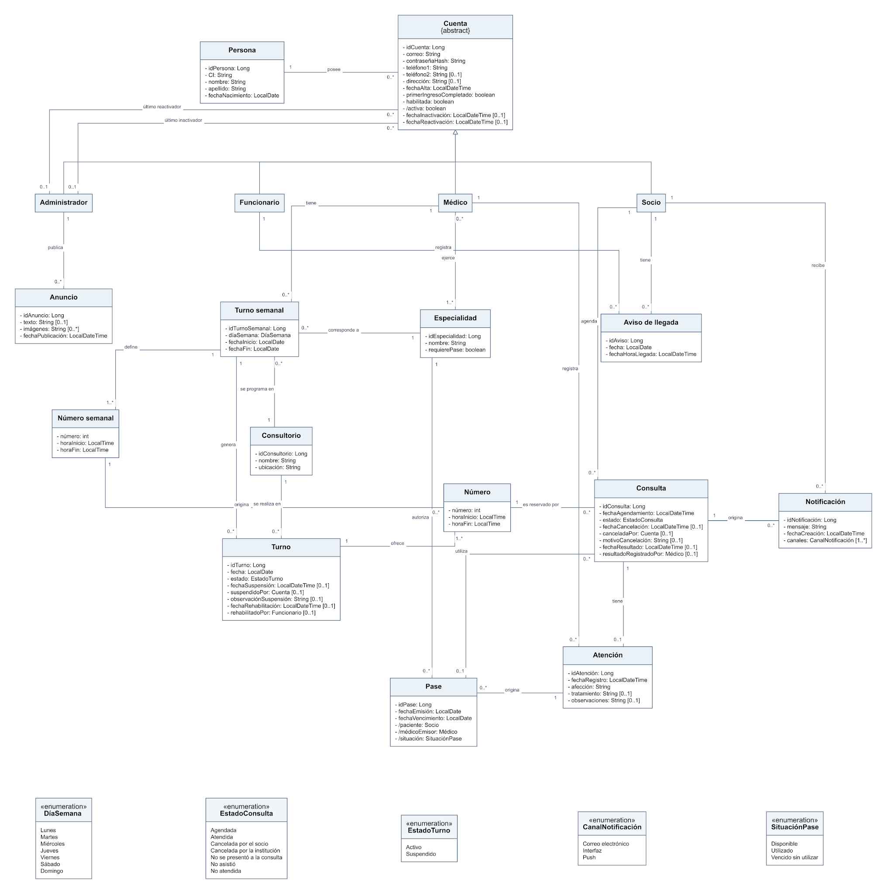

#  

[**1. Modelo de dominio 3**](#modelo-de-dominio)

> [1.1. Diagrama del modelo de dominio 3](#diagrama-del-modelo-de-dominio)
>
> [1.2. Conceptos y relaciones 4](#conceptos-y-relaciones)
>
> [1.3. Descripción integrada del modelo 5](#descripción-integrada-del-modelo)
>
> [1.4. Estados y valores derivados 6](#estados-y-valores-derivados)

[**2. Restricciones del modelo 8**](#restricciones-del-modelo)

> [2.1. Identidad, cuentas y catálogos 8](#identidad-cuentas-y-catálogos)
>
> [2.2. Turnos y disponibilidad 8](#turnos-y-disponibilidad)
>
> [2.3. Agenda y aviso de llegada 9](#agenda-y-aviso-de-llegada)
>
> [2.4. Atención y pases 9](#atención-y-pases)
>
> [2.5. Estados, conservación y trazabilidad 10](#estados-conservación-y-trazabilidad)

[**3. Decisiones de modelado 11**](#decisiones-de-modelado)

[**4. Trazabilidad con requerimientos y casos de uso 12**](#trazabilidad-con-requerimientos-y-casos-de-uso)

# 1. Modelo de dominio

El modelo de dominio representa los conceptos centrales del sistema de agenda y atención de consultas de la institución médica, sus atributos y las relaciones entre ellos. Se elaboró a partir de lo definido en el Documento de Requerimientos y el Documento de Casos de Uso.

El diagrama ofrece una vista general; la tabla y la descripción que siguen explican su significado.

## 1.1. Diagrama del modelo de dominio

Figura 1. Diagrama UML del modelo de dominio.

## 1.2. Conceptos y relaciones

La tabla 1 reúne los conceptos del diagrama. La columna de relaciones resume los vínculos necesarios para interpretar cada elemento; sus multiplicidades se consultan en la figura 1.

Tabla 1. Conceptos y relaciones del modelo.

| **Concepto**         | **Significado**                                                                                        | **Relaciones**                                                                                                                                                             |
|----------------------|--------------------------------------------------------------------------------------------------------|----------------------------------------------------------------------------------------------------------------------------------------------------------------------------|
| **Persona**          | Identidad común de una persona registrada: CI, nombre, apellido y fecha de nacimiento.                 | Posee sus Cuentas; una misma Persona puede ser Socio y empleado mediante cuentas distintas.                                                                                |
| **Cuenta**           | Acceso y datos propios de un rol: correo, contraseña, teléfonos, dirección, activación y habilitación. | Pertenece a una Persona; se especializa en Socio, Funcionario, Médico o Administrador. Un Administrador puede ser el último responsable de su inactivación o reactivación. |
| **Socio**            | Cuenta de quien consulta disponibilidad, agenda consultas y accede a su historial.                     | Agenda Consultas, puede tener un Aviso de llegada diario registrado por un Funcionario y recibe Notificaciones.                                                            |
| **Funcionario**      | Cuenta del personal que gestiona turnos y registra la presentación del socio.                          | Define Turnos semanales y registra Avisos de llegada; interviene en suspensiones, rehabilitaciones y cancelaciones previstas.                                              |
| **Médico**           | Cuenta del profesional que atiende y registra resultados clínicos.                                     | Ejerce una o más Especialidades; tiene Turnos semanales y registra Atenciones de sus pacientes.                                                                            |
| **Administrador**    | Cuenta encargada de mantener datos generales y comunicar novedades.                                    | Publica Anuncios y puede inactivar o reactivar cuentas de empleados.                                                                                                       |
| **Especialidad**     | Área médica que puede exigir un Pase para agendar.                                                     | Se vincula con Médicos, Turnos semanales y el destino de los Pases.                                                                                                        |
| **Consultorio**      | Lugar físico donde se programan y realizan las consultas.                                              | Se asigna al Turno semanal y se conserva en cada Turno concreto.                                                                                                           |
| **Turno semanal**    | Planificación recurrente de un médico para un día y un período de vigencia.                            | Corresponde a un Médico, una Especialidad y un Consultorio; define Números semanales y origina Turnos.                                                                     |
| **Número semanal**   | Franja horaria y número definidos en la planificación semanal.                                         | Pertenece a un Turno semanal y origina el Número de cada fecha concreta.                                                                                                   |
| **Turno**            | Instancia de la planificación para una fecha determinada, activa o suspendida.                         | Procede de un Turno semanal; conserva su Consultorio y ofrece Números concretos.                                                                                           |
| **Número**           | Franja efectiva de un Turno en una fecha, con número y horario.                                        | Pertenece a un Turno, procede de un Número semanal y puede estar relacionado con Consultas históricas.                                                                     |
| **Consulta**         | Cita agendada por un Socio en un Número; conserva su resultado y su historial.                         | Pertenece a un Socio y a un Número; puede utilizar un Pase, originar Notificaciones y tener cero o una Atención.                                                           |
| **Aviso de llegada** | Constancia de la presentación del Socio en un día de consultas.                                        | Corresponde al Socio y al Funcionario que lo registró; se aplica a todas sus Consultas de ese día.                                                                         |
| **Atención**         | Registro clínico realizado al finalizar una Consulta atendida.                                         | Pertenece a una Consulta y a un Médico; puede originar uno o más Pases.                                                                                                    |
| **Pase**             | Autorización emitida durante una Atención para agendar en una Especialidad de destino.                 | Se origina en una Atención, identifica al paciente y emisor, y puede quedar asociado a Consultas que lo utilizaron.                                                        |
| **Anuncio**          | Novedad institucional publicada en la cartelera, con texto, imágenes o ambos.                          | Lo publica un Administrador y puede ser consultado por los usuarios.                                                                                                       |
| **Notificación**     | Comunicación dirigida al Socio por los canales definidos.                                              | La recibe un Socio y se relaciona con la Consulta que dio lugar al aviso.                                                                                                  |

## 1.3. Descripción integrada del modelo

Una <u>Persona</u> reúne los datos de identidad asociados a su CI. Sus <u>Cuentas</u> contienen los datos de acceso y contacto correspondientes a cada rol. Una misma persona puede disponer de una cuenta de <u>Socio</u> y de otra de empleado sin duplicar los datos de identidad. <u>Administrador</u>, <u>Funcionario</u>, <u>Médico</u> y <u>Socio</u> representan los tipos de cuentas que intervienen en el sistema. En el caso del <u>Médico</u>, la relación con <u>Especialidad</u> expresa que puede ejercer una o varias especialidades.

La disponibilidad comienza con un <u>Turno semanal</u>: la planificación de un médico para una especialidad, un consultorio y un día de la semana durante un período definido. Sus <u>Números semanales</u> establecen las franjas horarias. Para cada fecha que corresponde a esa planificación se genera un <u>Turno</u> concreto, con sus propios <u>Números</u>. Esta separación permite suspender una fecha particular y conservar las demás; también permite que el consultorio de un <u>Turno</u> anterior siga reflejando dónde se realizaría la atención de esa fecha si posteriormente cambia la configuración semanal.

Un <u>Socio</u> agenda una <u>Consulta</u> al reservar un <u>Número</u> disponible. La <u>Consulta</u> vincula al socio con la fecha, el médico, la especialidad, el horario y el consultorio a través del número y su turno. Si la especialidad requiere <u>Pase</u>, la <u>Consulta</u> identifica cuál se utilizó. La cancelación conserva la <u>Consulta</u> para el historial y puede liberar el <u>Número</u> para una nueva agenda, siempre que aún se cumplan las condiciones de anticipación.

El <u>Aviso de llegada</u> registra que un <u>Socio</u> se presentó en la institución en un día determinado y qué <u>Funcionario</u> lo registró. Si ese <u>Socio</u> tiene más de una <u>Consulta</u> ese día, el mismo aviso se aplica a todas. El <u>Médico</u> consulta sus números y los avisos de llegada para decidir a quién atender; el <u>Número</u> organiza el turno, pero no impone un orden obligatorio de atención.

Cuando se registra una atención, la <u>Consulta</u> queda vinculada a una <u>Atención</u> con la afección y, si corresponde, el tratamiento y las observaciones. Cada <u>Atención</u> constituye un registro de la historia clínica del socio. De ella pueden originarse <u>Pases</u> para una <u>Especialidad</u> de destino, incluida la <u>Especialidad</u> de la <u>Atención</u>. Un <u>Pase</u> autoriza a agendar cuando la <u>Especialidad</u> lo exige, con independencia de que el <u>Médico</u> que atenderá sea quien lo emitió.

El modelo incorpora además los <u>Consultorios</u> donde se programan y realizan los turnos, los <u>Anuncios</u> publicados por el <u>Administrador</u> y las <u>Notificaciones</u> dirigidas al <u>Socio</u> ante los hechos previstos por los requerimientos. Estos conceptos completan la información necesaria para explicar la disponibilidad, la agenda, la atención y su comunicación al usuario.

## 1.4. Estados y valores derivados

<u>EstadoConsulta</u> reúne siete valores visibles para el usuario: Agendada, Atendida, Cancelada por el socio, Cancelada por la institución, No se presentó a la consulta, No asistió y No atendida. Los cinco primeros corresponden a estados registrados. No asistió y No atendida se determinan al consultar una consulta que permanece Agendada después de terminar su día: el primero cuando no existe aviso de llegada del socio para ese día y el segundo cuando sí existe. El diagrama utiliza una única enumeración porque todos son posibles resultados presentados como estado de la consulta.

<u>EstadoTurno</u> distingue Activo y Suspendido para cada fecha concreta. La situación de un <u>Pase</u> —Disponible, Utilizado o Vencido sin utilizar— se obtiene de su vigencia y de las consultas a las que se lo vinculó. El día de la semana y los canales de notificación también se representan como enumeraciones. Estas definiciones describen valores del dominio; su almacenamiento y traducción a tablas se precisarán en el Modelo de Datos.

#  

# 2. Restricciones del modelo

Las restricciones siguientes complementan las multiplicidades del diagrama. Se expresan como condiciones del dominio y se vinculan con los requerimientos vigentes; su aplicación técnica se detalla en el Modelo de Datos.

## 2.1. Identidad, cuentas y catálogos

**R-MD-01**. La CI identifica de forma única a una <u>Persona</u>. Puede existir una sola cuenta de <u>Socio</u> por persona y una sola cuenta de empleado habilitada o pendiente de primer ingreso que no haya sido inactivada administrativamente. El correo no es único. El rol de una cuenta no cambia (RF-31 y sección 3.1.1).

**R-MD-02**. Una cuenta de <u>Médico</u> debe asociarse a una o más <u>Especialidades</u>. El nombre de cada <u>Especialidad</u> es único sin distinguir mayúsculas; el nombre o número del <u>Consultorio</u> también es único (RF-29, RF-31 y RF-33).

**R-MD-03**. La inactivación y la reactivación de una cuenta de empleado conservan quién realizó la última operación de cada tipo y cuándo. Una cuenta inactiva no puede operar; la cuenta de <u>Socio</u> de la misma <u>Persona</u> no se ve afectada (RF-45).

## 2.2. Turnos y disponibilidad

**R-MD-04**. Un <u>Turno semanal</u> pertenece a un <u>Médico</u>, a una de sus <u>Especialidades</u> y a un <u>Consultorio</u>. Tiene día de la semana, fecha de inicio y fecha de finalización obligatorias, con finalización no anterior al inicio, y al menos un <u>Número semanal</u> (RF-13).

**R-MD-05.** Cada <u>Número semanal</u> tiene un número único dentro de su <u>Turno semanal</u>, hora de inicio y hora de fin. Su duración está entre 10 y 60 minutos; los extremos son múltiplos de cinco minutos. Los números de un mismo turno no se solapan y pueden existir intervalos sin número entre ellos (RF-13).

**R-MD-06.** Cada <u>Turno</u> de una fecha posee identificador propio, conserva la configuración que le dio origen y dispone de sus <u>Números</u> concretos, únicos dentro de ese <u>Turno</u>. Los números de fechas activas no pueden solaparse con los de otros turnos activos del mismo <u>Médico</u> o del mismo <u>Consultorio</u> (RF-13 y RNF-13).

**R-MD-07**. La suspensión afecta únicamente a las fechas seleccionadas y cancela sus <u>Consultas</u> Agendadas; la rehabilitación no recupera esas consultas. El <u>Consultorio</u> de una configuración semanal solo puede modificarse en las condiciones de RF-20, para fechas actuales y futuras, sin alterar las anteriores (RF-14, RF-15 y RF-20).

## 2.3. Agenda y aviso de llegada

**R-MD-08**. Una <u>Consulta</u> se asocia a un <u>Socio</u> y a un <u>Número</u> concreto. Por combinación de <u>Turno</u> y <u>Número</u> puede existir como máximo una consulta no cancelada; las canceladas permanecen en el historial y no impiden una nueva asignación (RF-09 y RNF-13).

**R-MD-09**. El socio no puede mantener otra <u>Consulta</u> activa de la misma <u>Especialidad</u> ni superar tres consultas activas en total, ni agendar consultas que se superpongan. La fecha elegida debe estar dentro de los límites de anticipación establecidos en RF-09 (RF-09).

**R-MD-10**. Un <u>Aviso de llegada</u> corresponde a un único <u>Socio</u> y una fecha. Solo se registra si tiene al menos una <u>Consulta</u> Agendada para ese día; se conserva el aviso original ante intentos posteriores y se aplica a todas las consultas del socio en esa fecha (RF-16).

## 2.4. Atención y pases

**R-MD-11**. Una <u>Consulta</u> puede tener cero o una <u>Atención</u>. La <u>Atención</u> requiere afección; tratamiento y observaciones son opcionales. Solo se registra para una consulta Agendada del día, con aviso de llegada y por el médico correspondiente (RF-23).

**R-MD-12**. Un <u>Pase</u> nace durante el registro de una <u>Atención</u> e identifica al paciente, al médico emisor, la <u>Especialidad</u> de destino, la fecha de emisión y el vencimiento. El destino puede ser la especialidad de la atención. La consulta posterior puede ser con otro médico de esa especialidad (RF-24).

**R-MD-13**. Cuando una <u>Especialidad</u> requiere <u>Pase</u>, se utiliza uno disponible cuyo vencimiento cubra la fecha de la <u>Consulta</u>. El pase se consume al agendar; solo la cancelación puede devolverlo, sin extender su vigencia original. Una consulta cancelada y otra posterior pueden quedar vinculadas históricamente al mismo <u>Pase</u> (RF-09 y RF-24).

## 2.5. Estados, conservación y trazabilidad

**R-MD-14**. No se presentó a la consulta solo puede registrarse en las condiciones del RF-23 y es definitivo. No asistió y No atendida se muestran para consultas que continuaron Agendadas hasta terminar el día, según exista o no <u>Aviso de llegada</u> (RF-11 y RF-23).

**R-MD-15**. Las <u>Consultas</u>, incluidas las canceladas, y las <u>Atenciones</u> registradas se conservan para su consulta posterior. Los datos de quién actuó y cuándo se registran en las acciones expresamente previstas, sin exigir versiones anteriores de todas las correcciones ni un historial general de modificaciones (RNF-14 y RNF-15).

#  

# 3. Decisiones de modelado

La separación entre <u>Persona</u> y <u>Cuenta</u> evita duplicar la identidad cuando una misma persona utiliza accesos distintos. Correo, contraseña y datos de contacto permanecen asociados a cada cuenta, de acuerdo con las reglas de alta y edición; el rol y la habilitación corresponden a la cuenta.

La distinción entre <u>Turno semanal</u>, <u>Número semanal</u>, <u>Turno</u> y <u>Número</u> separa el patrón recurrente de sus fechas y franjas efectivas. De ese modo es posible actuar sobre una fecha concreta y preservar los datos de las fechas anteriores. El cupo se obtiene de la cantidad de números, por lo que no se incorpora un atributo independiente que pueda contradecirla.

<u>Consulta</u> y <u>Atención</u> se modelan como conceptos diferentes. La primera conserva el compromiso agendado y su resultado incluso si se cancela o el socio no es atendido; la segunda contiene únicamente la información clínica efectivamente registrada. Las <u>Atenciones</u> constituyen la historia clínica consultable.

<u>Aviso de llegada</u> se representa de manera independiente porque tiene fecha, hora y <u>Funcionario</u> responsable propios, y se aplica a todas las consultas Agendadas del <u>Socio</u> en ese día. <u>Pase</u> también es un concepto único: su especialidad de destino puede coincidir con la de la atención, y su situación se calcula a partir de la vigencia y del uso.

Las enumeraciones exponen los valores del dominio con los nombres utilizados en Requerimientos y Casos de Uso. <u>EstadoConsulta</u> reúne resultados registrados y calculados para mantener un único vocabulario. Las fechas y los responsables de la última inactivación y reactivación se conservan por la exigencia específica de RF-45; no representan un registro general de cambios.

# 4. Trazabilidad con requerimientos y casos de uso

La tabla 2 muestra el origen principal de los grupos de conceptos. Las referencias permiten revisar la correspondencia entre el modelo, el Documento de Requerimientos y el Documento de Casos de Uso, sin reproducir aquí el detalle de cada flujo.

Tabla 2. Trazabilidad principal del modelo.

| **Grupo del modelo**                              | **Requerimientos**                           | **Casos de uso**                                         |
|---------------------------------------------------|----------------------------------------------|----------------------------------------------------------|
| **Persona y Cuenta; roles**                       | Sección 3.1.1; RF-01, RF-02, RF-31, RF-45    | CU 3.1.1, 3.1.2 y 3.5.2                                  |
| **Especialidad y Consultorio**                    | RF-29, RF-31 y RF-33                         | CU 3.5.1, 3.5.2 y 3.5.3                                  |
| **Turno semanal, Número semanal, Turno y Número** | RF-13 a RF-15; RF-17; RF-20; RNF-13          | CU 3.3.1, 3.3.2 y 3.3.3                                  |
| **Consulta**                                      | RF-08 a RF-11; RF-18; RF-21; RNF-13 y RNF-14 | CU 3.2.1 a 3.2.3; CU 3.3.6 y 3.4.1                       |
| **Aviso de llegada**                              | RF-16; sección 3.1.2                         | CU 3.3.4                                                 |
| **Atención e historia clínica**                   | RF-12, RF-22, RF-23 y RF-25                  | CU 3.2.4 y 3.4.2                                         |
| **Pase**                                          | RF-09, RF-24, RF-26                          | CU 3.2.2 y 3.4.3                                         |
| **Anuncio y Notificación**                        | RF-07, RF-28; RNF-24                         | CU 3.2.2 y 3.3.2 (notificaciones de agenda y suspensión) |
| **Estados y conservación**                        | RF-11, RF-14, RF-15, RF-23; RNF-14 y RNF-15  | CU 3.2.3, 3.3.2, 3.3.3 y 3.4.2                           |
